# 学生作业提交与查重系统 数据库设计文档（DBDD）

| 项目 | 内容 |
| --- | --- |
| 文档名称 | 学生作业提交与查重系统数据库设计文档 |
| 文档编号 | DBDD-EDU-SUBMIT-001 |
| 版本 | V1.0 |
| 文档状态 | 设计基线 |
| 编制日期 | 2026-10-23 |
| 编制人 | 林伟豪 |
| 适用范围 | 逻辑数据模型、物理表设计、约束、索引、事务、保留与迁移 |
| 上游依据 | 《需求规格说明书 v1.2》《架构设计文档》《功能逻辑设计》《功能测试用例》 |

## 目录

- [1. 文档说明](#1-文档说明)
- [2. 数据库总体设计](#2-数据库总体设计)
- [3. 逻辑数据模型](#3-逻辑数据模型)
- [4. 物理表设计](#4-物理表设计)
- [5. 完整性、事务与并发控制](#5-完整性事务与并发控制)
- [6. 索引、分区与性能设计](#6-索引分区与性能设计)
- [7. 文件、缓存与检索映射](#7-文件缓存与检索映射)
- [8. 安全与隐私设计](#8-安全与隐私设计)
- [9. 数据保留、归档与备份恢复](#9-数据保留归档与备份恢复)
- [10. 数据库迁移与运维](#10-数据库迁移与运维)
- [11. 需求追溯](#11-需求追溯)
- [12. 设计假设与待确认事项](#12-设计假设与待确认事项)
- [附录 A. 状态与枚举字典](#附录-a-状态与枚举字典)
- [附录 B. 关键 DDL 与约束示例](#附录-b-关键-ddl-与约束示例)

## 1. 文档说明

### 1.1 目的

本文档将需求规格说明书中的业务实体、业务规则和架构设计文档中的数据域划分，转化为可实施的 PostgreSQL 物理数据库设计。文档作为建表脚本、Flyway 迁移脚本、后端持久层、数据一致性测试、性能测试与运维备份恢复工作的共同基线。

### 1.2 范围

本文档覆盖：

- 数据库技术选型、schema 划分、数据所有权与事实源边界；
- 核心实体关系、状态模型与版本模型；
- 表、字段、主键、外键、唯一约束、检查约束和索引设计；
- 提交、查重、评审、成绩、申诉等关键流程的事务边界与并发控制；
- 分区、容量、性能、保留、归档、备份恢复与迁移策略；
- 权限、敏感数据、审计和合规要求；
- 需求到数据库对象的追溯关系。

本文档不覆盖：页面交互与视觉设计、REST API 字段样例、查重算法本身、对象存储内部实现、Redis 与 OpenSearch 集群运维细节。这些内容由接口设计、算法方案和部署手册承接。

### 1.3 读者与用途

| 读者 | 使用重点 |
| --- | --- |
| 后端开发人员 | 表结构、约束、事务边界、乐观锁与幂等实现 |
| 数据库管理员 | 实例配置、权限、索引、分区、备份恢复、容量治理 |
| 测试人员 | 数据校验场景、边界条件、并发与异常恢复验证 |
| 架构与评审人员 | 数据模型是否覆盖需求、是否满足一致性与可扩展性 |

### 1.4 术语

| 术语 | 说明 |
| --- | --- |
| 事实源 | 对某类数据具有最终权威性的存储。本系统业务事实以 PostgreSQL 为准 |
| 配置快照 | 作业发布或查重任务创建时固化的参数副本，后续配置变更不回写历史快照 |
| 生效版本 | 同一作业、同一所有者下用于查重、评审和成绩计算的唯一提交版本 |
| 当前报告 | 同一提交下最新且对外展示的查重报告版本，历史报告仍然保留 |
| 部分唯一索引 | PostgreSQL 中带 `WHERE` 条件的唯一索引，用于表达“仅一条生效/当前记录” |
| 事务发件箱 | 业务事务内写入待发布事件，再由中继异步投递，避免业务写入与消息投递不一致 |
| 收件箱 | 消费端记录已处理事件，保证消息重复投递时业务幂等 |
| 库水位 | 查重任务在某个比对库上读取到的最大条目序号，用于结果复现 |
| 逻辑删除 | 通过状态、归档时间或失效时间停止业务使用，不直接物理删除历史事实 |

### 1.5 设计约定

| 项目 | 约定 |
| --- | --- |
| 数据库版本 | PostgreSQL 16 及以上 |
| 字符集与排序 | UTF-8；默认排序规则在实例初始化时固定，不在 SQL 中依赖隐含排序 |
| 时区 | 数据库存储统一使用 UTC；所有时间字段使用 `timestamptz`；界面按 Asia/Shanghai 展示 |
| 主键 | 使用 UUID；生产环境由应用生成 UUIDv7，数据库默认 `gen_random_uuid()` 仅作为兜底 |
| 命名 | schema、表、字段使用小写 `snake_case`；表名使用单数；约束前缀为 `pk_`、`fk_`、`uk_`、`ck_`、`ix_` |
| 状态字段 | 使用 `varchar(32)` 加 `CHECK` 约束，不直接使用 PostgreSQL 原生 enum，便于兼容滚动发布 |
| 金额与分数 | 分数、相似度、权重使用 `numeric`；相似度范围 0～100，保留两位小数 |
| 摘要与签名 | SHA-256 存为 64 位小写十六进制；签名存 Base64 文本，密钥只保存 `key_id` |
| 大文本 | 在线提交正文使用 `text`；报告、文件、解压产物正文放对象存储，数据库只存元数据和对象引用 |
| JSONB | 仅用于配置快照、报告摘要、审计详情等半结构化数据；必须有应用层 Schema 校验和版本号 |
| 布尔字段 | `boolean NOT NULL DEFAULT false`，禁止使用 `0/1` 或空值表达三态 |
| 删除策略 | 业务事实优先逻辑失效或归档；报告、成绩历史、申诉、审计禁止物理删除 |
| 公共字段 | 可变业务表统一包含 `created_at`、`updated_at`；高并发更新表包含 `row_version` |

## 2. 数据库总体设计

### 2.1 技术选型与定位

系统采用 PostgreSQL 16+ 作为唯一业务事实数据库，原因包括：

- 课程、作业、提交、评审、成绩、申诉之间存在强关联，单库本地事务可显著降低一致性复杂度；
- 原生支持 `JSONB`、部分唯一索引、表达式索引、分区表、窗口函数与只读副本；
- 支持 WAL 连续归档和 PITR，可满足 RPO ≤ 15 分钟、RTO ≤ 2 小时的目标；
- 可通过 schema 边界支持模块化单体，在业务规模或团队边界变化时再拆分服务。

数据库只保存业务事实和元数据，不保存大文件正文。原始文件、预览文件、解压产物、归一化结果、查重报告 JSON/HTML、申诉证据等存入 S3 兼容对象存储，由 `platform.file_object` 统一登记对象元数据。Redis 用于会话、限流、热点缓存、幂等快速判断和任务租约；OpenSearch 用于指纹与候选检索；RabbitMQ 用于异步任务投递。Redis、OpenSearch 与消息队列均不是最终事实源。

### 2.2 schema 划分

| schema | 数据域 | 主要对象 | 事实源边界 |
| --- | --- | --- | --- |
| `platform` | 技术支撑 | 文件对象、发件箱、收件箱、异步作业 | 文件元数据与事件记录为准 |
| `iam` | 身份权限 | 组织、用户、角色、权限、用户角色 | 用户与权限事实源 |
| `course` | 课程 | 课程、成员、小组、花名册变更、助教范围配置 | 课程与成员事实源 |
| `assignment` | 作业 | 作业系列、作业、配置版本、附件、量规 | 作业配置与量规事实源 |
| `submission` | 提交 | 上传会话、提交版本、文件关联、诚信声明 | 提交版本事实源 |
| `checking` | 查重 | 比对库、库条目、任务、报告、文件分类、预查重配额 | 任务状态与报告元数据事实源 |
| `review` | 评审 | 评审任务分配、评审版本、维度得分、批注、成绩、成绩历史、诚信档案 | 评审与成绩事实源 |
| `appeal` | 申诉延期 | 延期申请、申诉、附件、处理动作 | 申诉与延期事实源 |
| `notification` | 通知 | 通知、投递尝试、偏好、模板、提醒记录、公告 | 通知事实源 |
| `audit` | 审计 | 业务审计日志、登录日志 | 只追加审计事实源 |
| `config` | 配置 | 系统参数、配置历史 | 全局配置事实源 |
| `analytics` | 统计 | 物化视图、日聚合 | 可重建，不是事实源 |

跨 schema 外键仅用于保证关键引用完整性。跨模块写入仍由应用服务控制事务边界，不允许一个请求对多个聚合执行长期大事务。

### 2.3 容量与数据量假设

| 对象 | 估算基线 | 设计影响 |
| --- | --- | --- |
| 用户 | 5 万 | 常规 B-Tree 索引即可 |
| 课程 | 1000 门 | 按课程过滤的复合索引 |
| 作业 | 10 万 | 作业状态与截止时间组合索引 |
| 提交 | 100 万次 | 版本唯一约束、所有者与状态索引 |
| 文件分类明细 | 千万至亿级 | 按报告生成月份分区，报告正文外置 |
| 查重任务/报告 | 百万至千万级 | 队列部分索引、任务租约、报告版本索引 |
| 通知/投递尝试 | 每年千万级 | 按月分区，历史分区归档或清理 |
| 审计/登录日志 | 每年数千万级 | 按月分区、只追加、BRIN 时间索引 |
| 数据库初始容量 | 2 TB NVMe | 预留 WAL、索引、膨胀和临时空间 |

### 2.4 关键设计决策

| 编号 | 决策 | 理由与影响 |
| --- | --- | --- |
| DD-01 | 单 PostgreSQL 实例内按 schema 划分模块 | 保留模块边界，同时避免初期分布式事务；后续可沿 schema 边界拆分 |
| DD-02 | 提交、报告、评审均采用“当前指针 + 历史版本”模型 | 满足多版本提交、重查、评审修改与不可篡改要求 |
| DD-03 | 有效提交和当前报告使用部分唯一索引 | 在数据库层保证同一所有者仅一条生效提交、同一提交仅一份当前报告 |
| DD-04 | 作业配置与查重参数采用版本化 JSONB 快照 | 支持参数变更后复现历史查重，避免历史任务受新配置影响 |
| DD-05 | 大文件与报告正文外置对象存储 | 控制数据库体积，避免大字段膨胀影响备份、复制与缓存 |
| DD-06 | 业务写入与事件发布采用事务发件箱 | 保证“提交成功但消息丢失”等异常场景可补偿 |
| DD-07 | 审计、成绩历史、申诉动作只追加 | 满足学术诚信、申诉复核和操作留痕要求 |
| DD-08 | 预查重与正式查重共用任务模型，预查重任务不要求 `submission_id` | 支持正式提交前自查，同时不污染正式提交与比对库 |
| DD-09 | 日志、通知与文件分类明细优先分区，核心交易表按增长阈值启用 | 兼顾高写入表治理与核心表唯一约束、迁移复杂度 |
| DD-10 | 缓存、检索和消息均可重建 | 明确 PostgreSQL 与对象存储的事实源地位，降低故障恢复复杂度 |

## 3. 逻辑数据模型

### 3.1 核心实体关系

```mermaid
erDiagram
    ORGANIZATION ||--o{ USER_ACCOUNT : contains
    USER_ACCOUNT ||--o{ USER_ROLE : has
    ROLE ||--o{ USER_ROLE : grants
    ROLE ||--o{ ROLE_PERMISSION : owns
    PERMISSION ||--o{ ROLE_PERMISSION : included

    USER_ACCOUNT ||--o{ COURSE_MEMBER : joins
    COURSE ||--o{ COURSE_MEMBER : has
    COURSE ||--o{ COURSE_GROUP : owns
    COURSE_GROUP ||--o{ COURSE_MEMBER : groups
    COURSE ||--o{ ASSIGNMENT : contains
    ASSIGNMENT_SERIES ||--o{ ASSIGNMENT : versions
    ASSIGNMENT ||--o{ ASSIGNMENT_CONFIG_VERSION : snapshots
    ASSIGNMENT ||--|| RUBRIC : defines
    RUBRIC ||--o{ RUBRIC_DIMENSION : contains
    RUBRIC_DIMENSION ||--o{ RUBRIC_LEVEL : contains
    ASSIGNMENT ||--o{ ASSIGNMENT_ATTACHMENT : attaches

    ASSIGNMENT ||--o{ SUBMISSION : receives
    USER_ACCOUNT ||--o{ SUBMISSION : submits
    COURSE_GROUP ||--o{ SUBMISSION : group_owns
    SUBMISSION ||--o{ SUBMISSION_FILE : includes
    FILE_OBJECT ||--o{ SUBMISSION_FILE : references
    SUBMISSION ||--o| INTEGRITY_CONSENT : declares

    SUBMISSION ||--o{ CHECK_TASK : triggers
    CHECK_TASK ||--o{ CHECK_TASK_LIBRARY : queries
    CHECK_LIBRARY ||--o{ CHECK_TASK_LIBRARY : selected
    CHECK_TASK ||--o| CHECK_REPORT : produces
    CHECK_REPORT ||--o{ FILE_CLASSIFICATION : lists
    CHECK_LIBRARY ||--o{ LIBRARY_ENTRY : contains

    SUBMISSION ||--o{ REVIEW : reviews
    REVIEW ||--o{ REVIEW_DIMENSION_SCORE : scores
    REVIEW ||--o{ ANNOTATION : annotates
    ASSIGNMENT ||--o{ REVIEW_ASSIGNMENT : distributes
    USER_ACCOUNT ||--o{ REVIEW_ASSIGNMENT : assigned
    SUBMISSION ||--o{ REVIEW_ASSIGNMENT : targets
    SUBMISSION ||--o| GRADE : grades
    GRADE ||--o{ GRADE_HISTORY : changes
    REVIEW ||--o{ ACADEMIC_INTEGRITY_RECORD : triggers

    ASSIGNMENT ||--o{ EXTENSION_REQUEST : allows
    SUBMISSION ||--o{ APPEAL : may_have
    APPEAL ||--o{ APPEAL_ACTION : records
    EXTENSION_REQUEST ||--o{ EXTENSION_ACTION : records

    USER_ACCOUNT ||--o{ NOTIFICATION : receives
    NOTIFICATION ||--o{ DELIVERY_ATTEMPT : delivers
```



### 3.2 关键关系规则

1. 组织采用树形结构；用户归属一个组织节点，角色与组织共同参与数据范围判断。
2. 课程负责人同时写入 `course.owner_id` 和 `course.course_member`，成员角色为 `INSTRUCTOR`；助教为 `ASSISTANT`，学生为 `STUDENT`。
3. 一个学生在同一课程内最多属于一个小组，由 `course_member.group_id` 表达；小组必须属于同一课程，通过复合外键约束保证。
4. 一个作业属于一个课程；作业系列用于跨学期、跨届对比，一个系列可在不同课程实例下产生多份作业。
5. 作业发布时创建配置版本；提交、查重任务和评审均引用或快照对应配置版本，后续编辑不改变历史。
6. 同一作业、同一所有者（个人或小组）的提交版本号连续递增；历史版本保留，仅一条 `is_effective=true`。
7. 查重任务与报告分离。任务可在无正式提交时执行预查重；正式查重任务必须关联提交。每次重查生成新的报告版本，仅一条 `is_current=true`。
8. 查重报告正文、来源明细和分段证据存对象存储；数据库保存总相似度、分级、算法版本、参数摘要、对象引用、摘要和签名。文件分类明细保存在数据库，便于报告清单查询与分区清理。
9. 助教或互评任务先由 `review_assignment` 固化“提交 + 评审人”分配，再按“提交 + 评审人 + 评审版本”保存评审；评审修改生成新版本，历史版本保留。成绩与提交一对一，成绩修改追加 `grade_history`。
10. 延期申请在同一作业、同一学生下唯一；申诉允许多次，但必须通过 `submission_id`、`review_id` 或 `grade_id` 锁定业务对象。
11. 学术诚信声明与评审结论分别留痕；疑似抄袭、约谈处理生成 `academic_integrity_record`，可由申诉复核追加记录。
12. 通知按“事件 + 收件人”生成逻辑通知，按“通知 + 渠道 + 尝试次数”生成投递尝试；站内信与外部渠道解耦。

### 3.3 状态模型与数据库映射

| 业务对象 | 状态字段 | 允许状态 | 数据库控制点 |
| --- | --- | --- | --- |
| 用户 | `user_account.status` | `PENDING/ACTIVE/LOCKED/DISABLED` | 停用账号递增 `token_version` |
| 课程 | `course.status` | `DRAFT/PENDING_REVIEW/ACTIVE/ARCHIVED` | 归档后应用层拒写，`archived_at` 留痕 |
| 作业 | `assignment.status` | `DRAFT/PUBLISHED/IN_PROGRESS/CLOSED/REVIEWING/FINISHED/ARCHIVED` | 状态与时间共同驱动，发布后写配置版本 |
| 上传会话 | `upload_session.status` | `OPEN/COMPLETED/SCANNING/CLEAN/INFECTED/FAILED/EXPIRED` | 扫描通过前不创建有效提交 |
| 提交 | `submission.status` | `PENDING_SCAN/SUBMITTED/CHECKING/CHECK_COMPLETED/CHECK_FAILED/REVIEWING/REVIEWED/PUBLISHED/CLOSED/REJECTED/WITHDRAWN` | 状态与 `is_effective` 分离 |
| 查重任务 | `check_task.status` | `QUEUED/PREPROCESSING/COMPARING/REPORTING/RETRY_WAIT/SUCCEEDED/FAILED/CANCELLED` | `task_version` 乐观锁与租约 |
| 查重报告 | `check_report.level` | `PASS/WARNING/SEVERE/UNKNOWN` | 报告生成后正文不可修改 |
| 评审 | `review.status` | `DRAFT/SUBMITTED/WITHDRAWN` | 提交后修改生成新版本 |
| 延期 | `extension_request.status` | `SUBMITTED/PENDING/APPROVED/REJECTED/CLOSED` | 每次动作追加 `extension_action` |
| 申诉 | `appeal.status` | `SUBMITTED/IN_REVIEW/APPROVED/REJECTED/WITHDRAWN/CLOSED` | 每次动作追加 `appeal_action` |
| 通知投递 | `delivery_attempt.status` | `PENDING/SENT/FAILED/SKIPPED` | 去重键与重试次数控制 |

## 4. 物理表设计

本章共设计 58 张基础业务表，按 11 个业务 schema 组织。以下字段表中，“PK”表示主键，“FK”表示外键，“UK”表示唯一约束，“IX”表示普通索引，“CK”表示检查约束。所有业务表默认不含物理删除权限，删除行为由状态或归档字段表达。

### 4.1 `platform` 技术支撑域

#### 4.1.1 `platform.file_object` 文件对象

| 字段 | 类型 | 空 | 默认/约束 | 说明 |
| --- | --- | --- | --- | --- |
| `id` | `uuid` | 否 | PK | 对象元数据 ID |
| `bucket` | `varchar(128)` | 否 | UK(bucket, object_key) | 存储桶或逻辑桶名 |
| `object_key` | `varchar(1024)` | 否 | UK(bucket, object_key) | 对象键，写入后不可变 |
| `original_name` | `text` | 否 |  | 上传原始文件名，仅展示 |
| `mime_type` | `varchar(255)` | 否 |  | 经服务端识别的 MIME 类型 |
| `size_bytes` | `bigint` | 否 | CK(size_bytes >= 0) | 对象字节数 |
| `sha256` | `char(64)` | 否 | IX | 小写十六进制摘要，用于完整性校验 |
| `storage_class` | `varchar(16)` | 否 | 默认 `STANDARD` | `STANDARD/IA/ARCHIVE` |
| `version_id` | `varchar(256)` | 是 |  | 对象存储版本号 |
| `encryption_key_id` | `varchar(256)` | 是 |  | KMS 密钥标识，不存密钥内容 |
| `scan_status` | `varchar(16)` | 否 | 默认 `PENDING`，IX | `PENDING/CLEAN/INFECTED/FAILED` |
| `object_lock_until` | `timestamptz` | 是 |  | 报告或证据对象的保留锁截止时间 |
| `retention_until` | `timestamptz` | 是 | IX | 生命周期迁移或清理时间 |
| `created_by` | `uuid` | 是 | FK → iam.user_account | 创建人；系统对象可为空 |
| `created_at` | `timestamptz` | 否 | 默认 `now()` | 创建时间 |
| `purged_at` | `timestamptz` | 是 |  | 对象物理清理确认时间，仅由清理任务写入 |

补充约束：`sha256` 只允许 64 位小写十六进制；`bucket + object_key` 唯一；同一摘要可存在多个对象，以支持跨课程隔离；应用数据库角色不得直接删除 `object_lock_until` 未到期的报告对象。

#### 4.1.2 `platform.outbox_event` 事务发件箱

| 字段 | 类型 | 空 | 默认/约束 | 说明 |
| --- | --- | --- | --- | --- |
| `id` | `uuid` | 否 | PK(id, created_at) | 事件记录 ID |
| `event_id` | `uuid` | 否 | UK(event_id, created_at) | 业务事件 ID |
| `aggregate_type` | `varchar(64)` | 否 | IX | 聚合类型，如 `submission` |
| `aggregate_id` | `uuid` | 否 | IX | 聚合根 ID |
| `event_type` | `varchar(128)` | 否 | IX | 事件类型，如 `check.requested.v1` |
| `payload` | `jsonb` | 否 | CK(jsonb_typeof(payload) = 'object') | 事件正文，不包含敏感明文 |
| `headers` | `jsonb` | 否 | 默认 `{}` | traceId、版本、重试来源等 |
| `status` | `varchar(16)` | 否 | 默认 `PENDING`，IX | `PENDING/PUBLISHED/FAILED` |
| `retry_count` | `smallint` | 否 | 默认 0，CK >= 0 | 发布重试次数 |
| `next_retry_at` | `timestamptz` | 是 | IX | 下次重试时间 |
| `last_error` | `text` | 是 |  | 最近一次错误摘要 |
| `created_at` | `timestamptz` | 否 | 默认 `now()` | 创建时间，分区键 |
| `published_at` | `timestamptz` | 是 |  | 成功发布时间 |

按月分区。部分索引 `ix_outbox_pending(status, next_retry_at, created_at) WHERE status IN ('PENDING','FAILED')` 支撑中继扫描。事件正文禁止写入密码、令牌、完整证件号和查重报告全文。

#### 4.1.3 `platform.inbox_event` 消费收件箱

| 字段 | 类型 | 空 | 默认/约束 | 说明 |
| --- | --- | --- | --- | --- |
| `consumer` | `varchar(64)` | 否 | PK(consumer, event_id) | 消费者名称 |
| `event_id` | `uuid` | 否 | PK(consumer, event_id) | 已处理事件 ID |
| `processed_at` | `timestamptz` | 否 | 默认 `now()` | 处理完成时间 |
| `result_hash` | `char(64)` | 是 |  | 处理结果摘要，用于重复消息一致性检查 |

消费者必须在同一本地事务内写入业务结果与 `inbox_event`，重复事件直接返回成功。

#### 4.1.4 `platform.async_job` 异步作业

| 字段 | 类型 | 空 | 默认/约束 | 说明 |
| --- | --- | --- | --- | --- |
| `id` | `uuid` | 否 | PK | 作业 ID |
| `job_type` | `varchar(32)` | 否 | IX | `USER_IMPORT/LIBRARY_IMPORT/EXPORT/BACKUP/RETENTION` |
| `status` | `varchar(16)` | 否 | 默认 `PENDING`，IX | `PENDING/RUNNING/SUCCEEDED/PARTIAL/FAILED/CANCELLED` |
| `input_file_id` | `uuid` | 是 | FK → platform.file_object | 导入或处理输入文件 |
| `result_file_id` | `uuid` | 是 | FK → platform.file_object | 错误报告或导出文件 |
| `parameters` | `jsonb` | 否 | 默认 `{}` | 非敏感作业参数 |
| `total_count` | `integer` | 否 | 默认 0，CK >= 0 | 总记录数 |
| `success_count` | `integer` | 否 | 默认 0，CK >= 0 | 成功数 |
| `failed_count` | `integer` | 否 | 默认 0，CK >= 0 | 失败或跳过数 |
| `error_detail` | `text` | 是 |  | 顶层错误摘要 |
| `requested_by` | `uuid` | 否 | FK → iam.user_account | 发起人 |
| `started_at` | `timestamptz` | 是 |  | 开始时间 |
| `finished_at` | `timestamptz` | 是 |  | 完成时间 |
| `created_at` | `timestamptz` | 否 | 默认 `now()` | 创建时间 |
| `updated_at` | `timestamptz` | 否 | 默认 `now()` | 更新时间 |

索引 `(job_type, status, created_at DESC)`；单条错误明细写入结果文件，避免在数据库产生海量导入错误行。

### 4.2 `iam` 身份权限域

#### 4.2.1 `iam.organization` 组织

| 字段 | 类型 | 空 | 默认/约束 | 说明 |
| --- | --- | --- | --- | --- |
| `id` | `uuid` | 否 | PK | 组织 ID |
| `parent_id` | `uuid` | 是 | FK → iam.organization(id) | 上级组织 |
| `org_code` | `varchar(64)` | 否 | UK | 组织编码 |
| `name` | `varchar(128)` | 否 | UK(parent_id, name) | 组织名称 |
| `org_type` | `varchar(16)` | 否 | CK | `SCHOOL/COLLEGE/MAJOR/CLASS` |
| `materialized_path` | `varchar(1024)` | 否 | IX | 组织物化路径，如 `/school/college/class` |
| `sort_order` | `integer` | 否 | 默认 0 | 同级排序 |
| `status` | `varchar(16)` | 否 | 默认 `ACTIVE` | `ACTIVE/DISABLED` |
| `created_at` | `timestamptz` | 否 | 默认 `now()` | 创建时间 |
| `updated_at` | `timestamptz` | 否 | 默认 `now()` | 更新时间 |

删除组织使用 `DISABLED`，存在子组织或用户时由应用阻止停用。

#### 4.2.2 `iam.user_account` 用户账号

| 字段 | 类型 | 空 | 默认/约束 | 说明 |
| --- | --- | --- | --- | --- |
| `id` | `uuid` | 否 | PK | 用户 ID |
| `user_no` | `varchar(32)` | 否 | UK | 学工号，全局唯一 |
| `login_name` | `citext` | 否 | UK | 登录名，大小写不敏感 |
| `display_name` | `varchar(64)` | 否 | IX | 姓名 |
| `email` | `citext` | 是 | IX | 邮箱，可为空 |
| `phone` | `varchar(32)` | 是 |  | 手机号，展示时脱敏 |
| `avatar_file_id` | `uuid` | 是 | FK → platform.file_object | 头像对象 |
| `org_id` | `uuid` | 是 | FK → iam.organization | 所属组织 |
| `status` | `varchar(16)` | 否 | 默认 `PENDING` | `PENDING/ACTIVE/LOCKED/DISABLED` |
| `password_hash` | `text` | 是 |  | Argon2id 哈希；纯 SSO 用户为空 |
| `password_changed_at` | `timestamptz` | 是 |  | 密码更新时间 |
| `failed_login_count` | `smallint` | 否 | 默认 0，CK >= 0 | 连续登录失败次数 |
| `locked_until` | `timestamptz` | 是 |  | 自动锁定截止时间 |
| `token_version` | `integer` | 否 | 默认 1，CK > 0 | 会话令牌版本，递增即失效旧会话 |
| `last_login_at` | `timestamptz` | 是 |  | 最后成功登录时间 |
| `created_at` | `timestamptz` | 否 | 默认 `now()` | 创建时间 |
| `updated_at` | `timestamptz` | 否 | 默认 `now()` | 更新时间 |
| `row_version` | `bigint` | 否 | 默认 0 | 乐观锁版本 |

`user_no` 与 `login_name` 均全局唯一。停用账号时在同一事务内递增 `token_version` 并写发件箱，通知会话缓存失效。用户“删除”优先改为停用；确需匿名化时保留学号映射或不可逆哈希，以满足成绩与审计追溯。

#### 4.2.3 `iam.role` 角色

| 字段 | 类型 | 空 | 默认/约束 | 说明 |
| --- | --- | --- | --- | --- |
| `id` | `uuid` | 否 | PK | 角色 ID |
| `code` | `varchar(64)` | 否 | UK | `STUDENT/TEACHER/ASSISTANT/ADMIN` 或自定义编码 |
| `name` | `varchar(64)` | 否 | UK | 角色名称 |
| `role_type` | `varchar(16)` | 否 | 默认 `CUSTOM` | `SYSTEM/CUSTOM` |
| `description` | `text` | 是 |  | 角色说明 |
| `status` | `varchar(16)` | 否 | 默认 `ACTIVE` | `ACTIVE/DISABLED` |
| `created_at` | `timestamptz` | 否 | 默认 `now()` | 创建时间 |
| `updated_at` | `timestamptz` | 否 | 默认 `now()` | 更新时间 |

#### 4.2.4 `iam.permission` 权限点

| 字段 | 类型 | 空 | 默认/约束 | 说明 |
| --- | --- | --- | --- | --- |
| `id` | `uuid` | 否 | PK | 权限 ID |
| `code` | `varchar(128)` | 否 | UK | 权限编码，如 `course:write` |
| `name` | `varchar(128)` | 否 |  | 权限名称 |
| `module` | `varchar(32)` | 否 | IX | 所属模块 |
| `description` | `text` | 是 |  | 权限说明 |
| `created_at` | `timestamptz` | 否 | 默认 `now()` | 创建时间 |

#### 4.2.5 `iam.role_permission` 角色权限关系

| 字段 | 类型 | 空 | 默认/约束 | 说明 |
| --- | --- | --- | --- | --- |
| `role_id` | `uuid` | 否 | PK，FK → iam.role | 角色 ID |
| `permission_id` | `uuid` | 否 | PK，FK → iam.permission | 权限 ID |
| `granted_by` | `uuid` | 是 | FK → iam.user_account | 授权人 |
| `granted_at` | `timestamptz` | 否 | 默认 `now()` | 授权时间 |

#### 4.2.6 `iam.user_role` 用户全局角色

| 字段 | 类型 | 空 | 默认/约束 | 说明 |
| --- | --- | --- | --- | --- |
| `user_id` | `uuid` | 否 | PK，FK → iam.user_account | 用户 ID |
| `role_id` | `uuid` | 否 | PK，FK → iam.role | 角色 ID |
| `granted_by` | `uuid` | 是 | FK → iam.user_account | 授权人 |
| `granted_at` | `timestamptz` | 否 | 默认 `now()` | 授权时间 |
| `expires_at` | `timestamptz` | 是 |  | 临时授权截止时间 |

全局角色只表达系统级身份，课程内身份由 `course.course_member.member_role` 表达。服务端鉴权采用“全局角色/权限 + 课程成员角色 + 资源状态”三重判断。

### 4.3 `course` 课程域

#### 4.3.1 `course.course` 课程

| 字段 | 类型 | 空 | 默认/约束 | 说明 |
| --- | --- | --- | --- | --- |
| `id` | `uuid` | 否 | PK | 课程 ID |
| `course_code` | `varchar(64)` | 否 | UK(course_code, semester) | 课程代码 |
| `name` | `varchar(128)` | 否 | IX | 课程名称 |
| `semester` | `varchar(32)` | 否 | UK(course_code, semester) | 学期编码，如 `2026-FALL` |
| `department_id` | `uuid` | 是 | FK → iam.organization | 开课院系 |
| `owner_id` | `uuid` | 否 | FK → iam.user_account，IX | 课程负责人 |
| `description` | `text` | 是 |  | 课程简介 |
| `cover_file_id` | `uuid` | 是 | FK → platform.file_object | 封面图片 |
| `status` | `varchar(24)` | 否 | 默认 `DRAFT`，IX | `DRAFT/PENDING_REVIEW/ACTIVE/ARCHIVED` |
| `invite_code` | `varchar(32)` | 是 | 部分 UK | 学生自助加入邀请码 |
| `archived_at` | `timestamptz` | 是 |  | 归档时间 |
| `archived_by` | `uuid` | 是 | FK → iam.user_account | 归档操作人 |
| `created_at` | `timestamptz` | 否 | 默认 `now()` | 创建时间 |
| `updated_at` | `timestamptz` | 否 | 默认 `now()` | 更新时间 |
| `row_version` | `bigint` | 否 | 默认 0 | 乐观锁版本 |

约束与索引：`UK(course_code, semester)`；`invite_code` 使用部分唯一索引 `WHERE invite_code IS NOT NULL`；`IX(owner_id, status)`；`IX(status, semester)`。课程代码与学期组合唯一由数据库兜底，应用仍返回可读错误。

#### 4.3.2 `course.course_group` 课程小组

| 字段 | 类型 | 空 | 默认/约束 | 说明 |
| --- | --- | --- | --- | --- |
| `id` | `uuid` | 否 | PK | 小组 ID |
| `course_id` | `uuid` | 否 | FK → course.course，UK(course_id, name) | 所属课程 |
| `name` | `varchar(64)` | 否 | UK(course_id, name) | 小组名称 |
| `leader_id` | `uuid` | 是 | FK → iam.user_account | 组长 |
| `status` | `varchar(16)` | 否 | 默认 `ACTIVE` | `ACTIVE/ARCHIVED` |
| `created_by` | `uuid` | 否 | FK → iam.user_account | 创建人 |
| `created_at` | `timestamptz` | 否 | 默认 `now()` | 创建时间 |
| `updated_at` | `timestamptz` | 否 | 默认 `now()` | 更新时间 |

额外添加 `UK(course_id, id)`，供成员表使用复合外键，防止跨课程引用小组。

#### 4.3.3 `course.course_member` 课程成员

| 字段 | 类型 | 空 | 默认/约束 | 说明 |
| --- | --- | --- | --- | --- |
| `id` | `uuid` | 否 | PK | 成员关系 ID |
| `course_id` | `uuid` | 否 | FK → course.course，UK(course_id, user_id) | 课程 ID |
| `user_id` | `uuid` | 否 | FK → iam.user_account，UK(course_id, user_id) | 用户 ID |
| `member_role` | `varchar(16)` | 否 | IX | `STUDENT/ASSISTANT/INSTRUCTOR` |
| `group_id` | `uuid` | 是 | FK(course_id, group_id) → course_group | 当前小组 |
| `scope_config` | `jsonb` | 否 | 默认 `{}` | 助教评审范围、批次或小组授权 |
| `status` | `varchar(16)` | 否 | 默认 `ACTIVE` | `ACTIVE/REMOVED` |
| `source` | `varchar(16)` | 否 | 默认 `MANUAL` | `MANUAL/INVITE/IMPORT/SYNC` |
| `joined_at` | `timestamptz` | 否 | 默认 `now()` | 加入时间 |
| `removed_at` | `timestamptz` | 是 |  | 移除或退课时间 |
| `created_at` | `timestamptz` | 否 | 默认 `now()` | 创建时间 |
| `updated_at` | `timestamptz` | 否 | 默认 `now()` | 更新时间 |
| `row_version` | `bigint` | 否 | 默认 0 | 乐观锁版本 |

唯一约束 `UK(course_id, user_id)`；复合外键 `(course_id, group_id)` 引用 `course_group(course_id, id)`。索引 `(user_id, status)`、`(course_id, member_role, status)`、`(group_id)`。助教范围不建独立表，以 `scope_config` 保存 `range/random/group` 配置，并由应用层校验；如后续需要按提交逐条分配，再演进为独立评审任务表。

#### 4.3.4 `course.roster_change_log` 花名册变更日志

| 字段 | 类型 | 空 | 默认/约束 | 说明 |
| --- | --- | --- | --- | --- |
| `id` | `uuid` | 否 | PK | 日志 ID |
| `course_id` | `uuid` | 否 | FK → course.course | 课程 ID |
| `course_member_id` | `uuid` | 是 | FK → course.course_member | 成员关系 ID |
| `affected_user_id` | `uuid` | 否 | FK → iam.user_account | 被变更用户 |
| `action` | `varchar(24)` | 否 |  | `ADD/REMOVE/ROLE_CHANGE/GROUP_CHANGE/RESTORE` |
| `source` | `varchar(16)` | 否 |  | `MANUAL/INVITE/IMPORT/SYNC` |
| `before_data` | `jsonb` | 是 |  | 变更前快照 |
| `after_data` | `jsonb` | 是 |  | 变更后快照 |
| `operator_id` | `uuid` | 否 | FK → iam.user_account | 操作人 |
| `created_at` | `timestamptz` | 否 | 默认 `now()` | 操作时间 |

只追加；索引 `(course_id, created_at DESC)`、`(affected_user_id, created_at DESC)`。

### 4.4 `assignment` 作业域

#### 4.4.1 `assignment.assignment_series` 作业系列

| 字段 | 类型 | 空 | 默认/约束 | 说明 |
| --- | --- | --- | --- | --- |
| `id` | `uuid` | 否 | PK | 系列 ID |
| `series_code` | `varchar(64)` | 否 | UK | 跨学期稳定的作业系列编码 |
| `course_code` | `varchar(64)` | 否 | IX | 课程代码，不直接外键到单学期课程 |
| `name` | `varchar(128)` | 否 |  | 系列名称 |
| `description` | `text` | 是 |  | 系列说明 |
| `created_by` | `uuid` | 否 | FK → iam.user_account | 创建人 |
| `created_at` | `timestamptz` | 否 | 默认 `now()` | 创建时间 |
| `updated_at` | `timestamptz` | 否 | 默认 `now()` | 更新时间 |

系列用于历届查重和跨届统计，不承载单次作业状态。

#### 4.4.2 `assignment.assignment` 作业

| 字段 | 类型 | 空 | 默认/约束 | 说明 |
| --- | --- | --- | --- | --- |
| `id` | `uuid` | 否 | PK | 作业 ID |
| `series_id` | `uuid` | 否 | FK → assignment.assignment_series，UK(series_id, course_id) | 作业系列 |
| `course_id` | `uuid` | 否 | FK → course.course，UK(series_id, course_id) | 所属课程 |
| `title` | `varchar(256)` | 否 |  | 作业标题 |
| `description` | `text` | 是 |  | 作业要求正文 |
| `status` | `varchar(24)` | 否 | 默认 `DRAFT`，IX | 作业状态 |
| `publish_at` | `timestamptz` | 是 |  | 发布时间 |
| `open_at` | `timestamptz` | 是 |  | 开放提交时间 |
| `deadline_at` | `timestamptz` | 否 | IX | 正常截止时间 |
| `late_deadline_at` | `timestamptz` | 是 | CK | 补交截止时间 |
| `allow_late` | `boolean` | 否 | 默认 false | 是否允许补交 |
| `allow_multi_version` | `boolean` | 否 | 默认 true | 是否允许多版本 |
| `effective_rule` | `varchar(24)` | 否 | 默认 `LAST_SUBMISSION` | `LAST_SUBMISSION/MANUAL/HIGHEST_SCORE` |
| `check_enabled` | `boolean` | 否 | 默认 false | 是否开启查重 |
| `is_group` | `boolean` | 否 | 默认 false | 是否小组作业 |
| `allow_peer_review` | `boolean` | 否 | 默认 false | 是否允许互评 |
| `weight` | `numeric(5,2)` | 否 | 默认 0，CK(0～100) | 课程总成绩权重 |
| `current_config_version_id` | `uuid` | 是 | FK → assignment_config_version | 当前生效配置版本 |
| `created_by` | `uuid` | 否 | FK → iam.user_account | 创建人 |
| `archived_at` | `timestamptz` | 是 |  | 归档时间 |
| `archived_by` | `uuid` | 是 | FK → iam.user_account | 归档操作人 |
| `created_at` | `timestamptz` | 否 | 默认 `now()` | 创建时间 |
| `updated_at` | `timestamptz` | 否 | 默认 `now()` | 更新时间 |
| `row_version` | `bigint` | 否 | 默认 0 | 乐观锁版本 |

检查约束：`late_deadline_at IS NULL OR late_deadline_at > deadline_at`；`allow_late = false` 时允许 `late_deadline_at` 为空；`weight BETWEEN 0 AND 100`。索引 `(course_id, status, deadline_at)`、`(course_id, deadline_at DESC)`、`(series_id)`。

`deadline_at` 是教师设置的原始截止时间，不因延期或补交修改。个人有效截止时间由作业规则、延期结果和提交时间共同计算后写入 `submission.effective_deadline_at` 快照。

#### 4.4.3 `assignment.assignment_config_version` 作业配置版本

| 字段 | 类型 | 空 | 默认/约束 | 说明 |
| --- | --- | --- | --- | --- |
| `id` | `uuid` | 否 | PK | 配置版本 ID |
| `assignment_id` | `uuid` | 否 | FK → assignment.assignment | 作业 ID |
| `version_no` | `integer` | 否 | UK(assignment_id, version_no)，CK > 0 | 版本号 |
| `submission_policy` | `jsonb` | 否 | 默认 `{}` | 允许类型、大小、补交、多版本规则 |
| `check_config` | `jsonb` | 否 | 默认 `{}` | 查重模式、阈值、桶范围、归一化选项 |
| `late_penalty` | `jsonb` | 否 | 默认 `{}` | 迟交扣分规则 |
| `notice_policy` | `jsonb` | 否 | 默认 `{}` | 提醒策略 |
| `rubric_snapshot` | `jsonb` | 否 | 默认 `{}` | 发布时量规快照 |
| `digest` | `char(64)` | 否 | UK(assignment_id, digest) | 规范化配置摘要 |
| `status` | `varchar(16)` | 否 | 默认 `DRAFT` | `DRAFT/PUBLISHED/SUPERSEDED` |
| `published_at` | `timestamptz` | 是 |  | 生效时间 |
| `created_by` | `uuid` | 否 | FK → iam.user_account | 创建人 |
| `created_at` | `timestamptz` | 否 | 默认 `now()` | 创建时间 |

`PUBLISHED` 后配置行不可更新；修改配置必须创建新版本并将旧版本置为 `SUPERSEDED`。教师提交的 YAML 查重配置由应用层解析、Schema 校验后转换为规范化 JSONB 存储；YAML 只作为交互格式，不作为数据库事实格式。`check_config` 至少包含：`mode`、`include_buckets`、`include_tests`、`exclude_patterns`、`text_thresholds`、`struct_thresholds`、`normalization`、`library_ids`、`plugin_version`。

#### 4.4.4 `assignment.assignment_attachment` 作业附件

| 字段 | 类型 | 空 | 默认/约束 | 说明 |
| --- | --- | --- | --- | --- |
| `id` | `uuid` | 否 | PK | 附件关联 ID |
| `assignment_id` | `uuid` | 否 | FK → assignment.assignment，UK(assignment_id, file_object_id) | 作业 ID |
| `file_object_id` | `uuid` | 否 | FK → platform.file_object，UK(assignment_id, file_object_id) | 文件对象 |
| `display_name` | `text` | 否 |  | 展示名称 |
| `sort_order` | `integer` | 否 | 默认 0 | 排序 |
| `created_at` | `timestamptz` | 否 | 默认 `now()` | 创建时间 |

#### 4.4.5 `assignment.assignment_check_library` 作业比对库绑定

| 字段 | 类型 | 空 | 默认/约束 | 说明 |
| --- | --- | --- | --- | --- |
| `assignment_id` | `uuid` | 否 | PK，FK → assignment.assignment | 作业 ID |
| `library_id` | `uuid` | 否 | PK，FK → checking.check_library | 比对库 ID |
| `enabled` | `boolean` | 否 | 默认 true | 是否启用 |
| `required` | `boolean` | 否 | 默认 false | 是否必选且不可关闭 |
| `created_at` | `timestamptz` | 否 | 默认 `now()` | 创建时间 |

本班库对作业强制 `enabled=true, required=true`；文献库默认关闭，启用前由应用校验授权配置。

`assignment_check_library` 表示当前可查询的规范化绑定关系；`assignment_config_version.check_config.library_ids` 保留发布时快照，用于历史任务复现，两者由应用服务在同一事务内同步维护。

#### 4.4.6 `assignment.rubric` 评分量规

| 字段 | 类型 | 空 | 默认/约束 | 说明 |
| --- | --- | --- | --- | --- |
| `id` | `uuid` | 否 | PK | 量规 ID |
| `assignment_id` | `uuid` | 否 | FK → assignment.assignment，UK | 作业 ID，一作业一份量规 |
| `title` | `varchar(128)` | 否 |  | 量规名称 |
| `total_score` | `numeric(6,2)` | 否 | CK >= 0 | 总分 |
| `status` | `varchar(16)` | 否 | 默认 `DRAFT` | `DRAFT/ACTIVE/ARCHIVED` |
| `created_by` | `uuid` | 否 | FK → iam.user_account | 创建人 |
| `created_at` | `timestamptz` | 否 | 默认 `now()` | 创建时间 |
| `updated_at` | `timestamptz` | 否 | 默认 `now()` | 更新时间 |
| `row_version` | `bigint` | 否 | 默认 0 | 乐观锁版本 |

#### 4.4.7 `assignment.rubric_dimension` 量规维度

| 字段 | 类型 | 空 | 默认/约束 | 说明 |
| --- | --- | --- | --- | --- |
| `id` | `uuid` | 否 | PK | 维度 ID |
| `rubric_id` | `uuid` | 否 | FK → assignment.rubric，UK(rubric_id, sort_order) | 量规 ID |
| `name` | `varchar(128)` | 否 | UK(rubric_id, name) | 维度名称 |
| `description` | `text` | 是 |  | 维度说明 |
| `max_score` | `numeric(6,2)` | 否 | CK >= 0 | 维度满分 |
| `sort_order` | `integer` | 否 | CK >= 0 | 排序 |
| `created_at` | `timestamptz` | 否 | 默认 `now()` | 创建时间 |

#### 4.4.8 `assignment.rubric_level` 量规等级

| 字段 | 类型 | 空 | 默认/约束 | 说明 |
| --- | --- | --- | --- | --- |
| `id` | `uuid` | 否 | PK | 等级 ID |
| `dimension_id` | `uuid` | 否 | FK → assignment.rubric_dimension，UK(dimension_id, sort_order) | 维度 ID |
| `label` | `varchar(64)` | 否 |  | 等级名称，如“优秀” |
| `score` | `numeric(6,2)` | 否 | CK >= 0 | 等级对应分数 |
| `description` | `text` | 是 |  | 等级说明 |
| `sort_order` | `integer` | 否 | CK >= 0 | 排序 |

量规发布后变更需生成新版本或至少保存 `rubric_snapshot`；评审明细表保存维度名称、满分和等级快照，避免后续量规编辑改变历史成绩解释。

### 4.5 `submission` 提交域

#### 4.5.1 `submission.upload_session` 上传会话

| 字段 | 类型 | 空 | 默认/约束 | 说明 |
| --- | --- | --- | --- | --- |
| `id` | `uuid` | 否 | PK | 上传会话 ID |
| `assignment_id` | `uuid` | 否 | FK → assignment.assignment，IX | 目标作业 |
| `uploader_id` | `uuid` | 否 | FK → iam.user_account | 实际上传人 |
| `owner_type` | `varchar(16)` | 否 | CK | `USER/GROUP` |
| `owner_id` | `uuid` | 否 |  | 个人用户或小组 ID |
| `expected_name` | `text` | 否 |  | 预期文件名 |
| `expected_size_bytes` | `bigint` | 否 | CK >= 0 | 预期大小 |
| `expected_sha256` | `char(64)` | 是 |  | 客户端声明摘要 |
| `mime_type` | `varchar(255)` | 是 |  | 声明类型 |
| `part_size` | `integer` | 否 | 默认 5242880 | 分片大小 |
| `total_parts` | `integer` | 否 | CK > 0 | 分片总数 |
| `received_parts` | `integer` | 否 | 默认 0，CK >= 0 | 已接收分片数 |
| `status` | `varchar(16)` | 否 | 默认 `OPEN`，IX | 上传状态 |
| `file_object_id` | `uuid` | 是 | FK → platform.file_object | 完成后的对象 |
| `idempotency_key` | `varchar(128)` | 是 | 部分 UK | 上传请求幂等键 |
| `expires_at` | `timestamptz` | 否 | IX | 会话过期时间 |
| `completed_at` | `timestamptz` | 是 |  | 上传完成时间 |
| `last_error` | `text` | 是 |  | 最近错误摘要 |
| `created_at` | `timestamptz` | 否 | 默认 `now()` | 创建时间 |
| `updated_at` | `timestamptz` | 否 | 默认 `now()` | 更新时间 |
| `row_version` | `bigint` | 否 | 默认 0 | 乐观锁版本 |

部分唯一索引 `UK(uploader_id, idempotency_key) WHERE idempotency_key IS NOT NULL`；索引 `(status, expires_at)`。扫描未通过时 `file_object_id` 可以存在，但对象位于隔离前缀，不参与业务读取。

一次提交包含多个文件时，每个文件对应一个上传会话，全部会话完成后在同一提交事务中关联到 `submission_file`。在线文本提交不创建上传会话。

#### 4.5.2 `submission.submission` 提交版本

| 字段 | 类型 | 空 | 默认/约束 | 说明 |
| --- | --- | --- | --- | --- |
| `id` | `uuid` | 否 | PK | 提交 ID |
| `assignment_id` | `uuid` | 否 | FK → assignment.assignment，IX | 作业 ID |
| `assignment_config_version_id` | `uuid` | 否 | FK → assignment_config_version | 冻结的配置版本 |
| `owner_type` | `varchar(16)` | 否 | UK(assignment_id, owner_type, owner_id, version_no) | `USER/GROUP` |
| `owner_id` | `uuid` | 否 | UK 同上 | 个人用户或小组 ID |
| `submitter_id` | `uuid` | 否 | FK → iam.user_account，IX | 实际提交人 |
| `version_no` | `integer` | 否 | UK 同上，CK > 0 | 版本号 |
| `status` | `varchar(24)` | 否 | 默认 `PENDING_SCAN`，IX | 提交状态 |
| `is_effective` | `boolean` | 否 | 默认 false | 是否生效版本 |
| `is_late` | `boolean` | 否 | 默认 false | 是否迟交 |
| `submitted_at` | `timestamptz` | 否 | 默认 `now()`，IX | 服务端接收完成时间 |
| `effective_deadline_at` | `timestamptz` | 否 |  | 当时计算出的有效截止时间 |
| `online_text` | `text` | 是 | CK(length <= 1000000) | 在线文本正文 |
| `online_text_digest` | `char(64)` | 是 |  | 在线文本摘要 |
| `input_digest` | `char(64)` | 是 |  | 全部输入规范化摘要 |
| `idempotency_key` | `varchar(128)` | 是 | 部分 UK | 提交幂等键 |
| `created_at` | `timestamptz` | 否 | 默认 `now()` | 创建时间 |
| `updated_at` | `timestamptz` | 否 | 默认 `now()` | 更新时间 |
| `row_version` | `bigint` | 否 | 默认 0 | 乐观锁版本 |

核心约束：

- `UK(assignment_id, owner_type, owner_id, version_no)` 保证版本号不重复；
- 部分唯一索引 `UK(assignment_id, owner_type, owner_id) WHERE is_effective = true` 保证唯一生效版本；
- 部分唯一索引 `UK(submitter_id, assignment_id, idempotency_key) WHERE idempotency_key IS NOT NULL` 保证重复请求返回原提交；
- `CHECK (owner_type IN ('USER','GROUP'))`；小组提交的 `owner_id` 必须指向同课程小组，由应用校验；
- 索引 `(assignment_id, status, submitted_at DESC)`、`(owner_type, owner_id, submitted_at DESC)`、`(assignment_id, is_effective) WHERE is_effective = true`。

提交行创建后，`assignment_config_version_id`、`owner_id`、`version_no`、`submitted_at` 不可修改。状态流转写入 `submission_status_history`。

#### 4.5.3 `submission.submission_file` 提交文件

| 字段 | 类型 | 空 | 默认/约束 | 说明 |
| --- | --- | --- | --- | --- |
| `id` | `uuid` | 否 | PK | 关联 ID |
| `submission_id` | `uuid` | 否 | FK → submission.submission，UK(submission_id, file_object_id) | 提交 ID |
| `file_object_id` | `uuid` | 否 | FK → platform.file_object，UK 同上 | 文件对象 |
| `file_role` | `varchar(16)` | 否 | 默认 `ORIGINAL` | `ORIGINAL/PREVIEW/ARCHIVE_MEMBER` |
| `display_name` | `text` | 否 |  | 展示名 |
| `sort_order` | `integer` | 否 | 默认 0 | 排序 |
| `created_at` | `timestamptz` | 否 | 默认 `now()` | 创建时间 |

原始文件不可覆盖。预览文件、解压产物只作为派生物，可在保留期后清理。

#### 4.5.4 `submission.integrity_consent` 学术诚信声明

| 字段 | 类型 | 空 | 默认/约束 | 说明 |
| --- | --- | --- | --- | --- |
| `id` | `uuid` | 否 | PK | 声明 ID |
| `assignment_id` | `uuid` | 否 | FK → assignment.assignment，UK(assignment_id, owner_type, owner_id) | 作业 ID |
| `owner_type` | `varchar(16)` | 否 | UK 同上 | `USER/GROUP` |
| `owner_id` | `uuid` | 否 | UK 同上 | 所有者 ID |
| `first_submission_id` | `uuid` | 否 | FK → submission.submission | 首次正式提交 |
| `declaration_version` | `varchar(32)` | 否 |  | 诚信声明文本版本 |
| `declaration_digest` | `char(64)` | 否 |  | 声明文本摘要 |
| `accepted_by` | `uuid` | 否 | FK → iam.user_account | 确认人 |
| `accepted_at` | `timestamptz` | 否 | 默认 `now()` | 确认时间 |
| `ip` | `inet` | 否 |  | 客户端 IP |
| `user_agent` | `text` | 是 |  | 客户端信息 |
| `created_at` | `timestamptz` | 否 | 默认 `now()` | 创建时间 |

同一作业、同一所有者仅一条首次声明记录，后续版本沿用该声明链。

#### 4.5.5 `submission.submission_status_history` 提交状态历史

| 字段 | 类型 | 空 | 默认/约束 | 说明 |
| --- | --- | --- | --- | --- |
| `id` | `uuid` | 否 | PK | 记录 ID |
| `submission_id` | `uuid` | 否 | FK → submission.submission，IX | 提交 ID |
| `from_status` | `varchar(24)` | 是 |  | 原状态 |
| `to_status` | `varchar(24)` | 否 |  | 新状态 |
| `reason_code` | `varchar(64)` | 是 |  | 原因编码 |
| `reason_text` | `text` | 是 |  | 原因说明 |
| `operator_id` | `uuid` | 是 |  | 操作人或系统任务 ID |
| `operator_type` | `varchar(16)` | 否 | 默认 `SYSTEM` | `USER/SYSTEM/WORKER` |
| `created_at` | `timestamptz` | 否 | 默认 `now()` | 操作时间 |

只追加；索引 `(submission_id, created_at)`。

#### 4.5.6 `submission.effective_change_log` 生效版本变更日志

| 字段 | 类型 | 空 | 默认/约束 | 说明 |
| --- | --- | --- | --- | --- |
| `id` | `uuid` | 否 | PK | 记录 ID |
| `assignment_id` | `uuid` | 否 | FK → assignment.assignment，IX | 作业 ID |
| `owner_type` | `varchar(16)` | 否 |  | `USER/GROUP` |
| `owner_id` | `uuid` | 否 |  | 所有者 ID |
| `from_submission_id` | `uuid` | 是 | FK → submission.submission | 原生效提交 |
| `to_submission_id` | `uuid` | 是 | FK → submission.submission | 新生效提交 |
| `change_source` | `varchar(24)` | 否 |  | `AUTO_LAST/STUDENT_SELECT/HIGHEST_SCORE/APPEAL/SYSTEM` |
| `operator_id` | `uuid` | 是 |  | 操作人；系统操作为空 |
| `created_at` | `timestamptz` | 否 | 默认 `now()` | 变更时间 |

索引 `(assignment_id, owner_type, owner_id, created_at DESC)`。生效版本切换需锁定同一所有者范围，避免并发产生双生效记录。

### 4.6 `checking` 查重域

#### 4.6.1 `checking.check_library` 比对库

| 字段 | 类型 | 空 | 默认/约束 | 说明 |
| --- | --- | --- | --- | --- |
| `id` | `uuid` | 否 | PK | 比对库 ID |
| `name` | `varchar(128)` | 否 |  | 库名称 |
| `library_type` | `varchar(16)` | 否 | UK(library_type, scope_key) | `CLASS/HISTORICAL/INTERNET/LITERATURE/WHITELIST` |
| `scope_key` | `varchar(128)` | 否 | UK(library_type, scope_key) | 库作用域，如 `course:<uuid>:2026-FALL` |
| `course_id` | `uuid` | 是 | FK → course.course，IX | 本班库/白名单关联课程 |
| `assignment_series_id` | `uuid` | 是 | FK → assignment.assignment_series | 历届库系列 |
| `status` | `varchar(16)` | 否 | 默认 `ACTIVE`，IX | `ACTIVE/DISABLED/REBUILDING` |
| `is_system` | `boolean` | 否 | 默认 false | 是否系统内置 |
| `source_config` | `jsonb` | 否 | 默认 `{}` | 供应商、授权、索引版本等非敏感配置 |
| `current_seq` | `bigint` | 否 | 默认 0，CK >= 0 | 当前最大库条目序号 |
| `created_by` | `uuid` | 是 | FK → iam.user_account | 创建人 |
| `created_at` | `timestamptz` | 否 | 默认 `now()` | 创建时间 |
| `updated_at` | `timestamptz` | 否 | 默认 `now()` | 更新时间 |
| `row_version` | `bigint` | 否 | 默认 0 | 乐观锁版本 |

索引 `(library_type, status)`；`source_config` 不存 API 密钥，密钥使用 `vault_ref` 或 KMS 引用。本班库按“课程 + 学期”建立，历届库按作业系列或课程代码建立，白名单按课程建立。

#### 4.6.2 `checking.library_entry` 库条目

| 字段 | 类型 | 空 | 默认/约束 | 说明 |
| --- | --- | --- | --- | --- |
| `id` | `uuid` | 否 | PK | 库条目 ID |
| `library_id` | `uuid` | 否 | FK → checking.check_library，UK(library_id, submission_id) | 比对库 ID |
| `submission_id` | `uuid` | 是 | FK → submission.submission，UK(library_id, submission_id) | 来源提交，可为空 |
| `file_object_id` | `uuid` | 是 | FK → platform.file_object | 白名单或外置材料文件 |
| `assignment_series_id` | `uuid` | 是 | FK → assignment.assignment_series，IX | 作业系列 |
| `owner_hash` | `char(64)` | 否 | IX | 所有者哈希，排除自比且不暴露用户 ID |
| `content_hash` | `char(64)` | 否 | IX | 入库内容摘要 |
| `language` | `varchar(32)` | 是 |  | 代码语言或内容类型 |
| `fingerprint_key` | `varchar(128)` | 是 |  | OpenSearch 索引文档键 |
| `fingerprint_file_id` | `uuid` | 是 | FK → platform.file_object | 指纹中间产物对象 |
| `seq` | `bigint` | 否 | UK(library_id, seq)，CK > 0 | 库内单调序号，作为查重水位 |
| `status` | `varchar(16)` | 否 | 默认 `ACTIVE`，IX | `ACTIVE/REMOVED` |
| `index_status` | `varchar(16)` | 否 | 默认 `PENDING`，IX | `PENDING/INDEXED/FAILED` |
| `removed_by` | `uuid` | 是 | FK → iam.user_account | 剔除操作人 |
| `removed_reason` | `text` | 是 |  | 剔除原因 |
| `indexed_at` | `timestamptz` | 是 |  | 索引完成时间 |
| `created_at` | `timestamptz` | 否 | 默认 `now()` | 创建时间 |
| `updated_at` | `timestamptz` | 否 | 默认 `now()` | 更新时间 |

约束 `CHECK (submission_id IS NOT NULL OR file_object_id IS NOT NULL)`；唯一索引 `UK(library_id, submission_id) WHERE submission_id IS NOT NULL`；`UK(library_id, seq)`。检索按 `(library_id, status, seq)` 和 `owner_hash`。剔除库条目时更新状态并清理 OpenSearch 文档，但历史报告仍保留来源快照。

`owner_hash` 使用带服务端密钥的 HMAC-SHA256，不使用用户 ID 的裸哈希，以降低离线枚举风险；该密钥不写入数据库。

#### 4.6.3 `checking.check_task` 查重任务

| 字段 | 类型 | 空 | 默认/约束 | 说明 |
| --- | --- | --- | --- | --- |
| `id` | `uuid` | 否 | PK | 任务 ID |
| `subject_type` | `varchar(16)` | 否 | CK | `SUBMISSION/PRECHECK` |
| `submission_id` | `uuid` | 是 | FK → submission.submission，IX | 正式查重的提交 ID；预查重为空 |
| `assignment_id` | `uuid` | 否 | FK → assignment.assignment，IX | 作业 ID |
| `requester_id` | `uuid` | 是 | FK → iam.user_account | 预查重学生或重查教师 |
| `task_type` | `varchar(16)` | 否 | IX | `FORMAL/PRECHECK/RECHECK/APPEAL` |
| `report_version` | `integer` | 否 | 默认 1，CK > 0 | 预期报告版本 |
| `priority` | `smallint` | 否 | 默认 100，CK 0～1000 | 数值越大优先级越高 |
| `status` | `varchar(16)` | 否 | 默认 `QUEUED`，IX | 任务状态 |
| `task_version` | `integer` | 否 | 默认 0 | 状态乐观锁 |
| `attempt` | `smallint` | 否 | 默认 0，CK >= 0 | 已尝试次数 |
| `max_attempts` | `smallint` | 否 | 默认 3，CK > 0 | 最大尝试次数 |
| `idempotency_key` | `varchar(128)` | 否 | UK | 任务幂等键 |
| `config_version_id` | `uuid` | 是 | FK → assignment_config_version | 作业配置版本 |
| `config_snapshot` | `jsonb` | 否 |  | 查重参数完整快照 |
| `config_digest` | `char(64)` | 否 | IX | 配置摘要 |
| `input_file_object_id` | `uuid` | 是 | FK → platform.file_object | 预查重输入对象 |
| `input_text_digest` | `char(64)` | 是 |  | 预查重在线文本摘要 |
| `input_digest` | `char(64)` | 是 | IX | 输入内容摘要 |
| `library_watermarks` | `jsonb` | 否 | 默认 `{}` | 各库水位摘要，便于报告复现 |
| `scheduled_at` | `timestamptz` | 否 | 默认 `now()`，IX | 最早可执行时间 |
| `started_at` | `timestamptz` | 是 |  | 首次开始时间 |
| `finished_at` | `timestamptz` | 是 |  | 终态时间 |
| `lease_owner` | `varchar(128)` | 是 |  | 当前 Worker 标识 |
| `lease_until` | `timestamptz` | 是 | IX | 租约截止时间 |
| `heartbeat_at` | `timestamptz` | 是 |  | Worker 心跳 |
| `error_class` | `varchar(16)` | 是 |  | `RETRYABLE/PERMANENT/SECURITY` |
| `error_code` | `varchar(64)` | 是 |  | 错误编码 |
| `error_detail` | `text` | 是 |  | 脱敏错误摘要 |
| `created_by` | `uuid` | 是 | FK → iam.user_account | 创建人 |
| `created_at` | `timestamptz` | 否 | 默认 `now()` | 创建时间 |
| `updated_at` | `timestamptz` | 否 | 默认 `now()` | 更新时间 |

关键约束：

- `CHECK`：正式查重必须 `subject_type='SUBMISSION' AND submission_id IS NOT NULL`；预查重必须 `subject_type='PRECHECK' AND submission_id IS NULL AND requester_id IS NOT NULL AND (input_file_object_id IS NOT NULL OR input_text_digest IS NOT NULL)`；
- `UK(idempotency_key)`；`UK(submission_id, report_version) WHERE submission_id IS NOT NULL`；
- 队列索引 `IX(status, priority DESC, scheduled_at, created_at) WHERE status IN ('QUEUED','RETRY_WAIT')`；
- 租约索引 `IX(lease_until) WHERE status IN ('PREPROCESSING','COMPARING','REPORTING')`；
- 补偿索引 `IX(updated_at, status)`。

Worker 使用 `SELECT ... FOR UPDATE SKIP LOCKED` 领取任务，更新状态时带 `task_version` 条件，旧 Worker 的回传不能覆盖新状态。

#### 4.6.4 `checking.check_task_library` 任务比对库快照

| 字段 | 类型 | 空 | 默认/约束 | 说明 |
| --- | --- | --- | --- | --- |
| `check_task_id` | `uuid` | 否 | PK，FK → check_task | 任务 ID |
| `library_id` | `uuid` | 否 | PK，FK → check_library | 比对库 ID |
| `watermark` | `bigint` | 否 | 默认 0，CK >= 0 | 该库读取水位 |
| `status` | `varchar(16)` | 否 | 默认 `PENDING` | `PENDING/SUCCEEDED/PARTIAL/FAILED/SKIPPED` |
| `error_code` | `varchar(64)` | 是 |  | 外部库失败原因 |
| `created_at` | `timestamptz` | 否 | 默认 `now()` | 创建时间 |
| `updated_at` | `timestamptz` | 否 | 默认 `now()` | 更新时间 |

任务创建时固化本班库、历届库、文献库、互联网库及白名单的启用状态与水位，保证同一任务的可复现性。

#### 4.6.5 `checking.check_report` 查重报告

| 字段 | 类型 | 空 | 默认/约束 | 说明 |
| --- | --- | --- | --- | --- |
| `id` | `uuid` | 否 | PK | 报告 ID |
| `check_task_id` | `uuid` | 否 | UK，FK → check_task | 生成任务 |
| `submission_id` | `uuid` | 是 | FK → submission.submission，IX | 正式报告关联提交；预查重为空 |
| `assignment_id` | `uuid` | 否 | FK → assignment.assignment，IX | 作业 ID |
| `requester_id` | `uuid` | 是 | FK → iam.user_account | 预查重报告所有者 |
| `report_version` | `integer` | 否 | UK(submission_id, report_version)，CK > 0 | 报告版本 |
| `is_current` | `boolean` | 否 | 默认 false | 是否当前报告 |
| `overall_score` | `numeric(5,2)` | 否 | CK 0～100 | 总相似度 |
| `text_score` | `numeric(5,2)` | 是 | CK 0～100 | 文本相似度 |
| `structure_score` | `numeric(5,2)` | 是 | CK 0～100 | 结构相似度 |
| `level` | `varchar(16)` | 否 | 默认 `UNKNOWN` | `PASS/WARNING/SEVERE/UNKNOWN` |
| `partial` | `boolean` | 否 | 默认 false | 外部库部分失败 |
| `algorithm_version` | `varchar(64)` | 否 |  | 算法插件版本 |
| `plugin_manifest` | `jsonb` | 否 | 默认 `{}` | 插件与语言能力声明 |
| `params` | `jsonb` | 否 |  | 实际参数快照 |
| `params_digest` | `char(64)` | 否 |  | 参数摘要 |
| `library_watermarks` | `jsonb` | 否 | 默认 `{}` | 各库水位 |
| `source_count` | `integer` | 否 | 默认 0，CK >= 0 | 命中来源数 |
| `top_source_type` | `varchar(24)` | 是 |  | 最高相似来源类型 |
| `top_source_similarity` | `numeric(5,2)` | 是 | CK 0～100 | 最高来源相似度 |
| `json_file_id` | `uuid` | 否 | FK → platform.file_object | 结构化报告 JSON |
| `html_file_id` | `uuid` | 否 | FK → platform.file_object | 静态 HTML 报告 |
| `report_digest` | `char(64)` | 否 | IX | 规范化报告摘要，用于完整性校验 |
| `signature` | `text` | 否 |  | HMAC/KMS 签名 |
| `signature_key_id` | `varchar(128)` | 否 |  | 签名密钥标识 |
| `generated_at` | `timestamptz` | 否 | 默认 `now()` | 报告生成时间 |
| `created_at` | `timestamptz` | 否 | 默认 `now()` | 创建时间 |

约束：`UK(check_task_id)`、`UK(submission_id, report_version) WHERE submission_id IS NOT NULL`、部分唯一索引 `UK(submission_id) WHERE is_current = true AND submission_id IS NOT NULL`。索引 `(submission_id, report_version DESC)`、`(assignment_id, level, generated_at DESC)`、`(requester_id, generated_at DESC) WHERE submission_id IS NULL`、`(report_digest)`。报告摘要不设全局唯一，以允许不同任务生成内容摘要相同的合法报告。

报告正文、来源列表、分段高亮、双栏对比证据和文件统计均写入 JSON；数据库只保存摘要与对象引用，列表查询不加载报告正文。报告插入后业务字段不可更新，仅允许受控函数切换 `is_current`。

#### 4.6.6 `checking.file_classification` 文件分类明细

| 字段 | 类型 | 空 | 默认/约束 | 说明 |
| --- | --- | --- | --- | --- |
| `id` | `uuid` | 否 | PK(id, created_at) | 明细 ID |
| `report_id` | `uuid` | 否 | FK → check_report，IX | 报告 ID |
| `submission_id` | `uuid` | 是 | FK → submission.submission，IX | 正式提交 ID；预查重时为空 |
| `path` | `varchar(1024)` | 否 | IX(report_id, path) | 压缩包内相对路径，已规范化 |
| `file_name` | `text` | 否 |  | 文件名 |
| `extension` | `varchar(32)` | 是 |  | 小写扩展名 |
| `size_bytes` | `bigint` | 否 | CK >= 0 | 文件大小 |
| `sha256` | `char(64)` | 是 | IX | 文件摘要 |
| `bucket` | `char(1)` | 否 | CK(A～F)，IX | 分类桶 |
| `included` | `boolean` | 否 | 默认 false | 是否参与查重 |
| `exclude_reason_code` | `varchar(32)` | 是 |  | `DEPENDENCY/BINARY/TEST/DOC/LARGE_FILE/CUSTOM_PATTERN` |
| `exclude_reason` | `text` | 是 |  | 可读排除原因 |
| `language` | `varchar(32)` | 是 |  | 识别出的代码语言 |
| `is_binary` | `boolean` | 否 | 默认 false | 是否二进制文件 |
| `weight` | `numeric(4,2)` | 否 | 默认 0，CK 0～1 | 计分权重 |
| `normalized_file_id` | `uuid` | 是 | FK → platform.file_object | 归一化产物对象 |
| `sort_order` | `integer` | 否 | 默认 0 | 报告展示排序 |
| `created_at` | `timestamptz` | 否 | 默认 `now()` | 创建时间，分区键 |

按报告生成月份做范围分区，主键包含 `created_at`。索引 `(report_id, bucket, included)`、`(report_id, path)`、`(submission_id, created_at)`。`submission_id` 从报告冗余写入，便于按提交查询文件清单；预查重分类明细的该字段为空。大批量明细同时压缩为报告内文件清单；分区清理时保留报告 JSON 中的清单快照。

#### 4.6.7 `checking.precheck_quota` 预查重配额

| 字段 | 类型 | 空 | 默认/约束 | 说明 |
| --- | --- | --- | --- | --- |
| `assignment_id` | `uuid` | 否 | PK，FK → assignment.assignment | 作业 ID |
| `user_id` | `uuid` | 否 | PK，FK → iam.user_account | 学生 ID |
| `limit_count` | `integer` | 否 | CK >= 0 | 配额上限快照 |
| `used_count` | `integer` | 否 | 默认 0，CK >= 0 | 已成功消耗次数 |
| `reserved_count` | `integer` | 否 | 默认 0，CK >= 0 | 执行中预占次数 |
| `row_version` | `bigint` | 否 | 默认 0 | 乐观锁版本 |
| `updated_at` | `timestamptz` | 否 | 默认 `now()` | 更新时间 |

约束 `used_count + reserved_count <= limit_count`。申请预查重时原子增加 `reserved_count`；任务成功时转为 `used_count`，失败或取消时释放预占。Redis 仅做快速预检，最终配额以本表为准。

### 4.7 `review` 评审与成绩域

#### 4.7.1 `review.review` 评审

| 字段 | 类型 | 空 | 默认/约束 | 说明 |
| --- | --- | --- | --- | --- |
| `id` | `uuid` | 否 | PK | 评审 ID |
| `submission_id` | `uuid` | 否 | FK → submission.submission，IX | 被评审提交 |
| `reviewer_id` | `uuid` | 否 | FK → iam.user_account，IX | 评审人 |
| `reviewer_type` | `varchar(16)` | 否 | 默认 `TEACHER` | `TEACHER/ASSISTANT/STUDENT` |
| `review_version` | `integer` | 否 | UK(submission_id, reviewer_id, review_version)，CK > 0 | 评审版本 |
| `is_current` | `boolean` | 否 | 默认 true | 是否当前评审版本 |
| `status` | `varchar(16)` | 否 | 默认 `DRAFT`，IX | `DRAFT/SUBMITTED/WITHDRAWN` |
| `total_score` | `numeric(6,2)` | 是 | CK >= 0 | 维度得分汇总 |
| `check_verdict` | `varchar(32)` | 是 |  | `ORIGINAL/SUSPECTED_PLAGIARISM/INTERVIEW_REQUIRED` |
| `comment` | `text` | 是 |  | 总体评语 |
| `feedback_file_id` | `uuid` | 是 | FK → platform.file_object | 反馈附件 |
| `submitted_at` | `timestamptz` | 是 |  | 评审提交时间 |
| `created_at` | `timestamptz` | 否 | 默认 `now()` | 创建时间 |
| `updated_at` | `timestamptz` | 否 | 默认 `now()` | 更新时间 |
| `row_version` | `bigint` | 否 | 默认 0 | 乐观锁版本 |

约束：`UK(submission_id, reviewer_id, review_version)`；部分唯一索引 `UK(submission_id, reviewer_id) WHERE is_current = true`。索引 `(reviewer_id, status, updated_at DESC)`、`(submission_id, is_current, status)`。

评审草稿对学生不可见。提交后的修改创建新 `review_version`，旧版本保留并置 `is_current=false`；成绩发布需同时校验当前评审状态与作业评审状态。

P0 默认一份提交由一名主评人评审；表中允许同一提交存在教师、助教或互评学生等多个评审人，以支持助教分工和 P2 互评。成绩通过 `grade.review_id` 指定采用的评审版本，P0 规则由应用层限定为教师当前评审。

#### 4.7.2 `review.review_dimension_score` 评审维度得分

| 字段 | 类型 | 空 | 默认/约束 | 说明 |
| --- | --- | --- | --- | --- |
| `id` | `uuid` | 否 | PK | 得分 ID |
| `review_id` | `uuid` | 否 | FK → review.review，UK(review_id, sort_order) | 评审 ID |
| `dimension_id` | `uuid` | 是 | FK → assignment.rubric_dimension | 原量规维度，可空 |
| `dimension_key` | `varchar(64)` | 否 |  | 稳定维度键 |
| `dimension_name` | `varchar(128)` | 否 |  | 维度名称快照 |
| `max_score` | `numeric(6,2)` | 否 | CK >= 0 | 满分快照 |
| `level_id` | `uuid` | 是 | FK → assignment.rubric_level | 所选等级，可空 |
| `level_label` | `varchar(64)` | 是 |  | 等级名称快照 |
| `score` | `numeric(6,2)` | 否 | CK >= 0 | 实际得分 |
| `comment` | `text` | 是 |  | 维度评语 |
| `sort_order` | `integer` | 否 | UK(review_id, sort_order) | 排序 |

保存名称、满分、等级标签快照，使历史评审在量规调整后仍可解释。应用层校验 `score <= max_score` 以及各维度总分与 `review.total_score` 一致。

#### 4.7.3 `review.annotation` 批注

| 字段 | 类型 | 空 | 默认/约束 | 说明 |
| --- | --- | --- | --- | --- |
| `id` | `uuid` | 否 | PK | 批注 ID |
| `review_id` | `uuid` | 否 | FK → review.review，IX | 评审 ID |
| `file_object_id` | `uuid` | 否 | FK → platform.file_object | 被批注预览对象 |
| `page_no` | `integer` | 是 | CK > 0 | PDF 页码 |
| `page_rotation` | `smallint` | 否 | 默认 0，CK ∈ {0,90,180,270} | 批注时页面旋转角度 |
| `x_ratio` | `numeric(9,6)` | 否 | CK 0～1 | 横向归一化坐标 |
| `y_ratio` | `numeric(9,6)` | 否 | CK 0～1 | 纵向归一化坐标 |
| `width_ratio` | `numeric(9,6)` | 否 | CK 0～1 | 归一化宽度 |
| `height_ratio` | `numeric(9,6)` | 否 | CK 0～1 | 归一化高度 |
| `selected_text` | `text` | 是 |  | 选中文本 |
| `content` | `text` | 否 |  | 批注内容 |
| `audio_file_id` | `uuid` | 是 | FK → platform.file_object | 语音批注对象 |
| `status` | `varchar(16)` | 否 | 默认 `ACTIVE` | `ACTIVE/DELETED` |
| `created_at` | `timestamptz` | 否 | 默认 `now()` | 创建时间 |
| `updated_at` | `timestamptz` | 否 | 默认 `now()` | 更新时间 |

坐标使用相对比例，避免 PDF 缩放和分辨率变化导致批注漂移；应用层校验 `x_ratio + width_ratio <= 1`、`y_ratio + height_ratio <= 1`，并结合 `page_rotation` 还原位置。索引 `(review_id, page_no, created_at)`。

#### 4.7.4 `review.grade` 成绩

| 字段 | 类型 | 空 | 默认/约束 | 说明 |
| --- | --- | --- | --- | --- |
| `id` | `uuid` | 否 | PK | 成绩 ID |
| `submission_id` | `uuid` | 否 | UK，FK → submission.submission | 提交 ID，一提交一成绩 |
| `review_id` | `uuid` | 是 | FK → review.review | 采用的当前评审 |
| `raw_score` | `numeric(6,2)` | 否 | CK >= 0 | 量规原始得分 |
| `late_deduction` | `numeric(6,2)` | 否 | 默认 0，CK >= 0 | 迟交扣分 |
| `final_score` | `numeric(6,2)` | 否 | CK >= 0 | 最终成绩，不得为负 |
| `score_formula` | `jsonb` | 否 | 默认 `{}` | 扣分规则与计算快照 |
| `published` | `boolean` | 否 | 默认 false，部分 IX | 是否已发布 |
| `published_at` | `timestamptz` | 是 |  | 首次发布时间，申诉时限起点 |
| `published_by` | `uuid` | 是 | FK → iam.user_account | 发布人 |
| `created_at` | `timestamptz` | 否 | 默认 `now()` | 创建时间 |
| `updated_at` | `timestamptz` | 否 | 默认 `now()` | 更新时间 |
| `row_version` | `bigint` | 否 | 默认 0 | 乐观锁版本 |

约束 `UK(submission_id)`；部分索引 `IX(published, published_at) WHERE published = true`；发布状态为 true 时 `review_id` 必填。应用层校验 `final_score = max(0, raw_score - late_deduction)`，数据库负责非负和唯一性。发布前学生不可见；首次发布后 `published_at` 不再变化，改分推进 `grade_history` 并重新通知。

#### 4.7.5 `review.grade_history` 成绩变更历史

| 字段 | 类型 | 空 | 默认/约束 | 说明 |
| --- | --- | --- | --- | --- |
| `id` | `uuid` | 否 | PK | 历史记录 ID |
| `grade_id` | `uuid` | 否 | FK → review.grade，UK(grade_id, change_version) | 成绩 ID |
| `change_version` | `integer` | 否 | UK(grade_id, change_version)，CK > 0 | 变更版本 |
| `old_raw_score` | `numeric(6,2)` | 是 |  | 变更前原始分 |
| `new_raw_score` | `numeric(6,2)` | 否 |  | 变更后原始分 |
| `old_late_deduction` | `numeric(6,2)` | 是 |  | 变更前扣分 |
| `new_late_deduction` | `numeric(6,2)` | 否 |  | 变更后扣分 |
| `old_final_score` | `numeric(6,2)` | 是 |  | 变更前最终分 |
| `new_final_score` | `numeric(6,2)` | 否 |  | 变更后最终分 |
| `old_published` | `boolean` | 是 |  | 变更前发布状态 |
| `new_published` | `boolean` | 否 |  | 变更后发布状态 |
| `reason` | `text` | 否 |  | 修改原因，必填 |
| `operator_id` | `uuid` | 否 | FK → iam.user_account | 操作人 |
| `changed_at` | `timestamptz` | 否 | 默认 `now()` | 变更时间 |

只追加。索引 `(grade_id, change_version DESC)`、`(operator_id, changed_at DESC)`。该表不允许更新或删除。

#### 4.7.6 `review.academic_integrity_record` 学术诚信档案

| 字段 | 类型 | 空 | 默认/约束 | 说明 |
| --- | --- | --- | --- | --- |
| `id` | `uuid` | 否 | PK | 档案记录 ID |
| `submission_id` | `uuid` | 否 | FK → submission.submission，IX | 关联提交 |
| `review_id` | `uuid` | 是 | FK → review.review，IX | 触发评审 |
| `appeal_id` | `uuid` | 是 | FK → appeal.appeal | 关联申诉 |
| `verdict_type` | `varchar(32)` | 否 |  | `ORIGINAL/SUSPECTED_PLAGIARISM/INTERVIEW_REQUIRED` |
| `summary` | `text` | 否 |  | 结论与处理摘要 |
| `evidence_file_id` | `uuid` | 是 | FK → platform.file_object | 证据包或约谈记录 |
| `status` | `varchar(16)` | 否 | 默认 `OPEN` | `OPEN/RESOLVED/ARCHIVED` |
| `created_by` | `uuid` | 否 | FK → iam.user_account | 创建人 |
| `created_at` | `timestamptz` | 否 | 默认 `now()` | 创建时间 |
| `updated_at` | `timestamptz` | 否 | 默认 `now()` | 更新时间 |

原始评审结论为原创时不生成记录；疑似抄袭、约谈处理生成记录。同一评审可因申诉复核追加多条记录，历史记录不覆盖；索引 `(review_id, created_at DESC)`、`(submission_id, created_at DESC)`。

#### 4.7.7 `review.review_assignment` 评审任务分配

| 字段 | 类型 | 空 | 默认/约束 | 说明 |
| --- | --- | --- | --- | --- |
| `id` | `uuid` | 否 | PK | 分配记录 ID |
| `assignment_id` | `uuid` | 否 | FK → assignment.assignment，IX | 作业 ID |
| `submission_id` | `uuid` | 否 | FK → submission.submission，UK(assignment_id, submission_id, reviewer_id) | 被分配提交 |
| `reviewer_id` | `uuid` | 否 | FK → iam.user_account，UK 同上 | 评审人 |
| `reviewer_type` | `varchar(16)` | 否 | 默认 `ASSISTANT` | `TEACHER/ASSISTANT/STUDENT` |
| `scope_source` | `varchar(16)` | 否 |  | `RANGE/RANDOM/GROUP/PEER/MANUAL` |
| `status` | `varchar(16)` | 否 | 默认 `ASSIGNED`，IX | `ASSIGNED/IN_PROGRESS/COMPLETED/REVOKED` |
| `assigned_by` | `uuid` | 否 | FK → iam.user_account | 分配人 |
| `assigned_at` | `timestamptz` | 否 | 默认 `now()` | 分配时间 |
| `due_at` | `timestamptz` | 是 |  | 评审截止时间 |
| `revoked_at` | `timestamptz` | 是 |  | 撤销时间 |
| `created_at` | `timestamptz` | 否 | 默认 `now()` | 创建时间 |
| `updated_at` | `timestamptz` | 否 | 默认 `now()` | 更新时间 |
| `row_version` | `bigint` | 否 | 默认 0 | 乐观锁版本 |

`UK(assignment_id, submission_id, reviewer_id)` 防止同一评审人被重复分配同一提交；索引 `(reviewer_id, status, due_at)`、`(assignment_id, status)`。`course_member.scope_config` 保存助教分配的规则，`review_assignment` 保存规则执行后形成的具体任务；随机分配使用可复现种子并在生成后固化，后续调整通过新增或撤销分配实现。

### 4.8 `appeal` 申诉与延期域

#### 4.8.1 `appeal.extension_request` 延期申请

| 字段 | 类型 | 空 | 默认/约束 | 说明 |
| --- | --- | --- | --- | --- |
| `id` | `uuid` | 否 | PK | 延期申请 ID |
| `assignment_id` | `uuid` | 否 | FK → assignment.assignment，UK(assignment_id, user_id) | 作业 ID |
| `user_id` | `uuid` | 否 | FK → iam.user_account，UK(assignment_id, user_id) | 学生 ID |
| `reason` | `text` | 否 |  | 申请理由 |
| `expected_deadline` | `timestamptz` | 否 |  | 期望截止时间 |
| `status` | `varchar(16)` | 否 | 默认 `SUBMITTED`，IX | `SUBMITTED/PENDING/APPROVED/REJECTED/CLOSED` |
| `approved_deadline` | `timestamptz` | 是 |  | 审批通过后的个人截止时间 |
| `handler_id` | `uuid` | 是 | FK → iam.user_account | 处理人 |
| `submitted_at` | `timestamptz` | 否 | 默认 `now()` | 提交时间 |
| `decided_at` | `timestamptz` | 是 |  | 决定时间 |
| `closed_at` | `timestamptz` | 是 |  | 关闭时间 |
| `created_at` | `timestamptz` | 否 | 默认 `now()` | 创建时间 |
| `updated_at` | `timestamptz` | 否 | 默认 `now()` | 更新时间 |
| `row_version` | `bigint` | 否 | 默认 0 | 乐观锁版本 |

`UK(assignment_id, user_id)` 落实“每作业每学生仅一次申请，驳回后不重复创建”。`APPROVED` 时 `approved_deadline` 必填且须晚于当前时间；应用层校验并写审计。

#### 4.8.2 `appeal.extension_attachment` 延期附件

| 字段 | 类型 | 空 | 默认/约束 | 说明 |
| --- | --- | --- | --- | --- |
| `id` | `uuid` | 否 | PK | 关联 ID |
| `extension_request_id` | `uuid` | 否 | FK → extension_request，UK(extension_request_id, file_object_id) | 延期申请 ID |
| `file_object_id` | `uuid` | 否 | FK → platform.file_object | 证据文件 |
| `display_name` | `text` | 否 |  | 展示名称 |
| `created_at` | `timestamptz` | 否 | 默认 `now()` | 创建时间 |

#### 4.8.3 `appeal.extension_action` 延期处理动作

| 字段 | 类型 | 空 | 默认/约束 | 说明 |
| --- | --- | --- | --- | --- |
| `id` | `uuid` | 否 | PK | 动作 ID |
| `extension_request_id` | `uuid` | 否 | FK → extension_request，IX | 延期申请 |
| `from_status` | `varchar(16)` | 是 |  | 原状态 |
| `to_status` | `varchar(16)` | 是 |  | 新状态 |
| `action` | `varchar(32)` | 否 |  | `SUBMIT/ACCEPT/APPROVE/REJECT/REQUEST_MORE/CLOSE` |
| `comment` | `text` | 是 |  | 处理意见 |
| `operator_id` | `uuid` | 否 | FK → iam.user_account | 操作人 |
| `created_at` | `timestamptz` | 否 | 默认 `now()` | 操作时间 |

只追加；索引 `(extension_request_id, created_at)`。

#### 4.8.4 `appeal.appeal` 申诉

| 字段 | 类型 | 空 | 默认/约束 | 说明 |
| --- | --- | --- | --- | --- |
| `id` | `uuid` | 否 | PK | 申诉 ID |
| `tracking_no` | `varchar(64)` | 否 | UK | 业务追踪号，关联重查/改分/约谈 |
| `user_id` | `uuid` | 否 | FK → iam.user_account，IX | 申诉学生 |
| `submission_id` | `uuid` | 否 | FK → submission.submission，IX | 关联提交 |
| `review_id` | `uuid` | 是 | FK → review.review | 关联评审 |
| `grade_id` | `uuid` | 是 | FK → review.grade | 关联成绩 |
| `appeal_type` | `varchar(16)` | 否 | CK | `CHECK_AGAINST/GRADE` |
| `reason` | `text` | 否 |  | 申诉理由 |
| `status` | `varchar(16)` | 否 | 默认 `SUBMITTED`，IX | `SUBMITTED/IN_REVIEW/APPROVED/REJECTED/WITHDRAWN/CLOSED` |
| `handler_id` | `uuid` | 是 | FK → iam.user_account | 当前处理人 |
| `conclusion` | `text` | 是 |  | 处理结论 |
| `submitted_at` | `timestamptz` | 否 | 默认 `now()` | 提交时间 |
| `deadline_at` | `timestamptz` | 否 |  | 申诉时限快照 |
| `decided_at` | `timestamptz` | 是 |  | 决定时间 |
| `closed_at` | `timestamptz` | 是 |  | 关闭时间 |
| `created_at` | `timestamptz` | 否 | 默认 `now()` | 创建时间 |
| `updated_at` | `timestamptz` | 否 | 默认 `now()` | 更新时间 |
| `row_version` | `bigint` | 否 | 默认 0 | 乐观锁版本 |

约束：`appeal_type='GRADE'` 时 `grade_id` 必填；查重异议时 `review_id` 或 `grade_id` 至少一个存在。索引 `(user_id, submitted_at DESC)`、`(submission_id, status)`、`(status, submitted_at)`、`(tracking_no)`。申诉允许多次，但处理中的重复申诉由应用提示或合并，不由数据库强制唯一。

#### 4.8.5 `appeal.appeal_attachment` 申诉附件

| 字段 | 类型 | 空 | 默认/约束 | 说明 |
| --- | --- | --- | --- | --- |
| `id` | `uuid` | 否 | PK | 关联 ID |
| `appeal_id` | `uuid` | 否 | FK → appeal.appeal，UK(appeal_id, file_object_id) | 申诉 ID |
| `file_object_id` | `uuid` | 否 | FK → platform.file_object | 证据文件 |
| `display_name` | `text` | 否 |  | 展示名称 |
| `created_at` | `timestamptz` | 否 | 默认 `now()` | 创建时间 |

#### 4.8.6 `appeal.appeal_action` 申诉处理动作

| 字段 | 类型 | 空 | 默认/约束 | 说明 |
| --- | --- | --- | --- | --- |
| `id` | `uuid` | 否 | PK | 动作 ID |
| `appeal_id` | `uuid` | 否 | FK → appeal.appeal，IX | 申诉 ID |
| `action_type` | `varchar(24)` | 否 |  | `ACCEPT/RECHECK/ADJUST_GRADE/INTERVIEW/DECIDE/WITHDRAW/COMMENT` |
| `from_status` | `varchar(16)` | 是 |  | 原状态 |
| `to_status` | `varchar(16)` | 是 |  | 新状态 |
| `related_task_id` | `uuid` | 是 | FK → checking.check_task | 重查任务 |
| `related_report_id` | `uuid` | 是 | FK → checking.check_report | 新报告 |
| `related_grade_history_id` | `uuid` | 是 | FK → review.grade_history | 改分记录 |
| `comment` | `text` | 是 |  | 处理意见 |
| `operator_id` | `uuid` | 否 | FK → iam.user_account | 操作人 |
| `created_at` | `timestamptz` | 否 | 默认 `now()` | 操作时间 |

只追加，所有与申诉相关的新报告、改分、约谈共享同一 `tracking_no`，形成完整证据链。

### 4.9 `notification` 通知域

#### 4.9.1 `notification.notification` 逻辑通知

| 字段 | 类型 | 空 | 默认/约束 | 说明 |
| --- | --- | --- | --- | --- |
| `id` | `uuid` | 否 | PK(id, created_at) | 通知 ID |
| `recipient_id` | `uuid` | 否 | FK → iam.user_account，IX | 收件人 |
| `notification_type` | `varchar(32)` | 否 | IX | `ASSIGNMENT_PUBLISHED/DEADLINE_REMINDER/CHECK_COMPLETED/CHECK_FAILED/GRADE_PUBLISHED/APPEAL_REPLIED/EXTENSION_RESULT/SYSTEM` |
| `title` | `varchar(256)` | 否 |  | 标题快照 |
| `content` | `text` | 否 |  | 正文快照 |
| `template_code` | `varchar(64)` | 是 |  | 模板编码 |
| `template_version` | `integer` | 是 |  | 模板版本快照 |
| `event_id` | `uuid` | 是 | IX | 触发事件 ID |
| `target_type` | `varchar(64)` | 是 |  | 深链目标类型，如 `ASSIGNMENT/CHECK_REPORT/APPEAL` |
| `target_id` | `uuid` | 是 |  | 深链目标 ID |
| `status` | `varchar(16)` | 否 | 默认 `CREATED` | `CREATED/SENT/PARTIAL/FAILED/EXPIRED` |
| `read_at` | `timestamptz` | 是 | 部分 IX | 站内信阅读时间 |
| `expires_at` | `timestamptz` | 是 | IX | 正文清理时间 |
| `created_at` | `timestamptz` | 否 | 默认 `now()` | 创建时间，分区键 |

按月分区。索引 `(recipient_id, read_at, created_at DESC)`、`(recipient_id, notification_type, created_at DESC)`、`(status, created_at)`。PostgreSQL 分区表不支持不带分区键的全局唯一索引，因此 `event_id + recipient_id` 的幂等由消费端 `platform.inbox_event` 保证；通知服务仍应在应用层先查后写，重复消费直接返回。

#### 4.9.2 `notification.delivery_attempt` 渠道投递尝试

| 字段 | 类型 | 空 | 默认/约束 | 说明 |
| --- | --- | --- | --- | --- |
| `id` | `uuid` | 否 | PK(id, created_at) | 投递尝试 ID |
| `notification_id` | `uuid` | 否 | IX | 逻辑通知 ID |
| `notification_created_at` | `timestamptz` | 否 | FK(notification_id, notification_created_at) → notification(id, created_at) | 通知分区键快照，用于分区表外键 |
| `channel` | `varchar(16)` | 否 |  | `IN_APP/EMAIL/SMS/WECHAT/DINGTALK` |
| `recipient_address_masked` | `text` | 是 |  | 脱敏收件地址 |
| `status` | `varchar(16)` | 否 | 默认 `PENDING`，IX | `PENDING/SENT/FAILED/SKIPPED` |
| `attempt_no` | `smallint` | 否 | 默认 1，CK > 0 | 渠道重试次数 |
| `provider_message_id` | `varchar(256)` | 是 |  | 外部渠道消息 ID |
| `error_code` | `varchar(64)` | 是 |  | 失败编码 |
| `error_detail` | `text` | 是 |  | 脱敏错误信息 |
| `sent_at` | `timestamptz` | 是 |  | 发送成功时间 |
| `next_retry_at` | `timestamptz` | 是 | IX | 下次重试时间 |
| `created_at` | `timestamptz` | 否 | 默认 `now()` | 创建时间，分区键 |

按月分区。逻辑去重键为 `event_id + recipient_id + channel`，实际投递以 `notification_id + channel + attempt_no` 区分尝试。因 `notification` 也按月分区，投递表通过 `(notification_id, notification_created_at)` 复合外键引用，应用写入时必须复制通知的分区时间。站内信始终落库，外部渠道失败不回滚业务。

#### 4.9.3 `notification.preference` 通知偏好

| 字段 | 类型 | 空 | 默认/约束 | 说明 |
| --- | --- | --- | --- | --- |
| `id` | `uuid` | 否 | PK | 偏好 ID |
| `user_id` | `uuid` | 否 | FK → iam.user_account，UK(user_id, notification_type, channel) | 用户 ID |
| `notification_type` | `varchar(32)` | 否 | UK 同上 | 通知类型 |
| `channel` | `varchar(16)` | 否 | UK 同上 | 渠道 |
| `enabled` | `boolean` | 否 | 默认 true | 是否启用 |
| `updated_at` | `timestamptz` | 否 | 默认 `now()` | 更新时间 |

站内信不可关闭；外部渠道按偏好与渠道可用性投递。

#### 4.9.4 `notification.template` 通知模板

| 字段 | 类型 | 空 | 默认/约束 | 说明 |
| --- | --- | --- | --- | --- |
| `id` | `uuid` | 否 | PK | 模板 ID |
| `code` | `varchar(64)` | 否 | UK(code, version, channel) | 模板编码 |
| `version` | `integer` | 否 | UK(code, version, channel)，CK > 0 | 版本 |
| `channel` | `varchar(16)` | 否 | UK(code, version, channel) | 渠道或 `ALL` |
| `name` | `varchar(128)` | 否 |  | 模板名称 |
| `title_template` | `text` | 否 |  | 标题模板 |
| `body_template` | `text` | 否 |  | 正文模板 |
| `variables` | `jsonb` | 否 | 默认 `[]` | 变量声明与校验规则 |
| `status` | `varchar(16)` | 否 | 默认 `DRAFT` | `DRAFT/ACTIVE/ARCHIVED` |
| `created_by` | `uuid` | 否 | FK → iam.user_account | 创建人 |
| `created_at` | `timestamptz` | 否 | 默认 `now()` | 创建时间 |

模板启用后不可覆盖，修改必须新增版本；通知生成时快照 `template_code` 与 `template_version`。

#### 4.9.5 `notification.reminder_record` 截止提醒记录

| 字段 | 类型 | 空 | 默认/约束 | 说明 |
| --- | --- | --- | --- | --- |
| `id` | `uuid` | 否 | PK | 提醒记录 ID |
| `assignment_id` | `uuid` | 否 | FK → assignment.assignment，UK(assignment_id, user_id, reminder_type) | 作业 ID |
| `user_id` | `uuid` | 否 | FK → iam.user_account，UK 同上 | 学生 ID |
| `reminder_type` | `varchar(16)` | 否 | UK 同上 | `BEFORE_24H/BEFORE_1H` |
| `notification_id` | `uuid` | 是 |  | 生成的通知 ID |
| `notification_created_at` | `timestamptz` | 是 | FK(notification_id, notification_created_at) → notification(id, created_at) | 通知分区键快照 |
| `sent_at` | `timestamptz` | 否 | 默认 `now()` | 发送时间 |

唯一约束保证定时扫描重复执行不会重复提醒；个人延期以 `effective_deadline_at` 计算提醒时间。`notification_id` 与 `notification_created_at` 必须同时为空或同时非空。

#### 4.9.6 `notification.announcement` 公告

| 字段 | 类型 | 空 | 默认/约束 | 说明 |
| --- | --- | --- | --- | --- |
| `id` | `uuid` | 否 | PK | 公告 ID |
| `scope_type` | `varchar(16)` | 否 | CK | `SYSTEM/COURSE` |
| `course_id` | `uuid` | 是 | FK → course.course，IX | 课程公告的课程 |
| `title` | `varchar(256)` | 否 |  | 标题 |
| `content` | `text` | 否 |  | 正文 |
| `is_pinned` | `boolean` | 否 | 默认 false | 是否置顶 |
| `status` | `varchar(16)` | 否 | 默认 `DRAFT` | `DRAFT/PUBLISHED/EXPIRED/DELETED` |
| `publish_at` | `timestamptz` | 是 |  | 发布时间 |
| `expire_at` | `timestamptz` | 是 |  | 失效时间 |
| `created_by` | `uuid` | 否 | FK → iam.user_account | 创建人 |
| `created_at` | `timestamptz` | 否 | 默认 `now()` | 创建时间 |
| `updated_at` | `timestamptz` | 否 | 默认 `now()` | 更新时间 |

约束：`SYSTEM` 公告 `course_id` 为空，`COURSE` 公告 `course_id` 必填；索引 `(scope_type, course_id, status, publish_at DESC)`。

### 4.10 `audit` 审计域

#### 4.10.1 `audit.audit_log` 业务审计日志

| 字段 | 类型 | 空 | 默认/约束 | 说明 |
| --- | --- | --- | --- | --- |
| `id` | `uuid` | 否 | PK(id, created_at) | 日志 ID |
| `actor_id` | `uuid` | 是 | IX | 操作人；系统任务为空 |
| `actor_type` | `varchar(16)` | 否 | 默认 `USER` | `USER/SYSTEM/WORKER` |
| `actor_no` | `varchar(32)` | 是 |  | 操作人学工号快照 |
| `action` | `varchar(128)` | 否 | IX | 动作编码，如 `grade.update` |
| `target_type` | `varchar(64)` | 否 | IX | 目标对象类型 |
| `target_id` | `uuid` | 是 | IX | 目标对象 ID |
| `result` | `varchar(16)` | 否 | 默认 `SUCCESS` | `SUCCESS/FAILED/DENIED` |
| `detail` | `jsonb` | 否 | 默认 `{}` | 变更前后摘要，禁止敏感明文 |
| `ip` | `inet` | 是 |  | 客户端 IP |
| `user_agent` | `text` | 是 |  | 客户端信息 |
| `trace_id` | `varchar(64)` | 是 | IX | 链路追踪 ID |
| `created_at` | `timestamptz` | 否 | 默认 `now()` | 操作时间，分区键 |

按月分区；索引 `(actor_id, created_at DESC)`、`(target_type, target_id, created_at DESC)`、`(action, created_at DESC)`、BRIN `(created_at)`。只追加，数据库角色不授予 `UPDATE/DELETE`。

#### 4.10.2 `audit.login_log` 登录日志

| 字段 | 类型 | 空 | 默认/约束 | 说明 |
| --- | --- | --- | --- | --- |
| `id` | `uuid` | 否 | PK(id, created_at) | 日志 ID |
| `user_id` | `uuid` | 是 | IX | 识别出的用户，失败登录可为空 |
| `login_name` | `citext` | 否 | IX | 登录名快照 |
| `success` | `boolean` | 否 | IX | 是否成功 |
| `failure_reason` | `varchar(64)` | 是 |  | `BAD_CREDENTIALS/ACCOUNT_LOCKED/DISABLED/SSO_ERROR` |
| `ip` | `inet` | 是 |  | 客户端 IP |
| `user_agent` | `text` | 是 |  | 客户端信息 |
| `trace_id` | `varchar(64)` | 是 |  | 链路追踪 ID |
| `created_at` | `timestamptz` | 否 | 默认 `now()` | 登录时间，分区键 |

按月分区，保留不少于 1 年；索引 `(login_name, created_at DESC)`、`(user_id, created_at DESC)`、`(success, created_at)`。

### 4.11 `config` 配置域

#### 4.11.1 `config.system_config` 系统参数

| 字段 | 类型 | 空 | 默认/约束 | 说明 |
| --- | --- | --- | --- | --- |
| `config_key` | `varchar(128)` | 否 | PK | 参数键，如 `check.default_thresholds` |
| `value` | `jsonb` | 否 |  | 参数值，必须为合法 JSON |
| `value_type` | `varchar(16)` | 否 |  | `BOOLEAN/INTEGER/DECIMAL/STRING/OBJECT/ARRAY` |
| `config_group` | `varchar(64)` | 否 | IX | 参数分组 |
| `description` | `text` | 是 |  | 参数说明 |
| `version` | `bigint` | 否 | 默认 1，CK > 0 | 参数版本 |
| `updated_by` | `uuid` | 是 | FK → iam.user_account | 更新人 |
| `updated_at` | `timestamptz` | 否 | 默认 `now()` | 更新时间 |

全局参数包括文件大小/类型、查重默认阈值、预查重配额、申诉时限、迟交扣分、课程审核开关、压缩包大小与解压限制。更新参数必须递增版本、写历史并发事件使缓存失效。

#### 4.11.2 `config.system_config_history` 配置历史

| 字段 | 类型 | 空 | 默认/约束 | 说明 |
| --- | --- | --- | --- | --- |
| `id` | `uuid` | 否 | PK | 历史 ID |
| `config_key` | `varchar(128)` | 否 | FK → system_config，UK(config_key, version) | 参数键 |
| `version` | `bigint` | 否 | UK(config_key, version) | 参数版本 |
| `old_value` | `jsonb` | 是 |  | 旧值 |
| `new_value` | `jsonb` | 否 |  | 新值 |
| `reason` | `text` | 是 |  | 修改原因 |
| `changed_by` | `uuid` | 是 | FK → iam.user_account | 修改人 |
| `changed_at` | `timestamptz` | 否 | 默认 `now()` | 修改时间 |

只追加，作为全局参数审计的第二重保障。

### 4.12 `analytics` 统计域

统计域只包含可重建的聚合对象，不作为业务事实源。系统不上传或修正统计结果来反向修改业务数据。

| 对象 | 粒度 | 主要来源 | 刷新策略 |
| --- | --- | --- | --- |
| `analytics.mv_assignment_submission_progress` | 作业 + 所有者 | `submission`、`course_member` | 5 分钟或提交事件触发 |
| `analytics.mv_assignment_score_distribution` | 作业 + 分数区间 | `grade`、`review` | 成绩发布后按作业刷新 |
| `analytics.mv_assignment_check_distribution` | 作业 + 分桶/等级 | `check_report` | 报告完成后按作业刷新 |
| `analytics.mv_course_total_score` | 课程 + 学生 | `assignment.weight`、`grade.final_score` | 成绩变更后刷新 |
| `analytics.daily_operation_metric` | 日 + 指标 + 范围 | 业务表聚合 | 每日批量 UPSERT，可重算 |

`analytics.daily_operation_metric` 的建议字段为：`metric_date date`、`metric_key varchar(64)`、`scope_type varchar(16)`、`scope_id uuid`、`dimensions jsonb`、`metric_value numeric(18,4)`、`updated_at timestamptz`，主键为 `(metric_date, metric_key, scope_type, scope_id)`。物化视图通过只读副本刷新，刷新失败不影响交易库。

## 5. 完整性、事务与并发控制

### 5.1 完整性约束实施原则

| 约束类型 | 数据库负责 | 应用层负责 |
| --- | --- | --- |
| 唯一性 | 学工号、课程代码+学期、作业版本号、有效提交、当前报告、成绩唯一 | 提供友好错误码、冲突后返回已有资源 |
| 引用完整性 | 课程/作业/提交/报告/成绩等关键实体外键 | 跨聚合状态前置条件、资源归属与数据范围 |
| 状态合法性 | 状态字段 `CHECK` 枚举 | 状态机合法迁移、时间与权限校验 |
| 业务时序 | 补交截止晚于正常截止、成绩非负、配额不超限 | 延期时间晚于当前时间、申诉时限、评审冻结 |
| 数据范围 | 关键表外键与索引 | 教师本人课程、学生本人或本组、助教分配范围 |
| 配置有效性 | JSON 基本类型与版本存在 | `check_config`、`submission_policy` 的 JSON Schema 校验 |

数据库不承担所有业务规则，避免将频繁变化的策略固化在触发器中；但所有“会产生永久错误事实”的规则必须有数据库兜底。

### 5.2 关键事务边界

| 业务场景 | 同一事务写入 | 事务外异步处理 |
| --- | --- | --- |
| 创建提交 | `submission`、`submission_file`、`integrity_consent`、`submission_status_history`、`outbox_event` | 通知、进度看板刷新 |
| 发起查重 | `check_task`、`check_task_library`、`submission.status`、`outbox_event` | RabbitMQ 投递、Worker 执行 |
| 报告完成 | `check_report`、当前报告切换、`submission.status`、`file_classification`、`outbox_event` | 库条目入库、通知、统计刷新 |
| 评审提交/发布成绩 | `review`、`review_dimension_score`、`grade`、`grade_history`、`submission.status`、`outbox_event` | 通知、看板 |
| 延期审批 | `extension_request`、`extension_action`、审计日志、`outbox_event` | 通知 |
| 申诉处理 | `appeal`、`appeal_action`、关联任务/成绩、审计日志、`outbox_event` | 通知、学术诚信档案同步 |
| 课程归档 | `course`、`assignment`、`submission` 只读状态、审计日志、归档作业 | 对象生命周期迁移、历届库入库 |

禁止在数据库事务内调用对象存储、RabbitMQ、邮件短信或外部查重 API。外部调用通过发件箱或异步作业完成，失败可重试。

### 5.3 并发与幂等控制

| 场景 | 风险 | 控制措施 |
| --- | --- | --- |
| 学生连续点击提交 | 重复提交版本 | `Idempotency-Key` + 部分唯一索引 + 冲突后返回原记录 |
| 多 Worker 同时领取任务 | 重复计算 | `FOR UPDATE SKIP LOCKED` + `lease_until` + `task_version` |
| 多个 Worker 回传结果 | 旧结果覆盖新状态 | 更新语句带 `WHERE task_version = ?`，不满足则丢弃 |
| 生效版本切换 | 出现两条生效记录 | 部分唯一索引 + 对 `(assignment_id, owner_type, owner_id)` 加事务级 advisory lock |
| 同一提交重查 | 重复当前报告 | `UK(submission_id, report_version)` + 部分唯一索引保证唯一当前报告 |
| 成绩批量发布 | 重复通知、重复改分 | 批次幂等键 + 成绩乐观锁 + `outbox_event.event_id` 去重 |
| 通知重复消费 | 重复邮件/短信 | `inbox_event` + 业务去重键；站内信幂等写入 |
| 库条目并发入库 | 重复条目、水位跳号 | 锁定 `check_library` 行递增 `current_seq` + `UK(library_id, submission_id)` + 幂等 Upsert |
| 预查重配额并发消耗 | 超配额 | 行锁或 `UPDATE ... WHERE used_count + reserved_count < limit_count` |

切换生效版本的推荐事务顺序：先获取 advisory lock，再将旧版本 `is_effective=false`，再设置新版本 `is_effective=true`，写 `effective_change_log` 和发件箱，最后提交。任何一步失败全部回滚。

### 5.4 不可变数据与只追加表

| 数据 | 不可变范围 | 允许变化 |
| --- | --- | --- |
| 提交版本 | 所有者、版本号、配置版本、提交时间、输入摘要 | 业务状态、生效标记 |
| 查重报告 | 分数、算法、参数、对象引用、摘要、签名 | `is_current` 受控切换 |
| 发布后的配置版本 | 全部配置字段 | `status` 从 `PUBLISHED` 到 `SUPERSEDED` |
| 成绩历史、申诉动作、延期动作、审计日志 | 全部字段 | 不允许更新或删除 |
| 库条目 | 来源、指纹、序号 | `status`、`index_status`、剔除信息 |

实现方式：应用层禁止更新；数据库层通过权限收回 `UPDATE/DELETE`，并对关键表增加触发器或受控函数。报告与成绩历史表只授予 `INSERT` 和必要列更新权限。

## 6. 索引、分区与性能设计

### 6.1 核心索引清单

| 表 | 索引 | 目的 |
| --- | --- | --- |
| `submission` | `UK(assignment_id, owner_type, owner_id, version_no)` | 版本号唯一 |
| `submission` | `UK(assignment_id, owner_type, owner_id) WHERE is_effective` | 唯一生效版本 |
| `submission` | `IX(assignment_id, status, submitted_at DESC)` | 教师进度、评审队列 |
| `upload_session` | `IX(status, expires_at)` | 过期上传清理、扫描轮询 |
| `check_task` | `IX(status, priority DESC, scheduled_at, created_at) WHERE status IN ('QUEUED','RETRY_WAIT')` | 任务领取 |
| `check_task` | `IX(lease_until) WHERE status IN ('PREPROCESSING','COMPARING','REPORTING')` | 租约超时补偿 |
| `check_report` | `UK(submission_id) WHERE is_current AND submission_id IS NOT NULL` | 当前报告唯一 |
| `check_report` | `IX(assignment_id, level, generated_at DESC)` | 高风险名单与分布 |
| `file_classification` | `IX(report_id, bucket, included)` | 报告文件清单 |
| `library_entry` | `UK(library_id, seq)` | 库水位与按序增量读取 |
| `library_entry` | `IX(library_id, status, seq)` | 有效条目扫描 |
| `review` | `UK(submission_id, reviewer_id) WHERE is_current` | 当前评审唯一 |
| `review` | `IX(reviewer_id, status, updated_at DESC)` | 评审工作台 |
| `review_assignment` | `IX(reviewer_id, status, due_at)` | 助教/互评待办队列 |
| `grade` | `IX(published, published_at) WHERE published` | 成绩发布与申诉时限 |
| `notification` | `IX(recipient_id, read_at, created_at DESC)` | 未读与站内信列表 |
| `audit_log` | `IX(actor_id, created_at DESC)`、`IX(target_type, target_id, created_at DESC)` | 审计检索 |
| `audit_log` | `BRIN(created_at)` | 大范围时间扫描 |

索引命名统一为 `ix_<表简称>_<字段简称>`，唯一索引使用 `uk_`。上线前使用 `EXPLAIN (ANALYZE, BUFFERS)` 验证关键查询；不使用未经验证的低选择性单列索引。

### 6.2 分区策略

| 表 | 分区方式 | 初始策略 | 保留与维护 |
| --- | --- | --- | --- |
| `audit.audit_log` | 按 `created_at` 月范围 | 上线即分区 | 保留至少 1 年，历史分区归档 |
| `audit.login_log` | 按 `created_at` 月范围 | 上线即分区 | 保留至少 1 年 |
| `notification.notification` | 按 `created_at` 月范围 | 上线即分区 | 6 个月后清理正文，保留统计 |
| `notification.delivery_attempt` | 按 `created_at` 月范围 | 上线即分区 | 6 个月后清理 |
| `platform.outbox_event` | 按 `created_at` 月范围 | 上线即分区 | 成功事件保留 30 天，失败事件按告警处理 |
| `checking.file_classification` | 按 `created_at` 月范围 | 上线即分区 | 随报告保留，明细可按学期归档 |
| `submission.submission` | 按学期或课程哈希 | 暂不分区，超过 5000 万行再评估 | 课程归档后转冷查询 |
| `checking.check_task` | 按 `created_at` 月 | 暂不分区，超过 2000 万行再评估 | 终态任务按年归档 |

分区表主键必须包含分区键；分区索引在父表创建后由 PostgreSQL 自动下挂。创建分区时预留未来 3 个月分区，避免定时任务失败导致写入中断。分区归档采用 `DETACH PARTITION` 后导出，禁止直接对大分区执行 `DELETE`。

### 6.3 典型查询与访问路径

**提交列表与同步状态**

```sql
SELECT id, version_no, status, is_effective, is_late, submitted_at
FROM submission.submission
WHERE assignment_id = $1
  AND owner_type = 'USER'
  AND owner_id = $2
ORDER BY version_no DESC;
```

走 `UK(assignment_id, owner_type, owner_id, version_no)`，无需额外排序。

**教师评审工作台**

```sql
SELECT s.id, s.submitter_id, s.submitted_at, r.overall_score, r.level,
       rv.status AS review_status
FROM submission.submission s
JOIN checking.check_report r
  ON r.submission_id = s.id AND r.is_current = true
LEFT JOIN review.review rv
  ON rv.submission_id = s.id AND rv.is_current = true
WHERE s.assignment_id = $1
  AND s.is_effective = true
ORDER BY r.overall_score DESC, s.submitted_at DESC
LIMIT $2 OFFSET $3;
```

作业内提交量有限，可使用稳定排序和分页；跨作业、跨课程的大报表改走只读副本与物化视图。

**未读通知**

```sql
SELECT id, title, notification_type, created_at
FROM notification.notification
WHERE recipient_id = $1
  AND read_at IS NULL
ORDER BY created_at DESC
LIMIT 50;
```

用户未读量通常较小；若红点计数成为热点，使用 Redis 计数并用数据库校正。

**任务领取**

```sql
SELECT id
FROM checking.check_task
WHERE status IN ('QUEUED', 'RETRY_WAIT')
  AND scheduled_at <= now()
ORDER BY priority DESC, scheduled_at, created_at
FOR UPDATE SKIP LOCKED
LIMIT 1;
```

`SKIP LOCKED` 与部分索引配合，避免 20～40 个 Worker 相互阻塞。

### 6.4 性能与维护策略

- 单表分页必须带稳定排序键；禁止大偏移 `OFFSET`，通知与审计使用游标分页。
- 报告列表只查询摘要字段，禁止 `SELECT *` 加载报告 JSON 对象引用之外的正文。
- 高并发写表控制索引数量；每个新增索引必须有明确查询场景与容量评估。
- `submission`、`check_task`、`notification` 等更新频繁表使用适度的 `fillfactor`（如 85～90）并依赖自动清理。
- 对 `submission`、`check_task` 设置 `autovacuum_vacuum_scale_factor` 与 `analyze` 阈值，避免状态更新造成膨胀和统计失真。
- 大查询与报表使用只读副本；关键写后读回主库，避免复制延迟导致“刚提交看不到”。
- 禁止在 `text`、`jsonb` 大字段上建立普通 B-Tree 索引；确需检索时使用表达式索引或 OpenSearch。
- 生产变更索引优先使用 `CREATE INDEX CONCURRENTLY`，并监控锁等待与复制延迟。

## 7. 文件、缓存与检索映射

### 7.1 对象存储与数据库映射

| 对象类型 | 对象键前缀 | 数据库引用 | 保留策略 |
| --- | --- | --- | --- |
| 上传隔离对象 | `quarantine/{yyyy}/{mm}/{upload_session_id}/` | `upload_session.file_object_id` | 扫描完成或失败后短期清理 |
| 提交原件 | `submissions/{course_id}/{assignment_id}/{submission_id}/original/` | `submission_file.file_object_id` | 课程归档后至毕业后 1 年 |
| 预览文件 | `submissions/.../preview/` | `submission_file.file_role='PREVIEW'` | 可再生成，按低频存储 |
| 解压产物 | `submissions/.../extracted/` | `file_classification.normalized_file_id` | 7 天或报告证据保留期 |
| 查重中间产物 | `check-artifacts/{check_task_id}/` | `library_entry.fingerprint_file_id` 等 | 7 天，证据除外 |
| 报告 JSON/HTML | `reports/{submission_id}/{report_id}/` | `check_report.json_file_id/html_file_id` | 永久，对象锁 + 版本控制 |
| 申诉证据 | `evidence/{appeal_id}/` | `appeal_attachment.file_object_id` | 随申诉永久保留 |
| 图书馆原始资料 | `libraries/{library_id}/` | `library_entry.file_object_id` | 按库类型与授权管理 |

对象元数据写入必须发生在对象确认存在且摘要校验通过之后。对象删除由生命周期策略和清理任务执行，数据库只记录 `purged_at`，不由普通业务代码直接删除。

### 7.2 Redis 使用边界

| 用途 | Key 示例 | 数据库关系 |
| --- | --- | --- |
| 会话 | `sess:{sid}` | 会话不作为事实源；用户 `token_version` 控制失效 |
| 权限缓存 | `perm:{user_id}:{version}` | 角色或成员变更后递增版本 |
| 限流 | `rl:{scope}:{key}` | 不落库 |
| 幂等快速判断 | `idem:{user_id}:{endpoint}:{key}` | 最终唯一性由数据库约束保证 |
| 任务租约 | `check:lease:{task_id}` | 与数据库 `lease_until` 双写，数据库为准 |
| 热点看板 | `dash:{scope}:{hash}` | 可随时从物化视图重建 |
| 预查重配额预检 | `precheck:{assignment_id}:{user_id}` | 最终以 `precheck_quota` 为准 |

Redis 数据丢失不得导致业务事实丢失。缓存键必须包含版本或租户范围，避免权限变更后读取旧缓存。

### 7.3 OpenSearch 映射

索引 `check-fingerprint-v1` 仅保存检索最小字段：`library_id`、`assignment_series_id`、`entry_id`、`owner_hash`、`content_hash`、`language`、`simhash`、`minhash_bands`、`token_shingles`、`created_at`。索引通过别名 `check-fingerprint-current` 切换版本。

OpenSearch 不是事实源。发生索引损坏或重建时：

1. 从 `library_entry` 读取 `ACTIVE` 条目与对象存储指纹产物；
2. 按 `library_id, seq` 顺序重放写入新索引；
3. 校验条目数与水位；
4. 原子切换别名；
5. 将切换结果写审计日志。

## 8. 安全与隐私设计

### 8.1 数据库账号与最小权限

| 账号 | 权限 | 用途 |
| --- | --- | --- |
| `db_migration` | 拥有 schema 与 DDL 权限 | 仅 Flyway 迁移使用，禁止在线业务使用 |
| `app_rw` | 业务表 `SELECT/INSERT/UPDATE`，受限 `DELETE` | 教学业务服务 |
| `check_writer` | 仅任务、报告、分类相关表受控写入 | 查重编排服务 |
| `report_reader` | 报告摘要与对象元数据只读 | 报告查询与下载鉴权 |
| `analytics_ro` | 只读副本 schema 只读 | 统计服务 |
| `audit_writer` | 审计表仅 `INSERT/SELECT` | 审计写入组件 |
| `backup_operator` | `pg_dump`/基础备份/WAL 读取 | 备份恢复 |
| `dba_breakglass` | 受审批的应急权限 | 故障处理，全操作审计 |

应用账号不得拥有 `SUPERUSER`、`CREATEDB`、`CREATEROLE`；报告与审计表不授予普通应用 `DELETE`。生产环境禁止使用数据库超级用户执行业务 SQL。

### 8.2 敏感数据处理

| 数据 | 保护措施 |
| --- | --- |
| 密码 | 仅保存 Argon2id 哈希；永不记录明文、哈希或重置令牌 |
| 邮箱/手机号 | 列表与日志脱敏；必要导出走审批与审计 |
| IP/User-Agent | 用于安全和声明留痕，展示时脱敏；按保留策略清理 |
| 查重报告与证据 | 对象存储加密、短期签名 URL；数据库只存引用与摘要 |
| 报告签名密钥 | KMS/Vault 管理，数据库只存 `signature_key_id` |
| 文献库凭证 | 不进入数据库 `source_config`，只存密钥引用 |
| 审计详情 | 只记录变更摘要；禁止写入完整密码、令牌、提交正文 |

数据库启用透明磁盘加密或存储层加密；备份文件同样加密。静态数据脱敏不能替代权限控制，敏感字段导出必须记录审计。

### 8.3 数据范围与越权防护

数据库外键只保证实体存在，不能独立判断“教师是否管理该课程”。所有资源接口必须执行三重校验：

1. **功能权限**：用户角色是否拥有操作权限点；
2. **数据范围**：教师本人课程、学生本人或本组、助教分配范围、管理员全局范围；
3. **资源状态**：课程未归档、作业可提交/评审、成绩未冻结、申诉在时限内。

查询必须从业务根对象（课程、作业、提交）带范围条件，不允许仅凭前端传入 ID 读取数据。批量接口对每个对象执行同一范围校验。

### 8.4 审计与合规

- 登录、成绩修改、申诉处理、权限变更、用户停用、报告生成、库条目剔除、备份恢复均写审计日志；
- 审计日志与登录日志只追加，保留至少 1 年；
- 审计日志记录 `trace_id`，与 OpenTelemetry 链路关联；
- 学术诚信声明、评审结论、申诉动作、报告签名共同形成可追溯档案；
- 数据导出、备份恢复、管理员应急访问需二次确认与审计；
- 个人信息删除请求优先匿名化，保留不可逆哈希和法定档案关联，避免破坏成绩与诚信记录。

### 8.5 注入与连接安全

- 所有 SQL 使用参数化查询；MyBatis 禁止字符串拼接 SQL；
- 动态排序字段使用白名单映射，不直接拼接用户输入；
- 数据库仅在内网开放，TLS 连接，限制来源网段；
- 连接池设置最大连接数、空闲回收和超时，避免任务高峰耗尽连接；
- 报表账号使用只读副本，业务写账号不得访问统计物化视图的刷新锁。

## 9. 数据保留、归档与备份恢复

### 9.1 数据保留策略

| 数据 | 保留期 | 到期处理 |
| --- | --- | --- |
| 用户与组织 | 账号存续期 + 审计要求期 | 停用或匿名化，不破坏历史引用 |
| 课程、作业、提交 | 课程归档后至毕业后 1 年 | 转冷存储；按学校政策删除或匿名化原件 |
| 查重报告摘要、签名 | 永久 | 冷存储，保留摘要与签名 |
| 文件分类明细 | 随报告保留，归档后可按策略清理 | 报告 JSON 内保留文件清单快照 |
| 评审与成绩 | 永久 | 只读、可导出 |
| 成绩变更历史 | 永久 | 只读 |
| 申诉与延期 | 永久 | 只读，形成诚信档案 |
| 学术诚信档案 | 永久 | 只读，受合规审批管理 |
| 审计日志、登录日志 | 不少于 1 年 | 分区归档后按合规要求处理 |
| 通知 | 6 个月 | 清理正文，保留统计 |
| 预查重报告 | 30 天或配置值 | 自动清理对象与摘要 |
| 查重中间产物 | 7 天 | 自动清理，报告证据除外 |
| 比对库条目 | 历届库永久保留，管理员可剔除 | 剔除后清理索引，保留历史报告快照 |
| 发件箱成功事件 | 30 天 | 分区清理 |

保留任务必须遵守“先检查引用、再延迟删除、最后审计”的顺序。报告、成绩历史、申诉、诚信档案不得因课程归档而删除。

### 9.2 课程归档数据顺序

1. 课程状态置 `ARCHIVED`，记录归档人和时间；
2. 作业状态置 `ARCHIVED`，关闭提交、查重、评审和申诉入口；
3. 提交、评审、成绩转为只读，不修改历史版本；
4. 生成课程归档摘要与导出包，登记 `platform.async_job`；
5. 按配置将历届库所需指纹写入 `library_entry`；
6. 对象存储生命周期迁移低频层，报告与证据保持对象锁；
7. 写审计日志，通知课程成员归档完成。

恢复归档需管理员审批并记录审计；恢复操作只恢复可写状态，不修改历史成绩与报告。

### 9.3 备份与恢复

| 项目 | 目标/策略 |
| --- | --- |
| RPO | PostgreSQL ≤ 15 分钟 |
| RTO | ≤ 2 小时 |
| 全量备份 | 每周一次 |
| 增量备份 | 每日一次 |
| WAL | 连续归档至独立备份存储 |
| 备份加密 | KMS 托管密钥加密，密钥与备份分离 |
| 保留 | 至少覆盖一个学期与审计要求；长期归档单独策略 |
| 校验 | 每日抽样验证备份可读、WAL 可回放 |
| 演练 | 每半年至少一次完整恢复演练 |

恢复流程：

1. 冻结相关写入口，记录故障时间点与影响范围；
2. 在隔离环境选择最近可用基础备份和目标恢复时间；
3. 回放 WAL 至目标点，执行一致性检查与报告签名抽样校验；
4. 校验用户、课程、提交、成绩、申诉关键表行数与摘要；
5. 经双人审批后切换流量；
6. 对故障窗口内未完成任务执行查重补偿、通知补发和成绩一致性核对；
7. 全过程写审计日志。

对象存储开启版本控制与跨节点副本；报告桶启用对象锁。OpenSearch 可从数据库和对象存储重建，RabbitMQ 消息不作为事实源，未完成任务由 `check_task` 与 `outbox_event` 恢复。

## 10. 数据库迁移与运维

### 10.1 迁移工具与目录

使用 Flyway 管理数据库版本，迁移脚本纳入代码仓库并经过评审：

```text
db/
├── migration/
│   ├── V20261023_001__create_schema.sql
│   ├── V20261023_002__create_iam_tables.sql
│   ├── V20261023_003__create_course_assignment.sql
│   └── ...
├── repeatable/
│   ├── R__roles_and_permissions.sql
│   └── R__reference_data.sql
└── baseline/
    └── schema-baseline.sql
```

脚本命名采用 `V<yyyyMMdd>_<序号>__<说明>.sql`。迁移脚本只前进、不修改已执行版本；修复使用新版本脚本。基线脚本只用于新环境初始化，不替代增量迁移。

### 10.2 变更策略

采用 expand-migrate-contract：

1. **expand**：新增可空列、表或索引，保持旧代码可运行；
2. **migrate**：后台分批回填数据，双写或双读切换；
3. **contract**：确认旧代码下线后，删除旧列或约束。

约束：

- 大表新增索引使用 `CREATE INDEX CONCURRENTLY`；
- 新列先允许空值并设置默认值，回填完成后再加 `NOT NULL`；
- 大表回填按主键或时间分片，每批记录数量可控，避免长事务与复制延迟；
- 删除列、重命名列、修改类型必须跨版本发布，不能与业务代码同版本一次性切换；
- 迁移前后执行 `pg_dump --schema-only` 或结构快照对比；
- 每次迁移提供回滚说明；数据库结构回滚不能依赖删除已写入业务数据。
- 跨 schema 存在循环引用（如 `assignment` 与 `checking`、`review` 与 `appeal`、`iam` 与 `platform`）时，先创建基础表，再用后续迁移 `ALTER TABLE ... ADD CONSTRAINT` 补充外键，避免建表顺序耦合；
- 被分区表引用的子表必须携带分区键，例如 `notification.delivery_attempt` 使用 `(notification_id, notification_created_at)` 复合外键，迁移与数据回填时必须同步维护该列。

### 10.3 初始化数据

首次部署需要初始化：

- 学生、教师、助教、管理员四个系统角色及权限点；
- 默认系统参数：文件大小、解压限制、查重阈值、预查重配额、申诉时限、迟交规则；
- 默认通知模板；
- 本班库、历届库、互联网库、文献库的库类型元数据（不预置外部凭证）；
- 初始组织树示例与管理员账号，由部署流程安全注入。

初始账号密码不得写入迁移脚本明文，使用一次性初始化任务或密钥管理系统注入。

### 10.4 运维检查

每日检查：备份成功、WAL 归档延迟、复制延迟、表膨胀、死锁、慢查询、磁盘余量、任务积压、死信数量。每周检查：索引命中率、未使用索引、分区创建、统计信息新鲜度。每月检查：容量趋势、保留任务执行、对象存储与数据库引用一致性、权限变更审计。

数据库告警至少覆盖：连接数、复制延迟、长事务、锁等待、WAL 空间、磁盘使用率、备份失败、PITR 归档中断、审计写入失败。

## 11. 需求追溯

| 需求 | 数据库落点 |
| --- | --- |
| FR-U-01～06 用户与权限 | `iam.user_account`、`role`、`permission`、`user_role`、`organization`、`audit.login_log` |
| FR-C-01～05 课程管理 | `course.course`、`course_member`、`course_group`、`roster_change_log`、`review.review_assignment`、`notification.announcement` |
| FR-A-01～06 作业管理 | `assignment.assignment`、`assignment_config_version`、`assignment_attachment`、`rubric*` |
| FR-S-01～06 提交管理 | `upload_session`、`submission`、`submission_file`、`integrity_consent`、`effective_change_log` |
| FR-K-01～09 查重引擎 | `check_library`、`library_entry`、`check_task`、`check_task_library`、`check_report` |
| FR-K-10～15 压缩包查重 | `file_classification`、`check_report.json_file_id`、`check_task.config_snapshot` |
| FR-R-01～06 评审与反馈 | `review`、`review_assignment`、`review_dimension_score`、`annotation`、`grade`、`grade_history` |
| FR-E-01～05 延期与申诉 | `extension_request`、`extension_action`、`appeal`、`appeal_action`、`academic_integrity_record` |
| FR-N-01～04 通知 | `notification`、`delivery_attempt`、`preference`、`template`、`reminder_record` |
| FR-ST-01～06 统计分析 | `analytics` 物化视图、只读副本、`check_report`/`grade` 聚合来源 |
| FR-AD-01～06 系统管理 | `config.system_config`、`system_config_history`、`platform.async_job`、`audit.audit_log` |
| BR-01 学号唯一 | `iam.user_account.user_no` 唯一索引 |
| BR-02 课程代码学期唯一 | `course.course` 唯一约束 |
| BR-03 截止时间约束 | `assignment` 检查约束 + 应用校验 + `effective_deadline_at` 快照 |
| BR-04 生效版本唯一 | `submission.is_effective` 部分唯一索引 |
| BR-05/06 查重与入库时机 | `check_task.task_type`、`library_entry.status`、发件箱 |
| BR-07/08 成绩可见与申诉时限 | `grade.published/published_at`、`appeal.deadline_at` |
| BR-09 延期唯一 | `extension_request` 唯一约束 |
| BR-10 权限范围 | `course_member`、`course.owner_id`、`course_member.scope_config` + 应用三重校验 |
| BR-11 迟交扣分 | `submission.is_late`、`grade.late_deduction`、`score_formula` |
| BR-12 诚信声明 | `integrity_consent` |
| BR-13 报告不可篡改 | 报告版本、摘要签名、对象锁、受控更新 |
| BR-14 课程归档只读 | 课程/作业状态 + 应用写保护 + 审计 |
| BR-15 互评前置 | `review.reviewer_type='STUDENT'` + 应用校验评审人本人已提交 |
| BR-16 比对源默认 | `assignment_check_library.required`、`check_library`、`check_task_library` |
| BR-17/18 文件分类与排除 | `file_classification`、`assignment_config_version.check_config` |

## 12. 设计假设与待确认事项

### 12.1 设计假设

1. 所有用户均有全局学工号或工号；纯 SSO 用户可不设置本地密码。
2. 一个用户在同一课程内只有一个成员角色；若后续需要“教师兼助教”等多角色，改为 `course_member_role` 关联表。
3. 每份作业在当前版本只有一份量规；量规修改通过版本化快照保留历史解释。
4. 查重报告的来源明细、分段高亮和双栏对比正文均存 JSON，数据库只保存报告摘要与文件分类明细。
5. 在线文本单次提交上限按 1,000,000 字符设计；若产品要求更大，应改为对象存储正文。
6. 预查重报告仅保留 30 天，不进入正式比对库，不生成成绩或学术档案。
7. 报告与成绩历史不做物理删除；用户删除请求按匿名化与法定保留规则处理。
8. 初期采用单 PostgreSQL 主库 + 只读副本；分区与只读副本的阈值在压测和试运行后校准。

### 12.2 待确认事项

| 编号 | 事项 | 当前处理 |
| --- | --- | --- |
| Q-01 | 学工号长度、格式及是否包含字母 | 暂定 `varchar(32)`，以院校实际规范调整 |
| Q-02 | 课程学期编码格式 | 暂定 `yyyy-TERM`，如 `2026-FALL` |
| Q-03 | 一个用户是否可能在同一课程兼任多角色 | 当前单角色；如需多角色迁移为关联表 |
| Q-04 | 量规是否需要独立多版本表 | 当前一作业一量规 + 快照；后续按产品确认 |
| Q-05 | 文献库/互联网库供应商与授权方式 | 通过 `source_config` 引用密钥和供应商，不固化表结构 |
| Q-06 | 数据驻留与备份地域要求 | 采用学校合规要求，上线前完成评审 |

## 附录 A. 状态与枚举字典

| 字典 | 取值 | 说明 |
| --- | --- | --- |
| `user_status` | `PENDING/ACTIVE/LOCKED/DISABLED` | 待激活、正常、锁定、停用 |
| `org_type` | `SCHOOL/COLLEGE/MAJOR/CLASS` | 学校、院系、专业、班级 |
| `role_type` | `SYSTEM/CUSTOM` | 系统预置、自定义角色 |
| `course_status` | `DRAFT/PENDING_REVIEW/ACTIVE/ARCHIVED` | 课程状态 |
| `course_member_role` | `STUDENT/ASSISTANT/INSTRUCTOR` | 学生、助教、教师 |
| `assignment_status` | `DRAFT/PUBLISHED/IN_PROGRESS/CLOSED/REVIEWING/FINISHED/ARCHIVED` | 作业状态 |
| `effective_rule` | `LAST_SUBMISSION/MANUAL/HIGHEST_SCORE` | 最后提交、学生指定、最高分 |
| `upload_status` | `OPEN/COMPLETED/SCANNING/CLEAN/INFECTED/FAILED/EXPIRED` | 上传与扫描状态 |
| `submission_status` | `PENDING_SCAN/SUBMITTED/CHECKING/CHECK_COMPLETED/CHECK_FAILED/REVIEWING/REVIEWED/PUBLISHED/CLOSED/REJECTED/WITHDRAWN` | 提交状态 |
| `check_task_type` | `FORMAL/PRECHECK/RECHECK/APPEAL` | 正式、预查重、重查、申诉复核 |
| `check_task_status` | `QUEUED/PREPROCESSING/COMPARING/REPORTING/RETRY_WAIT/SUCCEEDED/FAILED/CANCELLED` | 查重任务状态 |
| `check_level` | `PASS/WARNING/SEVERE/UNKNOWN` | 通过、警告、严重、未知 |
| `file_bucket` | `A/B/C/D/E/F` | 核心源码、配置构建、测试脚本、第三方依赖、二进制资源、文档与未知 |
| `review_status` | `DRAFT/SUBMITTED/WITHDRAWN` | 评审草稿、已提交、撤回 |
| `check_verdict` | `ORIGINAL/SUSPECTED_PLAGIARISM/INTERVIEW_REQUIRED` | 原创、疑似抄袭、约谈处理 |
| `extension_status` | `SUBMITTED/PENDING/APPROVED/REJECTED/CLOSED` | 延期状态 |
| `appeal_status` | `SUBMITTED/IN_REVIEW/APPROVED/REJECTED/WITHDRAWN/CLOSED` | 申诉状态 |
| `notification_status` | `CREATED/SENT/PARTIAL/FAILED/EXPIRED` | 通知状态 |
| `delivery_channel` | `IN_APP/EMAIL/SMS/WECHAT/DINGTALK` | 通知渠道 |
| `delivery_status` | `PENDING/SENT/FAILED/SKIPPED` | 投递状态 |
| `product_task_status` | `PENDING/RUNNING/SUCCEEDED/PARTIAL/FAILED/CANCELLED` | 异步作业状态 |
| `outbox_status` | `PENDING/PUBLISHED/FAILED` | 发件箱状态 |
| `storage_class` | `STANDARD/IA/ARCHIVE` | 对象存储分层 |

状态值只允许追加新值，不允许复用旧值表达新语义。新增状态需要同步修改数据库 `CHECK` 约束、应用状态机、接口文档和测试用例。

## 附录 B. 关键 DDL 与约束示例

以下 SQL 为设计基线示例，实际 Flyway 脚本按模块拆分并补齐审计列、触发器和权限。示例中的对象名与第 4 章一致。

### B.1 扩展与 schema

```sql
CREATE EXTENSION IF NOT EXISTS pgcrypto;
CREATE EXTENSION IF NOT EXISTS citext;

CREATE SCHEMA IF NOT EXISTS platform;
CREATE SCHEMA IF NOT EXISTS iam;
CREATE SCHEMA IF NOT EXISTS course;
CREATE SCHEMA IF NOT EXISTS assignment;
CREATE SCHEMA IF NOT EXISTS submission;
CREATE SCHEMA IF NOT EXISTS checking;
CREATE SCHEMA IF NOT EXISTS review;
CREATE SCHEMA IF NOT EXISTS appeal;
CREATE SCHEMA IF NOT EXISTS notification;
CREATE SCHEMA IF NOT EXISTS audit;
CREATE SCHEMA IF NOT EXISTS config;
CREATE SCHEMA IF NOT EXISTS analytics;
```

### B.2 更新时间触发器

```sql
CREATE OR REPLACE FUNCTION platform.set_updated_at()
RETURNS trigger
LANGUAGE plpgsql
AS $$
BEGIN
    NEW.updated_at := now();
    RETURN NEW;
END;
$$;

-- 示例：为需要更新时间的表绑定触发器
CREATE TRIGGER trg_submission_updated_at
BEFORE UPDATE ON submission.submission
FOR EACH ROW EXECUTE FUNCTION platform.set_updated_at();
```

### B.3 提交版本表核心 DDL

```sql
CREATE TABLE submission.submission (
    id uuid PRIMARY KEY DEFAULT gen_random_uuid(),
    assignment_id uuid NOT NULL REFERENCES assignment.assignment(id) ON DELETE RESTRICT,
    assignment_config_version_id uuid NOT NULL
        REFERENCES assignment.assignment_config_version(id) ON DELETE RESTRICT,
    owner_type varchar(16) NOT NULL,
    owner_id uuid NOT NULL,
    submitter_id uuid NOT NULL REFERENCES iam.user_account(id) ON DELETE RESTRICT,
    version_no integer NOT NULL CHECK (version_no > 0),
    status varchar(24) NOT NULL DEFAULT 'PENDING_SCAN'
        CHECK (status IN (
            'PENDING_SCAN','SUBMITTED','CHECKING','CHECK_COMPLETED','CHECK_FAILED',
            'REVIEWING','REVIEWED','PUBLISHED','CLOSED','REJECTED','WITHDRAWN'
        )),
    is_effective boolean NOT NULL DEFAULT false,
    is_late boolean NOT NULL DEFAULT false,
    submitted_at timestamptz NOT NULL DEFAULT now(),
    effective_deadline_at timestamptz NOT NULL,
    online_text text,
    online_text_digest char(64),
    input_digest char(64),
    idempotency_key varchar(128),
    created_at timestamptz NOT NULL DEFAULT now(),
    updated_at timestamptz NOT NULL DEFAULT now(),
    row_version bigint NOT NULL DEFAULT 0,
    CONSTRAINT ck_submission_owner_type CHECK (owner_type IN ('USER','GROUP')),
    CONSTRAINT ck_submission_online_text_length
        CHECK (online_text IS NULL OR length(online_text) <= 1000000),
    CONSTRAINT ck_submission_digest_format
        CHECK ((online_text_digest IS NULL OR online_text_digest ~ '^[0-9a-f]{64}$')
           AND (input_digest IS NULL OR input_digest ~ '^[0-9a-f]{64}$')),
    CONSTRAINT uk_submission_version UNIQUE (assignment_id, owner_type, owner_id, version_no)
);

CREATE UNIQUE INDEX uk_submission_effective
ON submission.submission (assignment_id, owner_type, owner_id)
WHERE is_effective = true;

CREATE UNIQUE INDEX uk_submission_idempotency
ON submission.submission (submitter_id, assignment_id, idempotency_key)
WHERE idempotency_key IS NOT NULL;

CREATE INDEX ix_submission_assignment_status
ON submission.submission (assignment_id, status, submitted_at DESC);

CREATE INDEX ix_submission_owner
ON submission.submission (owner_type, owner_id, submitted_at DESC);
```

生效版本切换示例：

```sql
BEGIN;
SELECT pg_advisory_xact_lock(
    hashtextextended($assignment_id::text || ':' || $owner_type || ':' || $owner_id::text, 0)
);
UPDATE submission.submission
SET is_effective = false, updated_at = now(), row_version = row_version + 1
WHERE assignment_id = $assignment_id
  AND owner_type = $owner_type
  AND owner_id = $owner_id
  AND is_effective = true
  AND id <> $new_submission_id;
UPDATE submission.submission
SET is_effective = true, updated_at = now(), row_version = row_version + 1
WHERE id = $new_submission_id;
INSERT INTO submission.effective_change_log (
    assignment_id, owner_type, owner_id, from_submission_id,
    to_submission_id, change_source, operator_id
) VALUES (
    $assignment_id, $owner_type, $owner_id, $old_submission_id,
    $new_submission_id, $change_source, $operator_id
);
COMMIT;
```

### B.4 查重任务核心 DDL

```sql
CREATE TABLE checking.check_task (
    id uuid PRIMARY KEY DEFAULT gen_random_uuid(),
    subject_type varchar(16) NOT NULL,
    submission_id uuid REFERENCES submission.submission(id) ON DELETE RESTRICT,
    assignment_id uuid NOT NULL REFERENCES assignment.assignment(id) ON DELETE RESTRICT,
    requester_id uuid REFERENCES iam.user_account(id) ON DELETE RESTRICT,
    task_type varchar(16) NOT NULL
        CHECK (task_type IN ('FORMAL','PRECHECK','RECHECK','APPEAL')),
    report_version integer NOT NULL DEFAULT 1 CHECK (report_version > 0),
    priority smallint NOT NULL DEFAULT 100 CHECK (priority BETWEEN 0 AND 1000),
    status varchar(16) NOT NULL DEFAULT 'QUEUED'
        CHECK (status IN (
            'QUEUED','PREPROCESSING','COMPARING','REPORTING',
            'RETRY_WAIT','SUCCEEDED','FAILED','CANCELLED'
        )),
    task_version integer NOT NULL DEFAULT 0,
    attempt smallint NOT NULL DEFAULT 0 CHECK (attempt >= 0),
    max_attempts smallint NOT NULL DEFAULT 3 CHECK (max_attempts > 0),
    idempotency_key varchar(128) NOT NULL UNIQUE,
    config_version_id uuid REFERENCES assignment.assignment_config_version(id),
    config_snapshot jsonb NOT NULL DEFAULT '{}'::jsonb,
    config_digest char(64) NOT NULL CHECK (config_digest ~ '^[0-9a-f]{64}$'),
    input_file_object_id uuid REFERENCES platform.file_object(id),
    input_text_digest char(64),
    input_digest char(64),
    library_watermarks jsonb NOT NULL DEFAULT '{}'::jsonb,
    scheduled_at timestamptz NOT NULL DEFAULT now(),
    started_at timestamptz,
    finished_at timestamptz,
    lease_owner varchar(128),
    lease_until timestamptz,
    heartbeat_at timestamptz,
    error_class varchar(16),
    error_code varchar(64),
    error_detail text,
    created_by uuid REFERENCES iam.user_account(id),
    created_at timestamptz NOT NULL DEFAULT now(),
    updated_at timestamptz NOT NULL DEFAULT now(),
    CONSTRAINT ck_check_task_subject CHECK (
        (subject_type = 'SUBMISSION' AND submission_id IS NOT NULL)
        OR
        (subject_type = 'PRECHECK'
            AND submission_id IS NULL
            AND requester_id IS NOT NULL
            AND (input_file_object_id IS NOT NULL OR input_text_digest IS NOT NULL))
    ),
    CONSTRAINT ck_check_task_error_class
        CHECK (error_class IS NULL OR error_class IN ('RETRYABLE','PERMANENT','SECURITY'))
);

CREATE UNIQUE INDEX uk_check_task_submission_version
ON checking.check_task (submission_id, report_version)
WHERE submission_id IS NOT NULL;

CREATE INDEX ix_check_task_queue
ON checking.check_task (status, priority DESC, scheduled_at, created_at)
WHERE status IN ('QUEUED','RETRY_WAIT');

CREATE INDEX ix_check_task_lease
ON checking.check_task (lease_until)
WHERE status IN ('PREPROCESSING','COMPARING','REPORTING');
```

### B.5 查重报告核心约束

```sql
CREATE TABLE checking.check_report (
    id uuid PRIMARY KEY DEFAULT gen_random_uuid(),
    check_task_id uuid NOT NULL UNIQUE
        REFERENCES checking.check_task(id) ON DELETE RESTRICT,
    submission_id uuid REFERENCES submission.submission(id) ON DELETE RESTRICT,
    assignment_id uuid NOT NULL REFERENCES assignment.assignment(id) ON DELETE RESTRICT,
    requester_id uuid REFERENCES iam.user_account(id) ON DELETE RESTRICT,
    report_version integer NOT NULL CHECK (report_version > 0),
    is_current boolean NOT NULL DEFAULT false,
    overall_score numeric(5,2) NOT NULL CHECK (overall_score BETWEEN 0 AND 100),
    text_score numeric(5,2) CHECK (text_score BETWEEN 0 AND 100),
    structure_score numeric(5,2) CHECK (structure_score BETWEEN 0 AND 100),
    level varchar(16) NOT NULL DEFAULT 'UNKNOWN'
        CHECK (level IN ('PASS','WARNING','SEVERE','UNKNOWN')),
    partial boolean NOT NULL DEFAULT false,
    algorithm_version varchar(64) NOT NULL,
    plugin_manifest jsonb NOT NULL DEFAULT '{}'::jsonb,
    params jsonb NOT NULL DEFAULT '{}'::jsonb,
    params_digest char(64) NOT NULL CHECK (params_digest ~ '^[0-9a-f]{64}$'),
    library_watermarks jsonb NOT NULL DEFAULT '{}'::jsonb,
    source_count integer NOT NULL DEFAULT 0 CHECK (source_count >= 0),
    top_source_type varchar(24),
    top_source_similarity numeric(5,2) CHECK (top_source_similarity BETWEEN 0 AND 100),
    json_file_id uuid NOT NULL REFERENCES platform.file_object(id) ON DELETE RESTRICT,
    html_file_id uuid NOT NULL REFERENCES platform.file_object(id) ON DELETE RESTRICT,
    report_digest char(64) NOT NULL CHECK (report_digest ~ '^[0-9a-f]{64}$'),
    signature text NOT NULL,
    signature_key_id varchar(128) NOT NULL,
    generated_at timestamptz NOT NULL DEFAULT now(),
    created_at timestamptz NOT NULL DEFAULT now()
);

CREATE UNIQUE INDEX uk_check_report_submission_version
ON checking.check_report (submission_id, report_version)
WHERE submission_id IS NOT NULL;

CREATE UNIQUE INDEX uk_check_report_current
ON checking.check_report (submission_id)
WHERE is_current = true AND submission_id IS NOT NULL;

CREATE INDEX ix_check_report_digest
ON checking.check_report (report_digest);

CREATE OR REPLACE FUNCTION checking.guard_check_report_immutable()
RETURNS trigger
LANGUAGE plpgsql
AS $$
BEGIN
    IF (to_jsonb(NEW) - 'is_current') IS DISTINCT FROM (to_jsonb(OLD) - 'is_current') THEN
        RAISE EXCEPTION 'check_report is immutable after generation';
    END IF;
    RETURN NEW;
END;
$$;

CREATE TRIGGER trg_check_report_immutable
BEFORE UPDATE ON checking.check_report
FOR EACH ROW EXECUTE FUNCTION checking.guard_check_report_immutable();
```

### B.6 分区表示例

```sql
CREATE TABLE audit.audit_log (
    id uuid NOT NULL DEFAULT gen_random_uuid(),
    actor_id uuid,
    actor_type varchar(16) NOT NULL DEFAULT 'USER',
    actor_no varchar(32),
    action varchar(128) NOT NULL,
    target_type varchar(64) NOT NULL,
    target_id uuid,
    result varchar(16) NOT NULL DEFAULT 'SUCCESS',
    detail jsonb NOT NULL DEFAULT '{}'::jsonb,
    ip inet,
    user_agent text,
    trace_id varchar(64),
    created_at timestamptz NOT NULL DEFAULT now(),
    PRIMARY KEY (id, created_at)
) PARTITION BY RANGE (created_at);

CREATE TABLE audit.audit_log_2026_10
PARTITION OF audit.audit_log
FOR VALUES FROM ('2026-10-01 00:00:00+00') TO ('2026-11-01 00:00:00+00');

CREATE INDEX ix_audit_log_actor_time
ON audit.audit_log (actor_id, created_at DESC);

CREATE INDEX ix_audit_log_target_time
ON audit.audit_log (target_type, target_id, created_at DESC);

CREATE INDEX ix_audit_log_created_brin
ON audit.audit_log USING brin (created_at);
```

### B.7 最小权限示例

```sql
CREATE ROLE app_rw NOLOGIN;
CREATE ROLE audit_writer NOLOGIN;
CREATE ROLE analytics_ro NOLOGIN;

GRANT USAGE ON SCHEMA platform, iam, course, assignment, submission, checking,
    review, appeal, notification, config
TO app_rw;

GRANT SELECT, INSERT, UPDATE ON ALL TABLES IN SCHEMA platform TO app_rw;
GRANT SELECT, INSERT, UPDATE ON ALL TABLES IN SCHEMA iam TO app_rw;
GRANT SELECT, INSERT, UPDATE ON ALL TABLES IN SCHEMA course TO app_rw;
GRANT SELECT, INSERT, UPDATE ON ALL TABLES IN SCHEMA assignment TO app_rw;
GRANT SELECT, INSERT, UPDATE ON ALL TABLES IN SCHEMA submission TO app_rw;
GRANT SELECT, INSERT, UPDATE ON ALL TABLES IN SCHEMA checking TO app_rw;
GRANT SELECT, INSERT, UPDATE ON ALL TABLES IN SCHEMA review TO app_rw;
GRANT SELECT, INSERT, UPDATE ON ALL TABLES IN SCHEMA appeal TO app_rw;
GRANT SELECT, INSERT, UPDATE ON ALL TABLES IN SCHEMA notification TO app_rw;
GRANT SELECT, INSERT, UPDATE ON ALL TABLES IN SCHEMA config TO app_rw;

GRANT USAGE ON SCHEMA audit TO audit_writer;
GRANT INSERT, SELECT ON audit.audit_log, audit.login_log TO audit_writer;
REVOKE UPDATE, DELETE ON audit.audit_log, audit.login_log FROM audit_writer;

GRANT USAGE ON SCHEMA analytics TO analytics_ro;
GRANT SELECT ON ALL TABLES IN SCHEMA analytics TO analytics_ro;
```

生产环境应按实际模块进一步拆分 `app_rw`，并对 `check_report`、`grade_history`、`appeal_action`、`extension_action` 使用列级授权或专用写入函数，确保不可变字段无法被普通更新语句修改。
