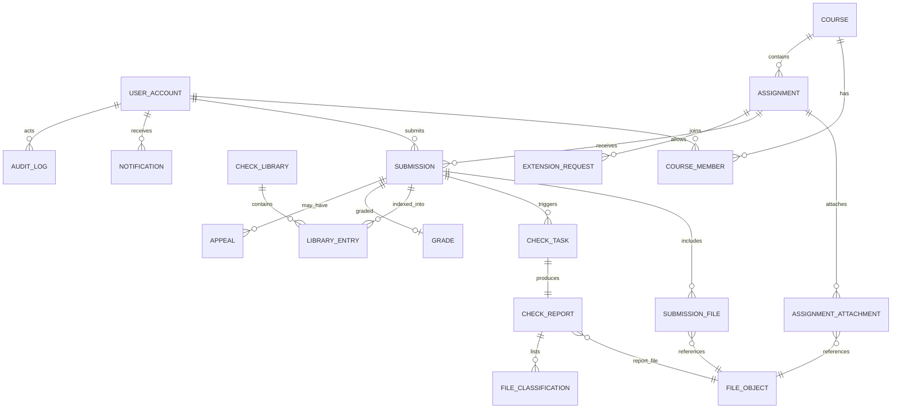

# 学生作业提交与查重系统 数据库设计文档（DBDD）

| 项目 | 内容 |
| --- | --- |
| 文档名称 | 学生作业提交与查重系统数据库设计文档 |
| 文档编号 | DBDD-EDU-SUBMIT-002 |
| 版本 | V1.2 |
| 编制日期 | 2026-11-04 |
| 编制人 | 林伟豪 |
| 文档状态 | 设计基线 |
| 适用范围 | 物理模型、表字段与约束、事务与并发、索引、安全与迁移 |
| 上游依据 | 《需求规格说明书 v1.3》《架构设计文档 v1.0》《功能逻辑设计》《功能测试用例》 |

> 本学生作业提交与查重系统，数据库设计**侧重提交与查重两类核心数据，其余部分精简**。全文共 19 张物理表，分布于 2 个 schema（`app` 业务表 + `audit` 只追加审计表）。提交与查重的关键约束（生效版本唯一、当前报告唯一、任务租约、幂等）完整建模；评审/批注/维度分/成绩合并为单表，通知/审计/配置各收敛为单表；配置、量规、比对库绑定等半结构化数据用 JSONB 承载。系统不依赖 Redis/OpenSearch/RabbitMQ 即可跑通主流程，数据库为唯一业务事实源。

---

## 1. 设计目标与原则

### 1.1 设计目标

1. **核心完整**：提交（多版本、生效版本、幂等、迟交、文件校验）与查重（比对库、库条目、任务队列、报告、压缩包文件分类）的数据结构完整可用，覆盖 FR-S、FR-K 全部 P0 需求。
2. **结构精简**：19 张物理表、2 个 schema，避免冗余的版本快照表、事件收发箱、子动作表与物化视图。
3. **实现低成本**：不依赖 Redis/OpenSearch/RabbitMQ 即可跑通主流程（这些组件可作为性能增强后续引入），数据库为唯一业务事实源。
4. **可演进**：保留关键扩展点（JSONB 配置、状态枚举、库类型），未来需要小组提交、配置版本化、事件总线时可在不破坏现有结构的前提下增量加表。

### 1.2 设计原则

| 原则 | 说明 |
| --- | --- |
| 核心域保真 | submission、checking 两域的表结构与关键约束（生效版本唯一、当前报告唯一、任务租约、幂等）完整建模 |
| 支撑域合并 | 评审+成绩+维度分+批注合并为 `grade`；通知六表合一；审计两表合一；申诉/延期只留主表 |
| 配置 JSONB 化 | 作业查重配置、量规、评审参数用 JSONB 列承载，不建独立配置版本表与量规维度表 |
| 事件去中心化 | 不建 outbox/inbox/async_job 表；简易系统用进程内事件 + 直接调用，查重异步由 `check_task` 自身承载 |
| 身份轻量化 | 系统角色内嵌于 `user_account.role`，课程角色存于 `course_member.member_role`，不建独立角色/权限/组织表 |
| schema 极简 | 仅 2 个 schema：业务表全部进 `app`，审计日志单独进 `audit` 做只追加权限隔离 |
| 统计按需算 | 不建统计物化视图，统计用 SQL 实时聚合，数据量上来后再建视图 |
| 删除策略 | 业务事实优先逻辑失效/归档；报告、成绩、审计、申诉禁止物理删除 |

---

## 2. 表清单总览

本方案共 **19 张物理表**，分布于 **2 个 schema**：`app`（18 张业务表）与 `audit`（1 张只追加审计表）。

| schema | 表 | 说明 | 是否核心 |
| --- | --- | --- | --- |
| `app` | `file_object` | 文件对象元数据（提交件、报告、附件共用） | 是 |
| `app` | `user_account` | 用户账号（内嵌系统角色） | 否（支撑） |
| `app` | `course` | 课程 | 否（支撑） |
| `app` | `course_member` | 课程成员（花名册 + 课程角色） | 否（支撑） |
| `app` | `assignment` | 作业（查重配置/量规以 JSONB 内嵌） | 是 |
| `app` | `assignment_attachment` | 作业参考材料附件 | 否（支撑） |
| `app` | `submission` | 提交版本（含诚信声明、幂等、生效标记） | **核心** |
| `app` | `submission_file` | 提交文件明细 | **核心** |
| `app` | `check_library` | 比对库 | **核心** |
| `app` | `library_entry` | 比对库条目（含指纹键、水位序号） | **核心** |
| `app` | `check_task` | 查重任务（队列、租约、重试、配置快照） | **核心** |
| `app` | `check_report` | 查重报告（相似度、分级、报告文件引用） | **核心** |
| `app` | `file_classification` | 压缩包文件分类明细（A～F 桶） | **核心** |
| `app` | `grade` | 成绩（内嵌评审、维度分、批注、查重结论） | 否（支撑） |
| `app` | `extension_request` | 延期申请 | 否（支撑） |
| `app` | `appeal` | 申诉 | 否（支撑） |
| `app` | `notification` | 站内通知 | 否（支撑） |
| `app` | `system_config` | 全局系统参数 | 否（支撑） |
| `audit` | `audit_log` | 审计日志（吸收登录日志、配置历史、各类动作流水，只追加） | 否（支撑） |

> 标记“核心”的 8 张表（file_object + submission/submission_file + checking 五表）是提交与查重功能的最小完整数据集。`audit` schema 独立，仅授予 `INSERT/SELECT`，不授予 `UPDATE/DELETE`，形成只追加安全边界；其余 18 张业务表均在 `app` schema。

---

## 3. 设计约定

| 项目 | 约定 |
| --- | --- |
| 数据库 | PostgreSQL 16+（单一业务事实库） |
| schema | 仅 `app`（业务表）与 `audit`（只追加审计表）两个 schema |
| 主键 | UUID，应用生成 UUIDv7，`gen_random_uuid()` 兜底 |
| 字符集/时区 | UTF-8；时间统一 `timestamptz` 存 UTC，界面按 Asia/Shanghai 展示 |
| 命名 | 表/字段小写 `snake_case`，表名单数；约束前缀 `pk_/fk_/uk_/ck_/ix_` |
| 状态字段 | `varchar` + `CHECK` 枚举（不用原生 enum，便于演进） |
| 分数/相似度 | `numeric`，相似度 0～100 保留两位 |
| 摘要 | SHA-256 存 `char(64)` 小写十六进制 |
| 半结构化 | 配置、量规、维度分、批注、审计详情用 JSONB，应用层做 Schema 校验 |
| 布尔 | `boolean NOT NULL DEFAULT false` |
| 公共字段 | 可变业务表含 `created_at`、`updated_at`；高并发更新表加 `row_version`（乐观锁） |
| 删除策略 | 业务事实优先逻辑失效/归档；报告、成绩、审计、申诉禁止物理删除 |
| 大文本/大文件 | 提交在线正文用 `text`（上限 100 万字符）；文件正文、报告正文放对象存储，DB 只存元数据与对象引用 |
| 事件与缓存 | 不引入 outbox/inbox；Redis、OpenSearch、RabbitMQ 均为可选增强，非事实源 |
| 表分区 | 建表不强制分区；仅 `audit.audit_log`、`app.notification`、`app.file_classification` 数据量增大后按月分区 |

---

## 4. 逻辑数据模型

### 4.1 核心实体关系



### 4.2 关键关系规则

1. 用户系统角色（STUDENT/TEACHER/ASSISTANT/ADMIN）存于 `user_account.role`；课程内角色（STUDENT/ASSISTANT/INSTRUCTOR）存于 `course_member.member_role`。鉴权 = 系统角色 + 课程角色 + 资源状态三重判断（应用层）。
2. 一个作业属于一个课程；查重配置、量规、评审参数以 JSONB 内嵌于 `assignment`，发布后修改由应用提示影响。
3. 个人提交：同一作业、同一学生版本号连续递增，仅一条 `is_effective=true`。无小组提交（P1，未来扩展）。
4. 查重任务与报告分离：任务可在无正式提交时执行预查重；正式查重必须关联提交。每次重查生成新报告版本，仅一条 `is_current=true`。
5. 报告正文、来源明细存对象存储（`check_report.report_file_id` 指向 JSON 报告文件）；DB 保存摘要、分级、文件分类明细。
6. 成绩与提交一对一，`grade` 内嵌评审人、维度分、批注、查重结论；改分写 `audit.audit_log`。
7. 延期“每作业每学生一次”；申诉可多次但关联提交/成绩。延期/申诉的处理动作与附件以审计日志留痕，不建子表。

### 4.3 状态模型与数据库映射

| 业务对象 | 状态字段 | 允许状态 | 数据库控制点 |
| --- | --- | --- | --- |
| 用户 | `user_account.status` | `PENDING/ACTIVE/LOCKED/DISABLED` | 停用账号递增 `token_version` |
| 课程 | `course.status` | `DRAFT/ACTIVE/ARCHIVED` | 归档后应用层拒写，`archived_at` 留痕 |
| 作业 | `assignment.status` | `DRAFT/PUBLISHED/CLOSED/ARCHIVED` | 状态与时间共同驱动 |
| 提交 | `submission.status` | `PENDING_SCAN/SUBMITTED/CHECKING/CHECK_COMPLETED/CHECK_FAILED/REVIEWED/PUBLISHED/CLOSED/WITHDRAWN` | 状态与 `is_effective` 分离 |
| 查重任务 | `check_task.status` | `QUEUED/PREPROCESSING/COMPARING/REPORTING/SUCCEEDED/FAILED/CANCELLED` | `task_version` 乐观锁与租约 |
| 查重报告 | `check_report.level` | `PASS/WARNING/SEVERE/UNKNOWN` | 报告生成后正文不可修改 |
| 成绩 | `grade.status` | `DRAFT/SUBMITTED/PUBLISHED` | 发布前学生不可见 |
| 延期 | `extension_request.status` | `SUBMITTED/APPROVED/REJECTED/CLOSED` | 每次动作写 `audit_log` |
| 申诉 | `appeal.status` | `SUBMITTED/IN_REVIEW/APPROVED/REJECTED/CLOSED` | 每次动作写 `audit_log` |

---

## 5. 物理表设计

> 表中“PK”主键、“FK”外键、“UK”唯一、“IX”索引、“CK”检查约束。字段表仅列业务字段，公共字段（created_at/updated_at/row_version）按约定统一存在。业务表均在 `app` schema，审计表在 `audit` schema。

### 5.1 文件支撑（`app.file_object`）

#### 5.1.1 `app.file_object` 文件对象

| 字段 | 类型 | 空 | 默认/约束 | 说明 |
| --- | --- | --- | --- | --- |
| `id` | `uuid` | 否 | PK | 对象元数据 ID |
| `bucket` | `varchar(128)` | 否 | UK(bucket, object_key) | 存储桶 |
| `object_key` | `varchar(1024)` | 否 | UK 同上 | 对象键，写入后不可变 |
| `original_name` | `text` | 否 |  | 上传原始文件名（展示用） |
| `mime_type` | `varchar(255)` | 否 |  | 服务端识别的 MIME |
| `size_bytes` | `bigint` | 否 | CK(>= 0) | 字节数 |
| `sha256` | `char(64)` | 否 | IX，CK(`^[0-9a-f]{64}$`) | 完整性摘要 |
| `scan_status` | `varchar(16)` | 否 | 默认 `PENDING`，IX | `PENDING/CLEAN/INFECTED/FAILED` |
| `created_by` | `uuid` | 是 | FK → app.user_account | 创建人 |
| `created_at` | `timestamptz` | 否 | 默认 `now()` | 创建时间 |

说明：扫描未通过的提交件对象不参与业务读取；提交件、报告 JSON、附件、参考材料共用本表登记。删除对象由生命周期任务执行，普通业务代码不删。

### 5.2 身份域（`app.user_account`）

#### 5.2.1 `app.user_account` 用户账号

| 字段 | 类型 | 空 | 默认/约束 | 说明 |
| --- | --- | --- | --- | --- |
| `id` | `uuid` | 否 | PK | 用户 ID |
| `user_no` | `varchar(32)` | 否 | UK | 学工号，全局唯一 |
| `login_name` | `citext` | 否 | UK | 登录名（大小写不敏感） |
| `display_name` | `varchar(64)` | 否 | IX | 姓名 |
| `email` | `citext` | 是 | IX | 邮箱 |
| `phone` | `varchar(32)` | 是 |  | 手机号（展示脱敏） |
| `role` | `varchar(16)` | 否 | CK | `STUDENT/TEACHER/ASSISTANT/ADMIN`，系统角色 |
| `password_hash` | `text` | 是 |  | Argon2id；纯 SSO 为空 |
| `status` | `varchar(16)` | 否 | 默认 `PENDING` | `PENDING/ACTIVE/LOCKED/DISABLED` |
| `token_version` | `integer` | 否 | 默认 1，CK > 0 | 递增即失效旧会话 |
| `last_login_at` | `timestamptz` | 是 |  | 最近登录 |
| `created_at` | `timestamptz` | 否 | 默认 `now()` |  |
| `updated_at` | `timestamptz` | 否 | 默认 `now()` |  |
| `row_version` | `bigint` | 否 | 默认 0 | 乐观锁 |

说明：停用账号同事务递增 `token_version` 并写审计；用户“删除”改为停用，确需匿名化时保留学号哈希以维持成绩/审计追溯。

### 5.3 课程域（`app.course`、`app.course_member`）

#### 5.3.1 `app.course` 课程

| 字段 | 类型 | 空 | 默认/约束 | 说明 |
| --- | --- | --- | --- | --- |
| `id` | `uuid` | 否 | PK | 课程 ID |
| `course_code` | `varchar(64)` | 否 | UK(course_code, semester) | 课程代码 |
| `name` | `varchar(128)` | 否 | IX | 课程名称 |
| `semester` | `varchar(32)` | 否 | UK 同上 | 学期，如 `2026-FALL` |
| `owner_id` | `uuid` | 否 | FK → app.user_account，IX | 课程负责人 |
| `description` | `text` | 是 |  | 简介 |
| `status` | `varchar(16)` | 否 | 默认 `DRAFT`，IX | `DRAFT/ACTIVE/ARCHIVED` |
| `invite_code` | `varchar(32)` | 是 | 部分 UK | 学生自助加入码 |
| `archived_at` | `timestamptz` | 是 |  | 归档时间 |
| `created_at` | `timestamptz` | 否 | 默认 `now()` |  |
| `updated_at` | `timestamptz` | 否 | 默认 `now()` |  |
| `row_version` | `bigint` | 否 | 默认 0 | 乐观锁 |

说明：`invite_code` 用部分唯一索引 `WHERE invite_code IS NOT NULL`；归档后应用层拒写。

#### 5.3.2 `app.course_member` 课程成员

| 字段 | 类型 | 空 | 默认/约束 | 说明 |
| --- | --- | --- | --- | --- |
| `id` | `uuid` | 否 | PK | 成员关系 ID |
| `course_id` | `uuid` | 否 | FK → app.course，UK(course_id, user_id) | 课程 |
| `user_id` | `uuid` | 否 | FK → app.user_account，UK 同上 | 用户 |
| `member_role` | `varchar(16)` | 否 | IX，CK | `STUDENT/ASSISTANT/INSTRUCTOR` |
| `status` | `varchar(16)` | 否 | 默认 `ACTIVE` | `ACTIVE/REMOVED` |
| `joined_at` | `timestamptz` | 否 | 默认 `now()` | 加入时间 |
| `removed_at` | `timestamptz` | 是 |  | 移除时间 |
| `created_at` | `timestamptz` | 否 | 默认 `now()` |  |
| `updated_at` | `timestamptz` | 否 | 默认 `now()` |  |

说明：花名册增删改写 `audit.audit_log`（`action=roster.add/remove/role_change`，detail 存前后快照）。助教评审范围由应用层按课程成员判定，不建 scope_config。

### 5.4 作业域（`app.assignment`、`app.assignment_attachment`）

#### 5.4.1 `app.assignment` 作业

| 字段 | 类型 | 空 | 默认/约束 | 说明 |
| --- | --- | --- | --- | --- |
| `id` | `uuid` | 否 | PK | 作业 ID |
| `course_id` | `uuid` | 否 | FK → app.course，IX | 所属课程 |
| `title` | `varchar(256)` | 否 |  | 标题 |
| `description` | `text` | 是 |  | 要求正文 |
| `status` | `varchar(16)` | 否 | 默认 `DRAFT`，IX | `DRAFT/PUBLISHED/CLOSED/ARCHIVED` |
| `publish_at` | `timestamptz` | 是 |  | 发布时间 |
| `open_at` | `timestamptz` | 是 |  | 开放提交时间 |
| `deadline_at` | `timestamptz` | 否 | IX | 正常截止 |
| `late_deadline_at` | `timestamptz` | 是 | CK(晚于 deadline_at) | 补交截止 |
| `allow_late` | `boolean` | 否 | 默认 false | 是否允许补交 |
| `allow_multi_version` | `boolean` | 否 | 默认 true | 是否允许多版本 |
| `effective_rule` | `varchar(16)` | 否 | 默认 `LAST_SUBMISSION` | `LAST_SUBMISSION/MANUAL` |
| `check_enabled` | `boolean` | 否 | 默认 false | 是否开启查重 |
| `check_config` | `jsonb` | 否 | 默认 `{}` | 查重配置：mode/thresholds/library_ids/exclude_options/precheck_limit |
| `rubric_definition` | `jsonb` | 否 | 默认 `{}` | 量规定义 `dimensions[{key,name,max_score,levels[]}]` |
| `weight` | `numeric(5,2)` | 否 | 默认 0，CK(0～100) | 课程总成绩权重 |
| `created_by` | `uuid` | 否 | FK → app.user_account | 创建人 |
| `created_at` | `timestamptz` | 否 | 默认 `now()` |  |
| `updated_at` | `timestamptz` | 否 | 默认 `now()` |  |
| `row_version` | `bigint` | 否 | 默认 0 | 乐观锁 |

`check_config` 建议结构：
```json
{
  "mode": "TEXT|CODE|MIXED",
  "text_thresholds": {"warning": 20, "severe": 50},
  "struct_thresholds": {"warning": 30, "severe": 60},
  "library_ids": ["<uuid>", "..."],
  "exclude": {"references": true, "template": true, "common_code": true},
  "code_scope": {"include_buckets": ["A","B"], "optional_c": false},
  "precheck": {"enabled": true, "limit": 3}
}
```
说明：`library_ids` 表达作业启用的比对库；本班库由应用在查重时强制加入且不可关闭。查重参数快照在创建任务时复制到 `check_task.config_snapshot`，保证历史任务可复现。`deadline_at` 为教师原始截止，个人有效截止写入 `submission.effective_deadline_at`。

#### 5.4.2 `app.assignment_attachment` 作业附件

| 字段 | 类型 | 空 | 默认/约束 | 说明 |
| --- | --- | --- | --- | --- |
| `id` | `uuid` | 否 | PK |  |
| `assignment_id` | `uuid` | 否 | FK → app.assignment，UK(assignment_id, file_object_id) | 作业 |
| `file_object_id` | `uuid` | 否 | FK → app.file_object，UK 同上 | 文件 |
| `display_name` | `text` | 否 |  | 展示名 |
| `sort_order` | `integer` | 否 | 默认 0 | 排序 |
| `created_at` | `timestamptz` | 否 | 默认 `now()` |  |

### 5.5 提交域【核心】（`app.submission`、`app.submission_file`）

#### 5.5.1 `app.submission` 提交版本

| 字段 | 类型 | 空 | 默认/约束 | 说明 |
| --- | --- | --- | --- | --- |
| `id` | `uuid` | 否 | PK | 提交 ID |
| `assignment_id` | `uuid` | 否 | FK → app.assignment，IX | 作业 |
| `submitter_id` | `uuid` | 否 | FK → app.user_account，IX | 提交人（个人提交即所有者） |
| `version_no` | `integer` | 否 | UK(aid,submitter_id,version_no)，CK > 0 | 版本号 |
| `status` | `varchar(20)` | 否 | 默认 `PENDING_SCAN`，IX | 提交状态 |
| `is_effective` | `boolean` | 否 | 默认 false | 是否生效版本 |
| `is_late` | `boolean` | 否 | 默认 false | 是否迟交 |
| `submitted_at` | `timestamptz` | 否 | 默认 `now()`，IX | 接收完成时间 |
| `effective_deadline_at` | `timestamptz` | 否 |  | 当时有效截止快照 |
| `online_text` | `text` | 是 | CK(length <= 1000000) | 在线文本正文 |
| `online_text_digest` | `char(64)` | 是 |  | 在线文本摘要 |
| `input_digest` | `char(64)` | 是 |  | 输入规范化摘要 |
| `integrity_consent` | `boolean` | 否 | 默认 false | 是否签署诚信声明 |
| `integrity_consent_at` | `timestamptz` | 是 |  | 声明确认时间 |
| `idempotency_key` | `varchar(128)` | 是 | 部分 UK | 提交幂等键 |
| `created_at` | `timestamptz` | 否 | 默认 `now()` |  |
| `updated_at` | `timestamptz` | 否 | 默认 `now()` |  |
| `row_version` | `bigint` | 否 | 默认 0 | 乐观锁 |

`submission_status` 枚举：`PENDING_SCAN/SUBMITTED/CHECKING/CHECK_COMPLETED/CHECK_FAILED/REVIEWED/PUBLISHED/CLOSED/WITHDRAWN`

核心约束：
- `UK(assignment_id, submitter_id, version_no)` 版本号不重复；
- 部分唯一索引 `UK(assignment_id, submitter_id) WHERE is_effective = true` 唯一生效版本；
- 部分唯一索引 `UK(submitter_id, assignment_id, idempotency_key) WHERE idempotency_key IS NOT NULL` 重复请求返回原提交；
- 提交行创建后 `submitter_id`、`version_no`、`submitted_at` 不可修改；状态流转与生效切换写 `audit.audit_log`。

说明：提交人即所有者（无小组提交）。诚信声明在首次正式提交时签署，后续版本沿用，以本表字段表达。

#### 5.5.2 `app.submission_file` 提交文件

| 字段 | 类型 | 空 | 默认/约束 | 说明 |
| --- | --- | --- | --- | --- |
| `id` | `uuid` | 否 | PK |  |
| `submission_id` | `uuid` | 否 | FK → app.submission，UK(submission_id, file_object_id) | 提交 |
| `file_object_id` | `uuid` | 否 | FK → app.file_object，UK 同上 | 文件对象 |
| `display_name` | `text` | 否 |  | 展示名 |
| `sort_order` | `integer` | 否 | 默认 0 | 排序 |
| `created_at` | `timestamptz` | 否 | 默认 `now()` |  |

说明：原始文件不可覆盖；扫描状态由 `file_object.scan_status` 表达，`PENDING_SCAN` 提交在所有文件 `CLEAN` 后才流转为 `SUBMITTED`。

### 5.6 查重域【核心】（`app.check_library`、`app.library_entry`、`app.check_task`、`app.check_report`、`app.file_classification`）

#### 5.6.1 `app.check_library` 比对库

| 字段 | 类型 | 空 | 默认/约束 | 说明 |
| --- | --- | --- | --- | --- |
| `id` | `uuid` | 否 | PK | 库 ID |
| `name` | `varchar(128)` | 否 |  | 库名称 |
| `library_type` | `varchar(16)` | 否 | UK(library_type, scope_key)，CK | `CLASS/HISTORICAL/INTERNET/LITERATURE/WHITELIST` |
| `scope_key` | `varchar(128)` | 否 | UK 同上 | 作用域，如 `course:<uuid>:2026-FALL` |
| `course_id` | `uuid` | 是 | FK → app.course，IX | 本班库/白名单关联课程 |
| `status` | `varchar(16)` | 否 | 默认 `ACTIVE`，IX | `ACTIVE/DISABLED` |
| `source_config` | `jsonb` | 否 | 默认 `{}` | 供应商/授权等非敏感配置（密钥用引用） |
| `created_by` | `uuid` | 是 | FK → app.user_account | 创建人 |
| `created_at` | `timestamptz` | 否 | 默认 `now()` |  |
| `updated_at` | `timestamptz` | 否 | 默认 `now()` |  |
| `row_version` | `bigint` | 否 | 默认 0 | 乐观锁 |

说明：本班库按“课程+学期”建立，查重时由应用强制加入；历届库按课程或系列建立；文献/互联网库默认不启用，须教师勾选且授权。`source_config` 不存 API 密钥。

#### 5.6.2 `app.library_entry` 库条目

| 字段 | 类型 | 空 | 默认/约束 | 说明 |
| --- | --- | --- | --- | --- |
| `id` | `uuid` | 否 | PK | 条目 ID |
| `library_id` | `uuid` | 否 | FK → app.check_library，UK(library_id, seq) | 库 |
| `submission_id` | `uuid` | 是 | FK → app.submission，部分 UK | 来源提交（本班/历届库） |
| `file_object_id` | `uuid` | 是 | FK → app.file_object | 白名单/外置材料文件 |
| `owner_hash` | `char(64)` | 否 | IX | 所有者 HMAC-SHA256，排除自比且不暴露用户 |
| `content_hash` | `char(64)` | 否 | IX | 入库内容摘要 |
| `language` | `varchar(32)` | 是 |  | 代码语言/内容类型 |
| `fingerprint_key` | `varchar(128)` | 是 |  | OpenSearch 索引文档键（可选） |
| `seq` | `bigint` | 否 | UK(library_id, seq)，CK > 0 | 库内单调序号（查重水位） |
| `status` | `varchar(16)` | 否 | 默认 `ACTIVE`，IX | `ACTIVE/REMOVED` |
| `index_status` | `varchar(16)` | 否 | 默认 `PENDING`，IX | `PENDING/INDEXED/FAILED` |
| `created_at` | `timestamptz` | 否 | 默认 `now()` |  |
| `updated_at` | `timestamptz` | 否 | 默认 `now()` |  |

约束：`CHECK (submission_id IS NOT NULL OR file_object_id IS NOT NULL)`；部分唯一索引 `UK(library_id, submission_id) WHERE submission_id IS NOT NULL`。剔除条目更新状态并写审计，历史报告保留来源快照。`owner_hash` 用服务端密钥 HMAC，密钥不入库。

#### 5.6.3 `app.check_task` 查重任务

| 字段 | 类型 | 空 | 默认/约束 | 说明 |
| --- | --- | --- | --- | --- |
| `id` | `uuid` | 否 | PK | 任务 ID |
| `subject_type` | `varchar(16)` | 否 | CK | `SUBMISSION/PRECHECK` |
| `submission_id` | `uuid` | 是 | FK → app.submission，IX | 正式查重关联提交；预查重为空 |
| `assignment_id` | `uuid` | 否 | FK → app.assignment，IX | 作业 |
| `requester_id` | `uuid` | 是 | FK → app.user_account | 预查重学生/重查教师 |
| `task_type` | `varchar(16)` | 否 | IX，CK | `FORMAL/PRECHECK/RECHECK` |
| `status` | `varchar(16)` | 否 | 默认 `QUEUED`，IX | 任务状态 |
| `task_version` | `integer` | 否 | 默认 0 | 状态乐观锁 |
| `attempt` | `smallint` | 否 | 默认 0，CK >= 0 | 已尝试次数 |
| `max_attempts` | `smallint` | 否 | 默认 3，CK > 0 | 最大尝试 |
| `idempotency_key` | `varchar(128)` | 否 | UK | 任务幂等键 |
| `config_snapshot` | `jsonb` | 否 |  | 查重参数完整快照 |
| `config_digest` | `char(64)` | 否 | IX | 配置摘要 |
| `input_file_object_id` | `uuid` | 是 | FK → app.file_object | 预查重输入对象 |
| `input_text_digest` | `char(64)` | 是 |  | 预查重在线文本摘要 |
| `library_watermarks` | `jsonb` | 否 | 默认 `{}` | 各库水位 |
| `scheduled_at` | `timestamptz` | 否 | 默认 `now()`，IX | 最早可执行 |
| `started_at` | `timestamptz` | 是 |  | 开始时间 |
| `finished_at` | `timestamptz` | 是 |  | 终态时间 |
| `lease_owner` | `varchar(128)` | 是 |  | 当前 Worker |
| `lease_until` | `timestamptz` | 是 | IX | 租约截止 |
| `heartbeat_at` | `timestamptz` | 是 |  | Worker 心跳 |
| `error_code` | `varchar(64)` | 是 |  | 错误编码 |
| `error_detail` | `text` | 是 |  | 脱敏错误摘要 |
| `created_by` | `uuid` | 是 | FK → app.user_account | 创建人 |
| `created_at` | `timestamptz` | 否 | 默认 `now()` |  |
| `updated_at` | `timestamptz` | 否 | 默认 `now()` |  |

`check_task_status`：`QUEUED/PREPROCESSING/COMPARING/REPORTING/SUCCEEDED/FAILED/CANCELLED`

关键约束：
- `CHECK`：正式查重须 `subject_type='SUBMISSION' AND submission_id IS NOT NULL`；预查重须 `subject_type='PRECHECK' AND submission_id IS NULL AND requester_id IS NOT NULL AND (input_file_object_id IS NOT NULL OR input_text_digest IS NOT NULL)`；
- 部分唯一索引 `UK(submission_id, task_type) WHERE submission_id IS NOT NULL AND task_type IN ('FORMAL','RECHECK')` 防止同一提交重复入队（重查须先取消旧任务）；
- 队列索引 `IX(status, scheduled_at, created_at) WHERE status = 'QUEUED'`；
- 租约索引 `IX(lease_until) WHERE status IN ('PREPROCESSING','COMPARING','REPORTING')`。

说明：Worker 用 `SELECT ... FOR UPDATE SKIP LOCKED` 领取，更新带 `task_version` 条件，旧 Worker 回传不覆盖新状态。

#### 5.6.4 `app.check_report` 查重报告

| 字段 | 类型 | 空 | 默认/约束 | 说明 |
| --- | --- | --- | --- | --- |
| `id` | `uuid` | 否 | PK | 报告 ID |
| `check_task_id` | `uuid` | 否 | UK，FK → app.check_task | 生成任务 |
| `submission_id` | `uuid` | 是 | FK → app.submission，IX | 正式报告关联提交；预查重为空 |
| `assignment_id` | `uuid` | 否 | FK → app.assignment，IX | 作业 |
| `requester_id` | `uuid` | 是 | FK → app.user_account | 预查重报告所有者 |
| `report_version` | `integer` | 否 | 部分 UK，CK > 0 | 报告版本 |
| `is_current` | `boolean` | 否 | 默认 false | 是否当前报告 |
| `overall_score` | `numeric(5,2)` | 否 | CK(0～100) | 总相似度 |
| `text_score` | `numeric(5,2)` | 是 | CK(0～100) | 文本相似度 |
| `structure_score` | `numeric(5,2)` | 是 | CK(0～100) | 结构相似度 |
| `level` | `varchar(16)` | 否 | 默认 `UNKNOWN`，CK | `PASS/WARNING/SEVERE/UNKNOWN` |
| `algorithm_version` | `varchar(64)` | 否 |  | 算法版本 |
| `params` | `jsonb` | 否 |  | 实际参数快照 |
| `params_digest` | `char(64)` | 否 |  | 参数摘要 |
| `source_count` | `integer` | 否 | 默认 0，CK >= 0 | 命中来源数 |
| `top_source_type` | `varchar(24)` | 是 |  | 最高相似来源类型 |
| `top_source_similarity` | `numeric(5,2)` | 是 | CK(0～100) | 最高来源相似度 |
| `report_file_id` | `uuid` | 否 | FK → app.file_object | 结构化报告 JSON（含来源明细/高亮/双栏证据） |
| `report_digest` | `char(64)` | 否 | IX | 报告摘要（完整性校验） |
| `generated_at` | `timestamptz` | 否 | 默认 `now()` | 生成时间 |
| `created_at` | `timestamptz` | 否 | 默认 `now()` |  |

约束：
- `UK(check_task_id)` 一任务一报告；
- 部分唯一索引 `UK(submission_id, report_version) WHERE submission_id IS NOT NULL`；
- 部分唯一索引 `UK(submission_id) WHERE is_current = true AND submission_id IS NOT NULL` 唯一当前报告；
- 报告业务字段插入后不可更新，仅允许受控切换 `is_current`。

说明：报告正文（来源列表、分段高亮、双栏对比、文件统计）写入 `report_file_id` 指向的 JSON 对象；DB 只存摘要与分类明细。`report_digest` 用于完整性校验；涉强防篡改场景可后续加签名字段。

#### 5.6.5 `app.file_classification` 文件分类明细

| 字段 | 类型 | 空 | 默认/约束 | 说明 |
| --- | --- | --- | --- | --- |
| `id` | `uuid` | 否 | PK | 明细 ID |
| `report_id` | `uuid` | 否 | FK → app.check_report，IX | 报告 |
| `submission_id` | `uuid` | 是 | FK → app.submission，IX | 提交（预查重为空） |
| `path` | `varchar(1024)` | 否 | IX | 压缩包内相对路径 |
| `file_name` | `text` | 否 |  | 文件名 |
| `extension` | `varchar(32)` | 是 |  | 小写扩展名 |
| `size_bytes` | `bigint` | 否 | CK(>= 0) | 大小 |
| `sha256` | `char(64)` | 是 | IX | 摘要 |
| `bucket` | `char(1)` | 否 | CK(A～F)，IX | 分类桶 |
| `included` | `boolean` | 否 | 默认 false | 是否参与查重 |
| `exclude_reason` | `varchar(64)` | 是 |  | 排除原因码 |
| `language` | `varchar(32)` | 是 |  | 识别语言 |
| `is_binary` | `boolean` | 否 | 默认 false | 是否二进制 |
| `sort_order` | `integer` | 否 | 默认 0 | 排序 |
| `created_at` | `timestamptz` | 否 | 默认 `now()` |  |

索引：`(report_id, bucket, included)`、`(report_id, path)`。说明：本表是压缩包代码查重（FR-K-10～15）的核心明细，分类桶 A 核心源码 / B 配置构建 / C 测试脚本 / D 第三方依赖 / E 二进制资源 / F 文档；查重默认仅对 A、B 桶执行。数据量增大后可按 `created_at` 月分区。

### 5.7 评审与成绩域（`app.grade`）

#### 5.7.1 `app.grade` 成绩（内嵌评审）

| 字段 | 类型 | 空 | 默认/约束 | 说明 |
| --- | --- | --- | --- | --- |
| `id` | `uuid` | 否 | PK | 成绩 ID |
| `submission_id` | `uuid` | 否 | UK，FK → app.submission | 提交（一提交一成绩） |
| `reviewer_id` | `uuid` | 否 | FK → app.user_account，IX | 评审人 |
| `reviewer_type` | `varchar(16)` | 否 | 默认 `TEACHER`，CK | `TEACHER/ASSISTANT/STUDENT` |
| `status` | `varchar(16)` | 否 | 默认 `DRAFT`，IX | `DRAFT/SUBMITTED/PUBLISHED` |
| `raw_score` | `numeric(6,2)` | 是 | CK(>= 0) | 量规原始分 |
| `late_deduction` | `numeric(6,2)` | 否 | 默认 0，CK(>= 0) | 迟交扣分 |
| `final_score` | `numeric(6,2)` | 否 | CK(>= 0) | 最终成绩 |
| `dimension_scores` | `jsonb` | 否 | 默认 `[]` | 维度分快照 `[{key,name,max_score,score,comment}]` |
| `annotations` | `jsonb` | 否 | 默认 `[]` | 批注 `[{file_object_id,page_no,x_ratio,y_ratio,content}]` |
| `check_verdict` | `varchar(32)` | 是 |  | `ORIGINAL/SUSPECTED_PLAGIARISM/INTERVIEW_REQUIRED` |
| `comment` | `text` | 是 |  | 总评 |
| `feedback_file_id` | `uuid` | 是 | FK → app.file_object | 反馈附件 |
| `published` | `boolean` | 否 | 默认 false，部分 IX | 是否发布 |
| `published_at` | `timestamptz` | 是 |  | 首次发布时间（申诉时限起点） |
| `published_by` | `uuid` | 是 | FK → app.user_account | 发布人 |
| `submitted_at` | `timestamptz` | 是 |  | 评审提交时间 |
| `created_at` | `timestamptz` | 否 | 默认 `now()` |  |
| `updated_at` | `timestamptz` | 否 | 默认 `now()` |  |
| `row_version` | `bigint` | 否 | 默认 0 | 乐观锁 |

说明：评审与成绩一对一（单评审人），评审人记于 `reviewer_id`；维度分与批注以 JSONB 快照保存（量规来源为 `assignment.rubric_definition`）。改分流水写 `audit.audit_log`（`action=grade.update`，detail 存前后分）。发布前学生不可见；`final_score = max(0, raw_score - late_deduction)`。匿名/互评为 P1/P2，后续按需在 `assignment` 增评审配置或加分配表。

### 5.8 申诉与延期域（`app.extension_request`、`app.appeal`）

#### 5.8.1 `app.extension_request` 延期申请

| 字段 | 类型 | 空 | 默认/约束 | 说明 |
| --- | --- | --- | --- | --- |
| `id` | `uuid` | 否 | PK |  |
| `assignment_id` | `uuid` | 否 | FK → app.assignment，UK(assignment_id, user_id) | 作业 |
| `user_id` | `uuid` | 否 | FK → app.user_account，UK 同上 | 学生 |
| `reason` | `text` | 否 |  | 理由 |
| `expected_deadline` | `timestamptz` | 否 |  | 期望截止 |
| `status` | `varchar(16)` | 否 | 默认 `SUBMITTED`，IX | `SUBMITTED/APPROVED/REJECTED/CLOSED` |
| `approved_deadline` | `timestamptz` | 是 |  | 审批后个人截止 |
| `handler_id` | `uuid` | 是 | FK → app.user_account | 处理人 |
| `submitted_at` | `timestamptz` | 否 | 默认 `now()` |  |
| `decided_at` | `timestamptz` | 是 |  | 决定时间 |
| `created_at` | `timestamptz` | 否 | 默认 `now()` |  |
| `updated_at` | `timestamptz` | 否 | 默认 `now()` |  |
| `row_version` | `bigint` | 否 | 默认 0 | 乐观锁 |

说明：`UK(assignment_id, user_id)` 落实“每作业每学生仅一次”。审批动作写 `audit.audit_log`。

#### 5.8.2 `app.appeal` 申诉

| 字段 | 类型 | 空 | 默认/约束 | 说明 |
| --- | --- | --- | --- | --- |
| `id` | `uuid` | 否 | PK |  |
| `tracking_no` | `varchar(64)` | 否 | UK | 业务追踪号 |
| `user_id` | `uuid` | 否 | FK → app.user_account，IX | 申诉学生 |
| `submission_id` | `uuid` | 否 | FK → app.submission，IX | 关联提交 |
| `grade_id` | `uuid` | 是 | FK → app.grade | 关联成绩（成绩申诉时必填） |
| `appeal_type` | `varchar(16)` | 否 | CK | `CHECK_AGAINST/GRADE` |
| `reason` | `text` | 否 |  | 理由 |
| `status` | `varchar(16)` | 否 | 默认 `SUBMITTED`，IX | `SUBMITTED/IN_REVIEW/APPROVED/REJECTED/CLOSED` |
| `handler_id` | `uuid` | 是 | FK → app.user_account | 处理人 |
| `conclusion` | `text` | 是 |  | 处理结论 |
| `submitted_at` | `timestamptz` | 否 | 默认 `now()` |  |
| `deadline_at` | `timestamptz` | 否 |  | 申诉时限快照 |
| `decided_at` | `timestamptz` | 是 |  | 决定时间 |
| `created_at` | `timestamptz` | 否 | 默认 `now()` |  |
| `updated_at` | `timestamptz` | 否 | 默认 `now()` |  |
| `row_version` | `bigint` | 否 | 默认 0 | 乐观锁 |

说明：`appeal_type='GRADE'` 时 `grade_id` 必填。处理动作（重查/改分/约谈）写 `audit.audit_log` 并共享 `tracking_no` 形成证据链。

### 5.9 通知域（`app.notification`）

#### 5.9.1 `app.notification` 站内通知

| 字段 | 类型 | 空 | 默认/约束 | 说明 |
| --- | --- | --- | --- | --- |
| `id` | `uuid` | 否 | PK | 通知 ID |
| `recipient_id` | `uuid` | 否 | FK → app.user_account，IX | 收件人 |
| `notification_type` | `varchar(32)` | 否 | IX | `ASSIGNMENT_PUBLISHED/DEADLINE_REMINDER/CHECK_COMPLETED/CHECK_FAILED/GRADE_PUBLISHED/APPEAL_REPLIED/EXTENSION_RESULT/SYSTEM` |
| `title` | `varchar(256)` | 否 |  | 标题 |
| `content` | `text` | 否 |  | 正文 |
| `target_type` | `varchar(64)` | 是 |  | 深链目标类型 |
| `target_id` | `uuid` | 是 |  | 深链目标 ID |
| `is_read` | `boolean` | 否 | 默认 false，部分 IX | 是否已读 |
| `read_at` | `timestamptz` | 是 |  | 阅读时间 |
| `created_at` | `timestamptz` | 否 | 默认 `now()`，IX | 创建时间 |

说明：简易系统以站内信为主；如需邮件/短信，后续加 `channel`/`status` 列或独立投递表。通知生成由应用层“先查后写”去重（依赖业务事件 ID）。数据量增大后按 `created_at` 月分区。

### 5.10 审计域（`audit.audit_log`，独立 audit schema）

#### 5.10.1 `audit.audit_log` 审计日志

| 字段 | 类型 | 空 | 默认/约束 | 说明 |
| --- | --- | --- | --- | --- |
| `id` | `uuid` | 否 | PK | 日志 ID |
| `actor_id` | `uuid` | 是 | IX | 操作人（系统为空） |
| `actor_type` | `varchar(16)` | 否 | 默认 `USER` | `USER/SYSTEM/WORKER` |
| `action` | `varchar(128)` | 否 | IX | 动作编码 |
| `target_type` | `varchar(64)` | 否 | IX | 目标对象类型 |
| `target_id` | `uuid` | 是 | IX | 目标对象 ID |
| `result` | `varchar(16)` | 否 | 默认 `SUCCESS` | `SUCCESS/FAILED/DENIED` |
| `detail` | `jsonb` | 否 | 默认 `{}` | 变更前后摘要（禁敏感明文） |
| `ip` | `inet` | 是 |  | 客户端 IP |
| `trace_id` | `varchar(64)` | 是 | IX | 链路追踪 ID |
| `created_at` | `timestamptz` | 否 | 默认 `now()` | 操作时间 |

说明：只追加，数据库角色不授 `UPDATE/DELETE`。承载登录（`action='login'`）、配置变更（`action='config.update'`）、成绩改分（`action='grade.update'`）、花名册变更（`action='roster.*`）、延期/申诉动作（`action='extension.* / appeal.*`）、提交状态与生效切换（`action='submission.status/effective'`）。索引 `(actor_id, created_at DESC)`、`(target_type, target_id, created_at DESC)`、`(action, created_at DESC)`、BRIN `(created_at)`。保留至少 1 年，按月分区。独立 `audit` schema 便于权限隔离（仅 `INSERT/SELECT`）。

### 5.11 配置域（`app.system_config`）

#### 5.11.1 `app.system_config` 系统参数

| 字段 | 类型 | 空 | 默认/约束 | 说明 |
| --- | --- | --- | --- | --- |
| `config_key` | `varchar(128)` | 否 | PK | 参数键 |
| `value` | `jsonb` | 否 |  | 参数值 |
| `value_type` | `varchar(16)` | 否 |  | `BOOLEAN/INTEGER/DECIMAL/STRING/OBJECT/ARRAY` |
| `config_group` | `varchar(64)` | 否 | IX | 分组 |
| `description` | `text` | 是 |  | 说明 |
| `version` | `bigint` | 否 | 默认 1，CK > 0 | 版本（缓存失效用） |
| `updated_by` | `uuid` | 是 | FK → app.user_account | 更新人 |
| `updated_at` | `timestamptz` | 否 | 默认 `now()` | 更新时间 |

说明：全局参数包括文件大小/类型限制、查重默认阈值、预查重配额、申诉时限、迟交扣分规则、压缩包解压限制等。更新递增 `version` 并写 `audit.audit_log`。

---

## 6. 核心约束与并发控制

### 6.1 提交：生效版本唯一

部分唯一索引保证同一作业、同一学生仅一条生效版本：
```sql
CREATE UNIQUE INDEX uk_submission_effective
ON app.submission (assignment_id, submitter_id)
WHERE is_effective = true;
```
切换生效版本推荐事务顺序：对 `(assignment_id, submitter_id)` 加 advisory lock → 旧版本置 `is_effective=false` → 新版本置 `true` → 写 `audit.audit_log` → 提交。

### 6.2 提交：幂等

```sql
CREATE UNIQUE INDEX uk_submission_idempotency
ON app.submission (submitter_id, assignment_id, idempotency_key)
WHERE idempotency_key IS NOT NULL;
```
重复提交请求命中唯一约束后返回原提交记录。

### 6.3 查重：当前报告唯一

```sql
CREATE UNIQUE INDEX uk_check_report_current
ON app.check_report (submission_id)
WHERE is_current = true AND submission_id IS NOT NULL;
```
重查生成新 `report_version`，切换 `is_current` 受控，旧报告保留。

### 6.4 查重：任务领取与租约

```sql
-- 领取
SELECT id FROM app.check_task
WHERE status = 'QUEUED' AND scheduled_at <= now()
ORDER BY created_at LIMIT 1
FOR UPDATE SKIP LOCKED;

-- 回传须带乐观锁条件，旧 Worker 不覆盖新状态
UPDATE app.check_task
SET status = 'SUCCEEDED', finished_at = now(), task_version = task_version + 1
WHERE id = $1 AND task_version = $2;
```
租约超时由补偿扫描 `IX(lease_until) WHERE status IN ('PREPROCESSING','COMPARING','REPORTING')` 重置为 `QUEUED`。

### 6.5 不可变与只追加

| 数据 | 不可变范围 | 允许变化 |
| --- | --- | --- |
| 提交版本 | 提交人、版本号、提交时间、输入摘要 | 状态、生效标记 |
| 查重报告 | 分数、算法、参数、报告文件引用、摘要 | `is_current` 受控切换 |
| 成绩 | 发布后的成绩字段 | 改分写 `audit.audit_log`，主行 `final_score` 更新 |
| 审计日志 | 全部字段 | 不允许更新或删除 |

实现：应用层禁止更新 + 数据库层收回 `UPDATE/DELETE` 权限；`check_report` 可加 `BEFORE UPDATE` 触发器禁止除 `is_current` 外的字段变更；`audit.audit_log` 所在 `audit` schema 仅授予 `INSERT/SELECT`。

### 6.6 事务边界

| 场景 | 同一事务写入 |
| --- | --- |
| 创建提交 | `app.submission`、`app.submission_file`、（首次）`integrity_consent` 字段、`audit.audit_log` |
| 发起查重 | `app.check_task`、`app.submission.status`、`audit.audit_log` |
| 报告完成 | `app.check_report`、当前报告切换、`app.submission.status`、`app.file_classification`、`audit.audit_log` |
| 发布成绩 | `app.grade`、`app.submission.status`、`audit.audit_log` |
| 延期/申诉处理 | 主表状态更新、`audit.audit_log` |

禁止在事务内调用对象存储、邮件短信或外部查重 API；外部调用在事务后异步执行（简易系统可用线程池，正式系统再引入消息队列）。

---

## 7. 索引设计

| 表 | 索引 | 目的 |
| --- | --- | --- |
| `app.submission` | `UK(assignment_id, submitter_id, version_no)` | 版本号唯一 |
| `app.submission` | `UK(assignment_id, submitter_id) WHERE is_effective` | 唯一生效版本 |
| `app.submission` | `IX(assignment_id, status, submitted_at DESC)` | 教师进度/评审队列 |
| `app.check_task` | `IX(status, scheduled_at, created_at) WHERE status='QUEUED'` | 任务领取 |
| `app.check_task` | `IX(lease_until) WHERE status IN ('PREPROCESSING','COMPARING','REPORTING')` | 租约补偿 |
| `app.check_report` | `UK(submission_id) WHERE is_current AND submission_id IS NOT NULL` | 当前报告唯一 |
| `app.check_report` | `IX(assignment_id, level, generated_at DESC)` | 高风险名单 |
| `app.file_classification` | `IX(report_id, bucket, included)` | 报告文件清单 |
| `app.library_entry` | `UK(library_id, seq)` | 库水位增量读取 |
| `app.library_entry` | `IX(library_id, status, seq)` | 有效条目扫描 |
| `app.grade` | `IX(submission_id)` + `IX(reviewer_id, status)` | 成绩查询/评审工作台 |
| `app.notification` | `IX(recipient_id, is_read, created_at DESC) WHERE is_read=false` | 未读列表 |
| `audit.audit_log` | `IX(actor_id, created_at DESC)`、`IX(target_type, target_id, created_at DESC)` | 审计检索 |
| `audit.audit_log` | `BRIN(created_at)` | 大范围时间扫描 |

---

## 8. 设计说明与权衡

### 8.1 schema 划分

本方案采用 2 个 schema：
- **`app`**：承载 18 张业务表。简易系统单 `app_rw` 账号在应用层做鉴权，无需 DB 层按模块拆权限；表名自带业务语义（`submission`、`check_task`、`grade`），不冲突。
- **`audit`**：仅 `audit_log` 一张只追加表。独立 schema 便于单独授予 `INSERT/SELECT`、收回 `UPDATE/DELETE`，形成不可篡改安全边界。

收益：消除多 schema 前缀噪音，SQL 不必全程带 schema 前缀；迁移脚本只需 `CREATE SCHEMA app; CREATE SCHEMA audit;`；ORM 与查询更简洁。权限模型收敛为 3 个角色：`app_rw`（业务表 `SELECT/INSERT/UPDATE`）、`audit_writer`（`audit.audit_log` 仅 `INSERT/SELECT`）、`analytics_ro`（统计只读）。未来需要按模块做 DB 权限隔离或拆服务时，可沿业务域将 `app` 内表迁出到独立 schema（表名不变，仅改 schema 归属）。

### 8.2 核心能力保障

本方案完整覆盖以下 P0 提交与查重能力：
- 提交多版本 + 生效版本唯一（部分唯一索引）
- 提交幂等（幂等键部分唯一索引）
- 迟交判定与有效截止快照
- 文件病毒扫描门控（`file_object.scan_status`）
- 查重任务队列 + 租约 + 乐观锁 + `FOR UPDATE SKIP LOCKED`
- 比对库 + 库条目 + 水位序号 + 排除自比（owner_hash）
- 查重报告版本 + 当前报告唯一 + 不可变 + 摘要校验
- 压缩包文件分类（A～F 桶）与查重范围配置
- 预查重（无正式提交的独立任务）与手动重查（新报告版本）
- 诚信声明留痕、成绩发布与申诉时限、审计不可删除

### 8.3 未来演进路径

当系统规模或需求增长时，可按以下顺序增量加表，**不破坏现有 19 张表 / 2 schema 结构**：
1. 引入消息队列 → 加 `app.outbox_event`/`app.inbox_event`，业务写入与事件发布解耦；
2. 需要小组提交 → 加 `app.course_group`，`app.submission` 增 `owner_type/owner_id` 与对应唯一索引；
3. 需要配置版本化 → 加 `app.assignment_config_version`，`check_task` 已有 `config_snapshot` 平滑过渡；
4. 需要互评/助教批量分配 → 加 `app.review_assignment`；
5. 需要报告强防篡改 → `app.check_report` 增 `signature`/`signature_key_id`，对接 KMS；
6. 统计性能瓶颈 → 新建统计物化视图（可独立 `analytics` schema 或放 `app`）；
7. 高写入表治理 → 对 `audit.audit_log`/`app.notification`/`app.file_classification`/`app.check_task` 启用月分区。

---

## 9. 需求覆盖

| 需求 | 数据库落点 |
| --- | --- |
| FR-U-01～06 用户与权限 | `app.user_account.role`、`app.course_member.member_role`、`audit.audit_log` |
| FR-C-01～05 课程管理 | `app.course`、`app.course_member`、`audit.audit_log`、（`app.notification` 作公告） |
| FR-A-01～06 作业管理 | `app.assignment`（`check_config`/`rubric_definition` JSONB）、`app.assignment_attachment` |
| FR-S-01/02/03/05/06 提交 | `app.submission`、`app.submission_file`、`app.file_object.scan_status`、生效版本部分唯一索引 |
| FR-S-04 小组提交（P1） | 未覆盖，作为未来扩展（见 8.3） |
| FR-K-01～09 查重引擎 | `app.check_library`、`app.library_entry`、`app.check_task`、`app.check_report` |
| FR-K-10～15 压缩包查重 | `app.file_classification`、`app.check_report.report_file_id`、`app.check_task.config_snapshot` |
| FR-K-06 预查重 | `app.check_task(subject_type='PRECHECK')`，配额用 `check_config.precheck_limit` + 计数 |
| FR-R-01～07 评审与成绩 | `app.grade`（内嵌维度分/批注/结论）、`audit.audit_log`（改分流水） |
| FR-R-08/09 匿名/互评（P1/P2） | 未覆盖，作为未来扩展 |
| FR-E-01～05 延期与申诉 | `app.extension_request`、`app.appeal`、`audit.audit_log`（动作流水） |
| FR-N-01/02 通知 | `app.notification`（站内信） |
| FR-N-03/04 偏好/模板（P1） | 未覆盖，作为未来扩展 |
| FR-ST-01～06 统计 | SQL 实时聚合（无独立表） |
| FR-AD-01～06 系统管理 | `app.system_config`、`audit.audit_log`、`app.check_library`（资源库） |
| BR-04 生效版本唯一 | `app.submission` 部分唯一索引 |
| BR-05/06 查重与入库时机 | `app.check_task.task_type`、`app.library_entry.status` |
| BR-07/08 成绩可见与申诉时限 | `app.grade.published/published_at`、`app.appeal.deadline_at` |
| BR-09 延期唯一 | `app.extension_request` 唯一约束 |
| BR-12 诚信声明 | `app.submission.integrity_consent/at` |
| BR-13 报告不可篡改 | 报告版本 + 当前报告唯一 + `report_digest` |
| BR-17/18 文件分类与排除 | `app.file_classification`、`app.assignment.check_config` |

> 本方案覆盖全部 P0 提交与查重需求；P1/P2 中非核心项（小组提交、匿名/互评、通知偏好/模板、统计物化视图）作为明确标注的未来扩展点，不影响核心系统跑通。

---

## 附录 A. 状态与枚举字典

| 字典 | 取值 |
| --- | --- |
| `user_status` | `PENDING/ACTIVE/LOCKED/DISABLED` |
| `user_role` | `STUDENT/TEACHER/ASSISTANT/ADMIN` |
| `course_status` | `DRAFT/ACTIVE/ARCHIVED` |
| `course_member_role` | `STUDENT/ASSISTANT/INSTRUCTOR` |
| `assignment_status` | `DRAFT/PUBLISHED/CLOSED/ARCHIVED` |
| `effective_rule` | `LAST_SUBMISSION/MANUAL` |
| `submission_status` | `PENDING_SCAN/SUBMITTED/CHECKING/CHECK_COMPLETED/CHECK_FAILED/REVIEWED/PUBLISHED/CLOSED/WITHDRAWN` |
| `file_scan_status` | `PENDING/CLEAN/INFECTED/FAILED` |
| `check_task_type` | `FORMAL/PRECHECK/RECHECK` |
| `check_task_status` | `QUEUED/PREPROCESSING/COMPARING/REPORTING/SUCCEEDED/FAILED/CANCELLED` |
| `check_level` | `PASS/WARNING/SEVERE/UNKNOWN` |
| `file_bucket` | `A/B/C/D/E/F` |
| `grade_status` | `DRAFT/SUBMITTED/PUBLISHED` |
| `check_verdict` | `ORIGINAL/SUSPECTED_PLAGIARISM/INTERVIEW_REQUIRED` |
| `extension_status` | `SUBMITTED/APPROVED/REJECTED/CLOSED` |
| `appeal_status` | `SUBMITTED/IN_REVIEW/APPROVED/REJECTED/CLOSED` |
| `library_type` | `CLASS/HISTORICAL/INTERNET/LITERATURE/WHITELIST` |

## 附录 B. 关键 DDL 与约束示例

### B.1 提交版本表

```sql
CREATE TABLE app.submission (
    id uuid PRIMARY KEY DEFAULT gen_random_uuid(),
    assignment_id uuid NOT NULL REFERENCES app.assignment(id) ON DELETE RESTRICT,
    submitter_id uuid NOT NULL REFERENCES app.user_account(id) ON DELETE RESTRICT,
    version_no integer NOT NULL CHECK (version_no > 0),
    status varchar(20) NOT NULL DEFAULT 'PENDING_SCAN'
        CHECK (status IN ('PENDING_SCAN','SUBMITTED','CHECKING','CHECK_COMPLETED',
            'CHECK_FAILED','REVIEWED','PUBLISHED','CLOSED','WITHDRAWN')),
    is_effective boolean NOT NULL DEFAULT false,
    is_late boolean NOT NULL DEFAULT false,
    submitted_at timestamptz NOT NULL DEFAULT now(),
    effective_deadline_at timestamptz NOT NULL,
    online_text text CHECK (online_text IS NULL OR length(online_text) <= 1000000),
    online_text_digest char(64),
    input_digest char(64),
    integrity_consent boolean NOT NULL DEFAULT false,
    integrity_consent_at timestamptz,
    idempotency_key varchar(128),
    created_at timestamptz NOT NULL DEFAULT now(),
    updated_at timestamptz NOT NULL DEFAULT now(),
    row_version bigint NOT NULL DEFAULT 0,
    CONSTRAINT uk_submission_version UNIQUE (assignment_id, submitter_id, version_no)
);

CREATE UNIQUE INDEX uk_submission_effective
ON app.submission (assignment_id, submitter_id) WHERE is_effective = true;

CREATE UNIQUE INDEX uk_submission_idempotency
ON app.submission (submitter_id, assignment_id, idempotency_key)
WHERE idempotency_key IS NOT NULL;

CREATE INDEX ix_submission_assignment_status
ON app.submission (assignment_id, status, submitted_at DESC);
```

### B.2 查重任务表（队列与租约）

```sql
CREATE TABLE app.check_task (
    id uuid PRIMARY KEY DEFAULT gen_random_uuid(),
    subject_type varchar(16) NOT NULL CHECK (subject_type IN ('SUBMISSION','PRECHECK')),
    submission_id uuid REFERENCES app.submission(id) ON DELETE RESTRICT,
    assignment_id uuid NOT NULL REFERENCES app.assignment(id) ON DELETE RESTRICT,
    requester_id uuid REFERENCES app.user_account(id) ON DELETE RESTRICT,
    task_type varchar(16) NOT NULL CHECK (task_type IN ('FORMAL','PRECHECK','RECHECK')),
    status varchar(16) NOT NULL DEFAULT 'QUEUED'
        CHECK (status IN ('QUEUED','PREPROCESSING','COMPARING','REPORTING',
            'SUCCEEDED','FAILED','CANCELLED')),
    task_version integer NOT NULL DEFAULT 0,
    attempt smallint NOT NULL DEFAULT 0 CHECK (attempt >= 0),
    max_attempts smallint NOT NULL DEFAULT 3 CHECK (max_attempts > 0),
    idempotency_key varchar(128) NOT NULL UNIQUE,
    config_snapshot jsonb NOT NULL DEFAULT '{}'::jsonb,
    config_digest char(64) NOT NULL CHECK (config_digest ~ '^[0-9a-f]{64}$'),
    input_file_object_id uuid REFERENCES app.file_object(id),
    input_text_digest char(64),
    library_watermarks jsonb NOT NULL DEFAULT '{}'::jsonb,
    scheduled_at timestamptz NOT NULL DEFAULT now(),
    started_at timestamptz,
    finished_at timestamptz,
    lease_owner varchar(128),
    lease_until timestamptz,
    heartbeat_at timestamptz,
    error_code varchar(64),
    error_detail text,
    created_by uuid REFERENCES app.user_account(id),
    created_at timestamptz NOT NULL DEFAULT now(),
    updated_at timestamptz NOT NULL DEFAULT now(),
    CONSTRAINT ck_check_task_subject CHECK (
        (subject_type = 'SUBMISSION' AND submission_id IS NOT NULL)
        OR (subject_type = 'PRECHECK' AND submission_id IS NULL
            AND requester_id IS NOT NULL
            AND (input_file_object_id IS NOT NULL OR input_text_digest IS NOT NULL))
    )
);

CREATE UNIQUE INDEX uk_check_task_submission_type
ON app.check_task (submission_id, task_type)
WHERE submission_id IS NOT NULL AND task_type IN ('FORMAL','RECHECK');

CREATE INDEX ix_check_task_queue
ON app.check_task (status, scheduled_at, created_at) WHERE status = 'QUEUED';

CREATE INDEX ix_check_task_lease
ON app.check_task (lease_until)
WHERE status IN ('PREPROCESSING','COMPARING','REPORTING');
```

### B.3 查重报告表（当前报告唯一 + 不可变）

```sql
CREATE TABLE app.check_report (
    id uuid PRIMARY KEY DEFAULT gen_random_uuid(),
    check_task_id uuid NOT NULL UNIQUE REFERENCES app.check_task(id) ON DELETE RESTRICT,
    submission_id uuid REFERENCES app.submission(id) ON DELETE RESTRICT,
    assignment_id uuid NOT NULL REFERENCES app.assignment(id) ON DELETE RESTRICT,
    requester_id uuid REFERENCES app.user_account(id) ON DELETE RESTRICT,
    report_version integer NOT NULL CHECK (report_version > 0),
    is_current boolean NOT NULL DEFAULT false,
    overall_score numeric(5,2) NOT NULL CHECK (overall_score BETWEEN 0 AND 100),
    text_score numeric(5,2) CHECK (text_score BETWEEN 0 AND 100),
    structure_score numeric(5,2) CHECK (structure_score BETWEEN 0 AND 100),
    level varchar(16) NOT NULL DEFAULT 'UNKNOWN'
        CHECK (level IN ('PASS','WARNING','SEVERE','UNKNOWN')),
    algorithm_version varchar(64) NOT NULL,
    params jsonb NOT NULL DEFAULT '{}'::jsonb,
    params_digest char(64) NOT NULL,
    source_count integer NOT NULL DEFAULT 0 CHECK (source_count >= 0),
    top_source_type varchar(24),
    top_source_similarity numeric(5,2) CHECK (top_source_similarity BETWEEN 0 AND 100),
    report_file_id uuid NOT NULL REFERENCES app.file_object(id) ON DELETE RESTRICT,
    report_digest char(64) NOT NULL,
    generated_at timestamptz NOT NULL DEFAULT now(),
    created_at timestamptz NOT NULL DEFAULT now()
);

CREATE UNIQUE INDEX uk_check_report_version
ON app.check_report (submission_id, report_version)
WHERE submission_id IS NOT NULL;

CREATE UNIQUE INDEX uk_check_report_current
ON app.check_report (submission_id)
WHERE is_current = true AND submission_id IS NOT NULL;

CREATE INDEX ix_check_report_level
ON app.check_report (assignment_id, level, generated_at DESC);

-- 报告业务字段不可变，仅允许切换 is_current
CREATE OR REPLACE FUNCTION app.guard_report_immutable()
RETURNS trigger LANGUAGE plpgsql AS $$
BEGIN
    IF (to_jsonb(NEW) - 'is_current') IS DISTINCT FROM (to_jsonb(OLD) - 'is_current') THEN
        RAISE EXCEPTION 'check_report is immutable after generation';
    END IF;
    RETURN NEW;
END;
$$;

CREATE TRIGGER trg_report_immutable
BEFORE UPDATE ON app.check_report
FOR EACH ROW EXECUTE FUNCTION app.guard_report_immutable();
```

### B.4 schema 初始化与最小权限

```sql
CREATE EXTENSION IF NOT EXISTS pgcrypto;
CREATE EXTENSION IF NOT EXISTS citext;

CREATE SCHEMA IF NOT EXISTS app;
CREATE SCHEMA IF NOT EXISTS audit;

-- 业务读写角色
CREATE ROLE app_rw NOLOGIN;
GRANT USAGE ON SCHEMA app TO app_rw;
GRANT SELECT, INSERT, UPDATE ON ALL TABLES IN SCHEMA app TO app_rw;

-- 审计只追加角色（独立 audit schema，仅 INSERT/SELECT）
CREATE ROLE audit_writer NOLOGIN;
GRANT USAGE ON SCHEMA audit TO audit_writer;
GRANT INSERT, SELECT ON audit.audit_log TO audit_writer;
REVOKE UPDATE, DELETE ON audit.audit_log FROM audit_writer;

-- 统计只读角色
CREATE ROLE analytics_ro NOLOGIN;
GRANT USAGE ON SCHEMA app TO analytics_ro;
GRANT SELECT ON ALL TABLES IN SCHEMA app TO analytics_ro;
```

生产环境可对 `app.check_report`、`app.grade` 的不可变字段用列级授权或写入函数进一步约束。

---

## 修订记录

| 版本 | 日期 | 说明 |
| --- | --- | --- |
| V1.0 | 2026-10-23 | 初版基线（58 表，11 schema），详见 `数据库设计文档v1.0.md` |
| V1.1 | 2026-10-31 | 轻量版（58→53 表）：删除花名册日志、作业系列表和独立量规表；保留课程封面、小组提交和作业附件；量规与评审配置改 JSONB |
| V1.2 | 2026-11-04 | 表数由53精简为19，对照关系如下：<br>①**删除表**：事件总线、组织、课程小组、独立量规维度表、作业配置版本表、比对库绑定表、上传会话表、预查重配额表、配置历史表、统计物化视图、登录日志表，以及申诉/延期/评审的子动作表与附件表。<br>②**合并表**：评审+成绩+维度分+批注+诚信档案合并为 `grade`；通知六表合一为 `notification`；审计两表合一为 `audit_log`；身份RBAC五表压缩为 `user_account` 内嵌角色。<br>③**JSONB 化**：作业查重配置、量规、比对库绑定、评审参数改 JSONB 内嵌于 `assignment`；任务级查重参数快照存 `check_task.config_snapshot`；维度分/批注存 `grade` JSONB。<br>⑤已覆盖全部P0提交与查重需求；P1/P2 非核心项作为未来扩展（见 8.3）。 |
