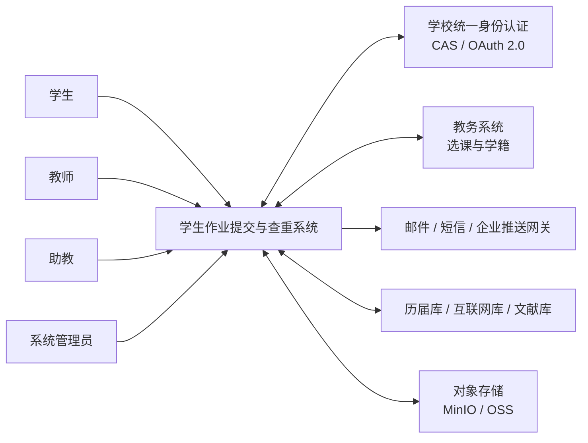
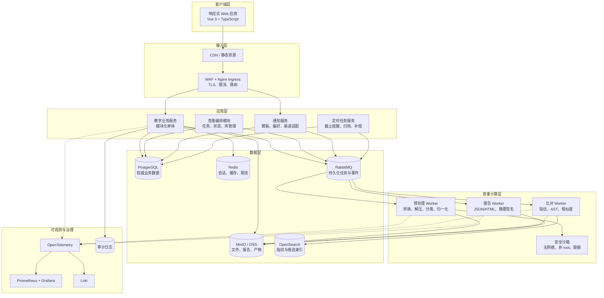
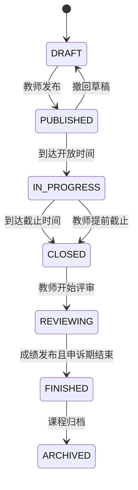
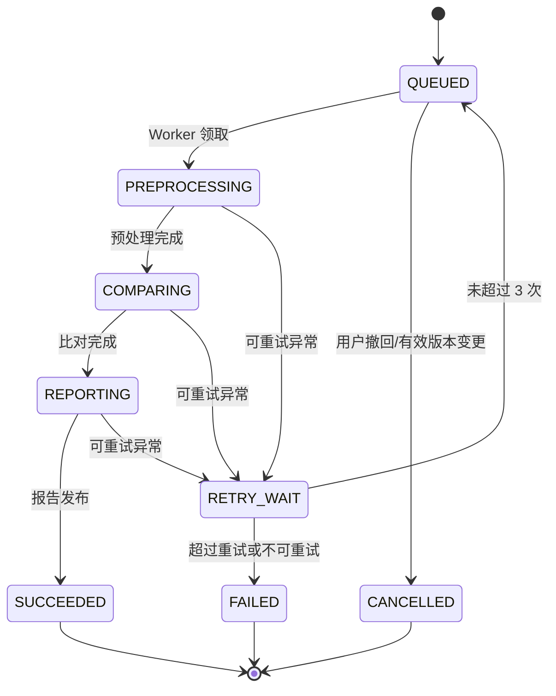
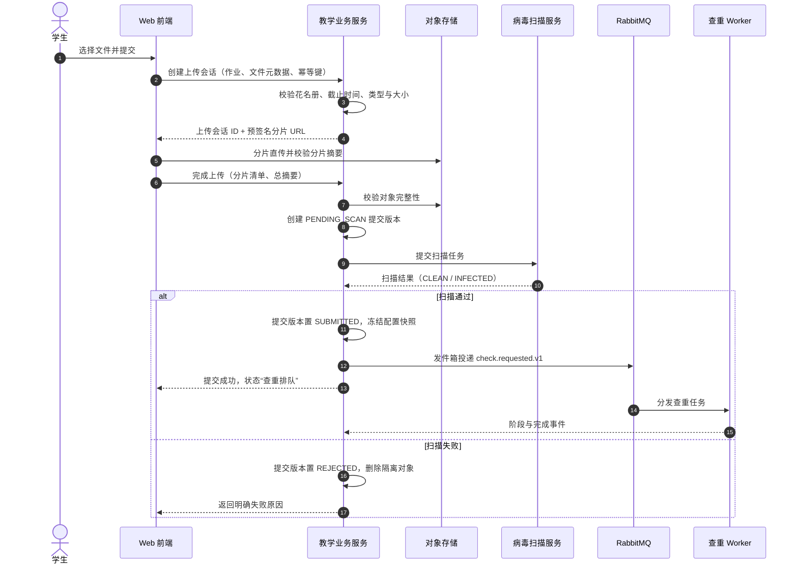
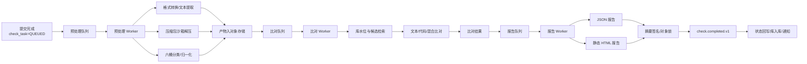
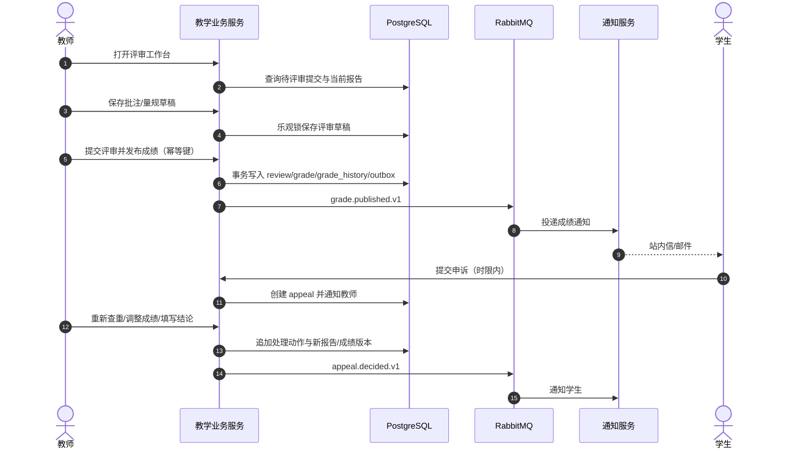
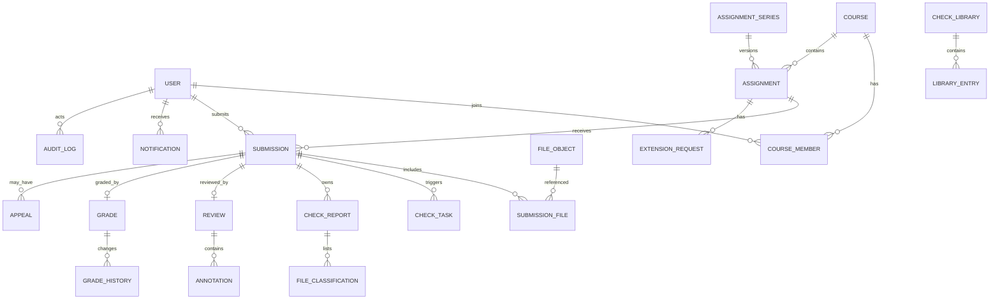

# 学生作业提交与查重系统 架构设计文档（SAD）

| 项目名称 | 学生作业提交与查重系统 |
| --- | --- |
| 文档名称 | 架构设计文档（Software Architecture Description, SAD） |
| 文档编号 | SAD-2026-001 |
| 文档版本 | V1.0 |
| 编制日期 | 2026-10-23 |
| 编制人 | 林伟豪 |
| 文档状态 | 设计基线 |
| 需求基线 | 《学生作业提交与查重系统-需求规格说明书 v1.2》 |
| 设计输入 | 《学生作业提交与查重系统-功能逻辑设计》《学生作业提交与查重系统-功能测试用例》《WBS任务分解表 v1.1》 |
| 编制规范 | ISO/IEC/IEEE 42010:2022、GB/T 8567-2006、IEEE 1016-2009 |

> 本文档描述系统的总体结构、模块边界、关键流程、数据与接口、安全、部署及质量属性实现策略，是详细设计、开发实现、测试验证、部署运维和架构评审的共同基线。若本文档与需求规格说明书冲突，以需求规格说明书 V1.2 为准；若涉及技术实现取舍，以本文档记录的架构决策为准。

## 目录

1. 文档说明
2. 架构驱动与约束
3. 架构原则与关键决策
4. 总体架构
5. 技术架构
6. 业务模块设计
7. 核心流程架构
8. 数据架构
9. 接口架构
10. 安全架构
11. 非功能设计
12. 部署架构与运维
13. 架构演进
14. 风险与应对
15. 需求追溯
16. 架构验收标准
附录 A. 查重配置示例
附录 B. 查重报告 JSON 骨架
附录 C. 架构评审检查单

## 1. 文档说明

### 1.1 目的

本文将需求规格说明书中的业务需求转化为可实现、可验证、可运维的系统结构，回答以下问题：

- 系统由哪些可独立部署单元和业务模块组成，各自承担什么职责；
- 提交、查重、评审、成绩发布、申诉等核心流程如何协同；
- 数据存放在哪里，如何保证一致性、可追溯与可复现；
- 查重引擎如何实现文本、代码和压缩包查重，如何支持算法替换和横向扩展；
- 如何满足性能、可用性、安全性、可维护性、可观测性与合规要求；
- 系统如何部署、备份、恢复、监控和逐步演进。

### 1.2 范围

本文档覆盖 SRS V1.2 定义的十大功能模块：用户与权限、课程、作业、提交、查重、评审与反馈、申诉与延期、通知、统计分析、系统管理；同时覆盖外部接口、数据架构、安全架构、部署架构和非功能设计。

不在本文档范围内：教务系统自身的选课排课、在线考试、直播教学；具体页面视觉稿、逐字段数据库 DDL、逐接口请求响应样例和算法论文级推导。上述内容分别由 UI 设计、数据库设计、接口设计、查重引擎技术方案等下游文档承接。

### 1.3 读者与用途

| 读者 | 关注重点 | 主要用途 |
| --- | --- | --- |
| 项目经理 | 范围、里程碑、风险、交付边界 | 计划管理与架构评审 |
| 需求人员 | 架构对业务规则的承接 | 需求追溯与变更影响分析 |
| 开发人员 | 模块边界、接口、数据模型、状态机 | 详细设计与编码 |
| 算法工程师 | 查重流水线、插件接口、任务模型 | 查重引擎实现与调优 |
| 测试人员 | 可测试边界、一致性策略、部署拓扑 | 集成测试、性能与安全测试设计 |
| 运维人员 | 部署单元、依赖、监控、备份恢复 | 环境建设与运行保障 |
| 评审专家 | 架构完整性、合理性、可演进性 | 设计基线评审 |

### 1.4 术语与缩略语

| 术语 | 说明 |
| --- | --- |
| SAD | Software Architecture Description，软件架构描述 |
| ADR | Architecture Decision Record，架构决策记录 |
| 模块化单体 | 单一进程部署、按业务模块严格分区、模块间通过应用接口或领域事件协作的架构形态 |
| 可独立部署单元 | 可单独构建、发布、扩缩容和监控的运行单元，不等同于微服务 |
| 事务发件箱 | Outbox Pattern，在同一数据库事务中写入业务数据和待发送事件，再由中继可靠投递 |
| 收件箱去重 | Inbox Pattern，消费方按事件 ID 去重，保证至少一次投递下的业务幂等 |
| 有效版本 | 多版本提交中参与查重、评审和成绩计算的唯一版本 |
| 水位 | 某一时刻比对库可见条目的最大顺序号，用于固定查重候选范围 |
| 隔离区 | 上传后尚未通过病毒扫描和格式校验的文件暂存区域 |
| 分层查重 | 文本指纹初筛、AST 结构比对、精确代码块匹配三层处理 |
| 文件分类桶 | 压缩包内文件按用途划分的 A 至 F 六类 |
| 预览查重 | 学生正式提交前的自查查重，仅本人可见且不入库 |
| RPO/RTO | 恢复点目标/恢复时间目标 |
| SLO | Service Level Objective，服务级别目标 |

### 1.5 参考文档

| 编号 | 文档 |
| --- | --- |
| R-01 | 《学生作业提交与查重系统-需求规格说明书 v1.2》 |
| R-02 | 《学生作业提交与查重系统-功能逻辑设计》 |
| R-03 | 《学生作业提交与查重系统-功能测试用例》 |
| R-04 | 《WBS任务分解表 v1.1》 |
| R-05 | ISO/IEC/IEEE 42010:2022 系统与软件工程 架构描述 |
| R-06 | GB/T 8567-2006 计算机软件文档编制规范 |
| R-07 | OWASP ASVS 4.0、OWASP Top 10 |
| R-08 | S3 Multipart Upload、AMQP 0-9-1、OAuth 2.0、OpenID Connect 规范 |

### 1.6 与 WBS 总体设计任务的对应关系

| WBS 任务 | 本文档对应章节 | 说明 |
| --- | --- | --- |
| 3.1 总体架构设计 | 第 3～6 章 | 架构原则、上下文、容器、模块与依赖 |
| 3.2 数据模型与数据库设计 | 第 8 章 | 逻辑数据模型、分区、存储与一致性 |
| 3.3 接口设计 | 第 9 章 | API 规范、事件契约、外部接口 |
| 3.4 界面与交互设计 | 5.2、6.2 节 | 前端架构与关键交互承载方式 |
| 3.5 查重引擎技术方案设计 | 7.2～7.5 节 | 查重流水线、算法插件、报告与压缩包处理 |
| 3.6 安全与权限设计 | 第 10 章 | 身份、权限、文件、沙箱、审计与隐私 |
| 3.7 性能与容量设计 | 11.1～11.4 节 | 性能、容量、扩展与可靠性 |
| 3.8 部署架构与运行环境设计 | 第 12 章 | 环境、网络、集群、CI/CD 与灾备 |

## 2. 架构驱动与约束

### 2.1 业务目标

系统面向高校作业教学场景，建立“发布—提交—查重—评审—反馈—申诉—归档”的完整闭环，核心业务目标是：

1. **全生命周期可追溯**：每次提交、查重、评审、成绩修改、申诉均有版本与审计记录。
2. **查重结果可信可复现**：算法版本、参数快照、比对库水位和报告摘要固化，支持申诉复核。
3. **高峰期稳定可用**：截止日前集中提交、查重不丢失、不串号；查重故障不阻断提交。
4. **多角色边界清晰**：学生、教师、助教、管理员按课程归属和业务范围严格控制数据访问。
5. **压缩包代码查重安全可控**：恶意压缩包被隔离，依赖、二进制、测试脚本等噪声被正确分类。
6. **可运营、可演进**：任务积压、失败、外部依赖异常可观测；算法、通知渠道、比对库可插拔扩展。

### 2.2 用户角色与数据边界

| 角色 | 核心操作 | 默认数据范围 | 关键限制 |
| --- | --- | --- | --- |
| 学生 | 查看作业、提交、预查重、查看本人报告与成绩、申诉、延期 | 本人选课、本人或所属小组的提交 | 不得访问他人提交、报告、成绩 |
| 教师 | 建课、发布作业、配置查重、评审、发布成绩、处理申诉与延期 | 本人负责或被授权的课程 | 不得跨课程访问；敏感操作审计 |
| 助教 | 在分配范围内评审、批注、辅助处理 | 被分配的学生/小组提交 | 不得修改作业配置、发布成绩、处理申诉 |
| 系统管理员 | 用户、角色、资源库、参数、监控、备份恢复 | 系统全局运行数据 | 业务内容访问受最小权限与审计约束 |

### 2.3 质量属性场景

| 编号 | 质量属性 | 场景 | 架构响应目标 |
| --- | --- | --- | --- |
| QA-P-01 | 性能 | 单课程 500 名学生集中提交 | 提交不丢失、不串号；除文件上传外的提交接口 P95 ≤ 1s |
| QA-P-02 | 性能 | 10 万字文本或 5000 行代码查重 | 任务开始执行后 P95 分别 ≤ 60s、≤ 90s |
| QA-P-03 | 性能 | 100MB 压缩包、100 个源码文件 | 解压分类 P95 ≤ 30s，完整查重 P95 ≤ 180s |
| QA-A-01 | 可用性 | 查重服务不可用 | 提交仍成功，任务持久化排队，恢复后自动补做 |
| QA-A-02 | 可靠性 | 数据库主节点故障 | 自动故障切换，RPO ≤ 15 分钟，RTO ≤ 2 小时 |
| QA-S-01 | 安全性 | 学生构造跨课程资源 ID | 服务端拒绝并记录审计，不泄露资源内容 |
| QA-S-02 | 安全性 | 上传 Zip Bomb 或路径穿越压缩包 | 沙箱内流式校验并拒绝，不写业务存储 |
| QA-R-01 | 可复现性 | 对查重结论发起申诉 | 依据算法版本、参数快照、库水位重算，结果可解释 |
| QA-M-01 | 可维护性 | 新增一种查重算法或语言解析器 | 通过插件注册接入，不修改业务编排代码 |
| QA-O-01 | 可观测性 | 某次查重异常变慢 | 可从提交 ID 追踪到预处理、比对、报告各阶段耗时与错误 |
| QA-C-01 | 合规性 | 课程归档、数据保留到期 | 按保留策略归档或匿名化，学术诚信记录依法保留 |

### 2.4 设计与实现约束

继承 SRS V1.2 的约束并落实为架构要求：

- **C-01 身份认证**：对接学校 CAS/OAuth 2.0 统一身份认证，同时保留受控的本地账号通道。
- **C-02 成绩导出**：成绩可导出为学生、课程、作业维度的 Excel/CSV，并支持教务接口回传。
- **C-03 算法可插拔**：查重预处理、特征提取、相似度计算和报告渲染通过稳定接口隔离。
- **C-04 文件安全**：所有上传文件先进入隔离区，经类型识别、病毒扫描和完整性校验后方可进入业务域。
- **C-05 隐私合规**：遵循《个人信息保护法》，最小化采集、目的限定、访问审计、到期处理。
- **C-06 报告可复现**：报告固化算法版本、参数、库水位、输入摘要与生成时间。
- **C-07 中文界面**：前端以中文为主，文案资源化；后端错误码稳定，界面文案可国际化。
- **C-08 压缩包隔离**：压缩包解压在无网络、非 root、只读镜像、资源受限的沙箱中执行。

### 2.5 容量与负载基线

| 维度 | 设计基线 | 说明 |
| --- | --- | --- |
| 注册用户 | 5 万 | 峰值在线用户按 10% 估算 |
| 课程/作业 | 1000 门 / 10 万份 | 单课程可含多班级、多助教 |
| 累计提交 | 100 万份 | 含多版本，不含预查重草稿 |
| API 吞吐 | 读 1000 RPS、写 200 TPS | 不包含对象存储直传流量 |
| 并发提交 | 单课程 500 人 | 通过直传对象存储和异步处理削峰 |
| 查重并发 | 基线 20 路，突发 40 路 | 按队列长度自动扩缩容 |
| 对象存储 | 初始 20TB，可在线扩容 | 含提交、预览、报告、查重中间产物 |
| 数据库 | 2TB NVMe 起步 | 报告正文和大清单放对象存储 |
| 峰值队列等待 | 正式提交 P95 ≤ 30 分钟 | 通过 40 路突发并发和公平调度控制 |

### 2.6 假设与依赖

- 学校统一身份认证提供稳定的 CAS/OAuth 2.0 接口；不可用时允许管理员本地应急登录。
- 教务系统支持定时全量或增量同步；同步失败时可使用 Excel 批量导入兜底。
- 对象存储提供 S3 兼容 API、版本控制、服务端加密和生命周期策略。
- 消息中间件支持持久化、确认机制、死信队列和至少一次投递。
- 代码查重需支持 Java、Python、C/C++、JavaScript/TypeScript、Go、C# 等主流语言；未支持语言降级为文本与 Token 查重。
- 互联网库和文献库受授权、配额与版权约束，默认关闭，异常时不得阻断核心查重。

## 3. 架构原则与关键决策

### 3.1 架构原则

| 原则 | 落地要求 |
| --- | --- |
| 业务边界优先 | 模块按业务能力划分，不以技术分层作为服务拆分依据 |
| 先单体后拆分 | 初期采用模块化单体承载教学业务，只把计算密集、异步、独立扩缩容能力拆出 |
| 提交不可变 | 提交版本、查重报告、成绩修改链只追加不覆盖，确保可追溯 |
| 异步解耦 | 查重、通知、报表聚合、外部库查询通过事件与消息队列解耦 |
| 最终一致 | 跨模块流程使用发件箱、收件箱、状态机和补偿任务，不引入分布式强事务 |
| 最小权限 | RBAC 叠加课程/分工数据范围，所有资源访问服务端二次校验 |
| 默认安全 | 上传隔离、沙箱解压、无公网对象桶、报告签名、敏感操作审计 |
| 可观测 | 每个异步任务携带 `traceId`，关键阶段输出结构化日志与指标 |
| 可替换 | 查重算法、文档解析器、通知渠道、比对源均通过适配器接口接入 |
| 证据可复现 | 报告记录输入摘要、算法版本、参数快照、库水位与输出摘要 |
| 演进式架构 | 拆分以指标为依据，避免为未来规模预付复杂度和运维成本 |

### 3.2 关键架构决策（ADR）

| 编号 | 决策 | 理由 | 代价与控制 |
| --- | --- | --- | --- |
| ADR-01 | 教学业务采用模块化单体，查重计算、通知投递独立部署 | 当前业务强关联、团队与运维规模有限；单体事务简单，查重可独立扩缩容 | 需通过模块边界、独立 schema、ArchUnit 和代码评审防止耦合成泥球 |
| ADR-02 | 主数据库选用 PostgreSQL 16+ | JSONB 适合配置快照与报告元数据；分区、部分唯一索引、窗口函数成熟；事务与一致性能力强 | 团队需具备 PostgreSQL 运维能力；复杂查询需 DBA 评审 |
| ADR-03 | 消息中间件选用 RabbitMQ，持久化队列 + 死信队列 | 延迟低、路由灵活、优先级与重试机制成熟，适合 20～40 路查重任务 | 需配置仲裁队列、发布确认、消费者幂等与积压告警 |
| ADR-04 | 查重计算内核采用 Python 独立 Worker，业务侧保持 Java | Python 生态适合文本处理、AST/Token 分析、数据算法快速迭代；避免业务主服务被计算任务拖垮 | 增加多语言工程与跨语言契约治理；核心契约使用 JSON Schema 和契约测试 |
| ADR-05 | 文件直传 S3 兼容对象存储，业务服务只签发预签名 URL | 避免大文件穿过应用服务，降低内存和带宽压力，支持分片与断点续传 | 需管控预签名有效期、上传会话状态和完成校验 |
| ADR-06 | 查重报告采用 JSON + 静态 HTML 双格式，生成后不可变 | 满足在线展示、程序读取、审计复核和防篡改要求 | 需对象锁、摘要签名、版本化访问和存储成本治理 |
| ADR-07 | 压缩包在独立无网络沙箱中流式解压 | 防止 Zip Bomb、路径穿越、符号链接和恶意文件影响主系统 | 沙箱冷启动有额外开销，通过预热池和任务批处理优化 |
| ADR-08 | 指纹候选检索使用 OpenSearch，PostgreSQL 为权威数据源 | 大规模倒排与 LSH 候选检索需要专用索引；PG 保留业务事实 | 索引可重建，需全量重建与增量补偿机制 |
| ADR-09 | 同一作业按提交顺序与库水位确定候选，排除本人历史版本 | 保证报告可复现、避免自比 100% 误报、控制计算量 | 首个提交在后续提交入库前无法反向匹配，需提供截止后一致性复核任务 |
| ADR-10 | 统计看板读取只读副本与物化视图 | 隔离报表查询对交易库的影响 | 报表存在秒级至分钟级延迟，需在界面标注数据时间 |

## 4. 总体架构

### 4.1 架构视图方法

本文档同时给出四类视图：系统上下文视图说明系统边界与外部依赖；逻辑视图说明业务模块和组件职责；运行视图说明提交、查重、评审等关键流程；部署视图说明生产环境和网络区域。模块关系采用 C4 模型的 Context/Container/Component 思路表达。

### 4.2 系统上下文



系统边界内负责教学业务、权限、文件治理、查重编排、报告与审计；身份源、教务数据、外部比对源和消息通道属于外部依赖。外部依赖不可用时必须提供降级或补偿，不得破坏提交主链路。

### 4.3 逻辑架构



### 4.4 分层职责

| 层次 | 职责 | 不允许事项 |
| --- | --- | --- |
| 客户端层 | 页面渲染、表单校验、上传控制、报告可视化、草稿本地保存 | 不承载最终权限判断，不直接访问数据库或私有对象 |
| 接入层 | TLS 终止、路由、静态资源、请求限流、请求大小限制、基础 WAF | 不实现业务状态流转，不保存业务数据 |
| 应用层 | 用例编排、事务边界、权限与数据范围校验、状态机、事件发布 | 不执行长耗时解压或相似度计算 |
| 计算层 | 文档处理、压缩包解压、代码解析、指纹与相似度计算、报告渲染 | 不直接修改业务表，不持有长期数据库凭证 |
| 数据层 | 事务数据、缓存、消息、对象、检索索引 | 不允许公网直接访问；缓存与索引不作为唯一事实来源 |
| 治理层 | 日志、指标、追踪、审计、告警、备份 | 不保存可被业务修改的原始业务数据 |

### 4.5 可独立部署单元

| 部署单元 | 形态 | 主要职责 | 扩缩容依据 |
| --- | --- | --- | --- |
| `web-app` | 静态资源 + CDN | 学生/教师/助教/管理员工作台 | CDN 自动扩展 |
| `teaching-service` | Spring Boot 无状态服务 | M1～M10 业务用例、查重编排、对外 API | CPU、RPS、P95 延迟 |
| `check-worker` | Python 容器，按角色启动 | 预处理、比对、报告三个阶段 | 队列长度、任务耗时 |
| `notification-worker` | 无状态消费者 | 站内信、邮件、短信、Webhook 投递 | 队列长度、投递失败率 |
| `scheduler` | 双副本 + 领导者选举 | 截止提醒、作业状态推进、补偿、清理 | 固定小规模 |
| `sandbox-job` | Kubernetes Job / 受限容器 | 压缩包解压、文档转换、病毒扫描隔离 | 按预处理任务创建 |

`teaching-service` 内部按模块划分包和数据库 schema，但初期作为单一进程部署。查重 Worker 独立部署，避免 CPU、内存和第三方解析库故障影响提交主链路。

### 4.6 模块间依赖规则

1. 模块仅通过应用服务接口、查询接口或领域事件协作，禁止跨模块直接写表。
2. 每个模块拥有独立 schema，例如 `iam`、`course`、`assignment`、`submission`、`checking`、`review`、`appeal`、`notification`、`analytics`、`audit`、`config`。
3. 跨模块读取通过只读查询服务或物化视图；禁止以 ORM 关联映射替代边界。
4. 共享内核只允许包含 ID、时间、结果、错误码、认证上下文等稳定基础类型。
5. 通过 ArchUnit 规则和代码评审检查循环依赖、跨模块 Repository 调用和直接表访问。
6. 领域事件按“业务事实”命名，不以“命令”命名；事件发布必须由事务发件箱完成。

### 4.7 不采用全面微服务化的理由

- 课程、作业、提交、评审、申诉之间存在强事务和强一致性关联，过早拆分会产生大量分布式事务与补偿逻辑。
- 当前系统规模的主要压力集中在文件上传和查重计算，二者已通过对象存储直传与独立 Worker 解决。
- 5 万用户、100 万提交的规模可通过模块化单体、只读副本、分区和水平扩展满足。
- 微服务会显著增加部署、链路治理、契约兼容和故障定位成本，不符合当前团队与运维成熟度。

当查重、通知或统计任一模块出现独立扩容阈值、独立发布节奏或故障隔离刚性需求时，再按现有模块边界拆分为服务。

## 5. 技术架构

### 5.1 技术选型

| 层次 | 选型 | 用途与理由 |
| --- | --- | --- |
| 前端框架 | Vue 3 + TypeScript + Vite | 组件化、响应式、生态成熟；适合复杂表单与报告页面 |
| 状态与路由 | Pinia + Vue Router | 轻量状态管理与角色路由守卫 |
| UI/可视化 | Element Plus + ECharts + PDF.js + Monaco Editor | 快速构建中文管理界面、图表、PDF 预览和代码对比 |
| 后端框架 | Java 21 LTS + Spring Boot 3.x | 企业级事务、安全、消息与可观测生态成熟 |
| 安全 | Spring Security 6 + OAuth2 Resource Server | SSO、令牌校验、方法级权限与 CSRF 防护 |
| 持久层 | MyBatis-Plus + Flyway | 复杂查询可控，数据库版本迁移可审计 |
| 查重内核 | Python 3.12 + tree-sitter + NumPy/SciPy + datasketch | 多语言 AST、指纹和相似度算法生态完善 |
| 文档处理 | LibreOffice Headless + PyMuPDF + Apache Tika | Office/PDF 转文本、预览生成与格式识别 |
| 主数据库 | PostgreSQL 16+ | 事务、JSONB、分区、部分唯一索引、只读副本 |
| 缓存 | Redis 7+ | 会话、权限缓存、限流、幂等键、热点数据 |
| 消息队列 | RabbitMQ 3.13+ | 持久化任务、优先级、延迟重试、死信队列 |
| 对象存储 | MinIO 或学校 OSS（S3 兼容） | 分片直传、生命周期、版本控制、对象锁 |
| 检索索引 | OpenSearch 2.x | 指纹倒排、LSH 候选检索、索引别名与重建 |
| 容器与编排 | Docker + Kubernetes + Helm | 滚动发布、HPA/KEDA、资源隔离、故障自愈 |
| 可观测性 | OpenTelemetry + Prometheus + Grafana + Loki + Tempo | 指标、日志、链路追踪统一关联 |
| 安全工具 | ClamAV、Trivy、SonarQube、OWASP Dependency-Check | 病毒扫描、镜像与依赖漏洞、代码质量 |

具体小版本在详细设计中锁定，并通过依赖锁定文件、SBOM 和镜像摘要保证可重复构建。

### 5.2 前端架构

前端采用按角色装配的单页应用，分为公共壳层和业务域模块：

```text
web-app/
├── app/                 应用壳、路由、主题、国际化
├── shared/              按钮、表格、状态徽章、上传器、错误边界
├── domains/
│   ├── identity/        登录、个人中心、通知偏好
│   ├── course/          课程、花名册、助教
│   ├── assignment/      作业配置、量规、查重参数
│   ├── submission/      提交、版本、进度、倒计时
│   ├── checking/        报告仪表盘、分段高亮、双栏对比、文件清单
│   ├── review/          评审工作台、批注、Rubric
│   ├── appeal/          申诉与延期
│   ├── analytics/       看板与图表
│   └── admin/           用户、资源库、参数、审计
└── platform/            API 客户端、上传器、权限指令、埋点
```

关键设计：

- **路由守卫**只用于改善体验，真实权限由服务端判定。
- **上传器**实现 5MB 分片、并行度控制、断点续传、SHA-256 校验和重试退避。
- **报告页**以 JSON 为主数据源，按页/段懒加载；HTML 报告仅用于下载或隔离 iframe 展示。
- **评审工作台**三栏布局，文档预览使用服务端转换后的 PDF，批注以相对坐标保存，避免因分辨率变化漂移。
- **状态统一**：提交、查重、评审状态使用统一颜色和语义组件，避免各页面自定义。
- **草稿保护**：在线文本与评分表定时本地保存，恢复时提示服务端版本，防止覆盖他人修改。
- **错误处理**：统一解析 RFC 9457 错误，展示可操作信息与 `traceId`，禁止静默失败。

### 5.3 后端架构

`teaching-service` 内采用清晰分层：

```text
adapter/in        REST Controller、定时入口、消息消费者
application       用例编排、事务边界、权限校验、DTO 转换
domain            实体、值对象、领域服务、状态机、领域事件
adapter/out       数据库、对象存储、消息、外部系统适配器
infrastructure    配置、日志、追踪、缓存、安全基础能力
```

约束：

- Controller 不直接调用 Repository，不承载业务规则。
- 事务边界位于应用服务；跨模块流程通过事件推进，不做跨 schema 大事务。
- 所有写操作带 `Idempotency-Key` 或业务唯一键，重复请求返回同一结果。
- 查询接口默认使用只读事务；报表查询走只读副本。
- 敏感操作在应用服务层写审计事件，与业务变更同事务提交到发件箱。

### 5.4 查重引擎技术架构

查重引擎采用“编排在业务侧、计算在独立 Worker”的结构：

- 业务侧维护 `check_task`、`check_report`、库条目和状态机，是权威事实。
- Worker 无长期业务数据库写权限，只读取任务、访问限定对象并回传结果事件。
- 三种 Worker 角色共享镜像，通过启动参数 `worker.role=preprocess|compare|report` 区分。
- 算法以插件形式注册，插件声明输入、输出、支持语言、版本和资源需求。
- 预处理产物、归一化映射、候选集和中间结果写入对象存储，便于复算与审计。
- OpenSearch 保存指纹与候选索引；索引可由对象存储和 PostgreSQL 元数据重建。

### 5.5 外部系统适配

所有外部依赖通过适配器隔离，统一实现超时、重试、熔断、限流和降级：

| 外部系统 | 适配方式 | 降级策略 |
| --- | --- | --- |
| 统一身份认证 | CAS/OAuth 2.0 适配器 | SSO 不可用时启用管理员应急本地登录；普通用户提示稍后重试 |
| 教务系统 | REST/JSON 或文件同步 | 失败时保留上次快照，允许管理员 Excel 导入 |
| 邮件/短信/企业推送 | 渠道适配器 | 站内信必达；外部渠道失败重试并记录投递状态 |
| 文献/互联网库 | 供应商 API 适配器 | 熔断后标记报告“外部库暂不可用”，核心本班查重继续完成 |
| 对象存储 | S3 兼容客户端 | 上传失败可断点续传；报告读取失败告警并重试 |
| 病毒扫描 | ClamAV 本地服务 | 扫描不可用时文件保持隔离，不进入业务存储 |

## 6. 业务模块设计

### 6.1 模块总览

| 模块 | 职责 | 关键组件 | 主要数据 | 主要依赖 |
| --- | --- | --- | --- | --- |
| M1 用户与权限 | 身份认证、用户、角色、权限、数据范围、组织 | SSO 适配器、会话服务、权限引擎、导入器 | user、role、permission、enrollment | SSO、Redis |
| M2 课程管理 | 课程、花名册、助教、分组、归档 | 课程服务、成员服务、归档任务 | course、course_member、group | M1、M3 |
| M3 作业管理 | 作业配置、状态机、量规、查重参数、白名单 | 作业服务、配置快照、量规服务 | assignment、rubric、check_config | M2、M5 |
| M4 提交管理 | 上传会话、文件校验、版本、生效规则、小组、迟交 | 上传会话服务、提交服务、版本服务 | submission、file_object、consent | M3、M5、对象存储 |
| M5 查重引擎 | 任务编排、预处理、分类、归一化、比对、报告、资源库 | 编排器、算法插件、Worker、报告服务 | check_task、check_report、file_classification、library_entry | MQ、对象存储、OpenSearch |
| M6 评审与反馈 | 评审队列、批注、量规打分、结论、批量、发布 | 评审服务、批注服务、成绩服务 | review、annotation、grade、grade_history | M4、M5、M8 |
| M7 申诉与延期 | 延期申请审批、查重/成绩申诉、复核 | 申请服务、申诉工作流 | extension_request、appeal、appeal_action | M3、M4、M6、M8 |
| M8 通知 | 事件触发、模板、偏好、渠道投递 | 路由服务、模板引擎、渠道适配器 | notification、delivery_attempt、preference | MQ、邮件/短信 |
| M9 统计分析 | 提交进度、成绩/查重分布、预警、运营看板 | 查询服务、聚合任务 | 物化视图、日聚合表 | 只读副本 |
| M10 系统管理 | 全局参数、资源库、监控、审计、公告、备份 | 配置中心、审计服务、运维接口 | system_config、announcement、audit_log | 全部模块 |

### 6.2 关键模块详细设计

#### 6.2.1 提交管理

提交管理采用“上传会话”和“提交版本”分离模型：

- **上传会话**：记录分片、校验和、过期时间、上传人、目标作业、隔离区对象；状态为 `OPEN → COMPLETED → SCANNING → CLEAN / INFECTED / FAILED`。
- **提交版本**：文件通过扫描后创建不可变提交记录，状态为 `SUBMITTED → CHECKING → CHECK_COMPLETED / CHECK_FAILED → REVIEWING → REVIEWED → PUBLISHED → CLOSED`。
- **有效版本**：独立布尔字段 `is_effective`，不得混入业务状态；通过部分唯一索引保证每个作业、每个所有者只有一条有效版本。
- **所有者键**：个人提交使用 `owner_type=USER, owner_id=user_id`；小组提交使用 `owner_type=GROUP, owner_id=group_id`，并记录实际提交人。
- **截止判断**：以服务端接收完成时间为准；延期和补交通过 `effective_deadline` 计算，不修改原始截止时间。
- **生效规则**：支持“最后一次提交 / 学生截止前手动指定 / 评审后最高分”三种配置；规则随作业配置快照固化，评审开始后不再变更。
- **幂等**：提交请求携带 `Idempotency-Key`，同一用户同一作业同一键重复提交返回原版本。
- **学术诚信**：首次正式提交记录声明版本、时间、IP、User-Agent 和确认结果，后续版本沿用同一声明链。

#### 6.2.2 查重引擎

查重模块分为四个子域：

1. **任务编排**：创建任务、分配优先级、状态推进、超时、重试、取消、补偿。
2. **预处理**：文档转换、文本清洗、压缩包解压、文件分类、代码归一化、映射保存。
3. **相似度计算**：候选检索、文本/代码/混合比对、分数聚合、证据定位。
4. **报告与资源库**：报告生成、签名、版本管理、库条目入库与剔除、白名单维护。

算法插件接口（概念契约）：

```text
Preprocessor.parse(input) -> NormalizedArtifact
FeatureExtractor.extract(artifact) -> FingerprintSet
CandidateRetriever.search(fingerprints, scope, watermark) -> CandidateSet
SimilarityMatcher.compare(artifact, candidate) -> SimilarityEvidence
ScoreAggregator.aggregate(evidences, policy) -> SimilarityResult
ReportRenderer.render(result, template) -> { json, html }
```

插件必须声明 `plugin_id`、`algorithm_version`、支持的语言/内容类型、资源上限和可复现参数；未声明版本的插件不得进入生产。

#### 6.2.3 评审与反馈

- 评审对象锁定为提交版本而非学生，避免有效版本变化导致批注错位。
- 教师开始评审时对提交版本加逻辑锁；成绩发布前学生不得变更有效版本。
- 批注保存为“页码 + 归一化坐标 + 文本范围 + 内容”，支持 PDF 旋转和缩放。
- 评审草稿与已提交评审分离；提交后修改须生成新评审版本并记录原因。
- 查重结论标记为 `ORIGINAL / SUSPECTED_PLAGIARISM / INTERVIEW_REQUIRED`，写入学术诚信档案。
- 成绩发布通过事务发件箱触发通知；修改成绩写入 `grade_history`，包含修改前后值、原因、操作人和时间。
- 匿名评审只在查询投影和界面层隐藏学生身份，真实关联仍保存在服务端并受权限与审计保护。
- 互评复用评审模型，以 `reviewer_type=STUDENT` 区分；互评任务生成前必须校验评审人已提交本人作业。

#### 6.2.4 通知

- 业务模块只发布“需要通知”的领域事件，不直接调用邮件或短信 API。
- 通知服务解析用户偏好、模板版本和渠道可用性，生成独立投递任务。
- 去重键为 `event_id + recipient_id + channel`，保证重复消费不重复送达。
- 站内信与外部渠道解耦：外部渠道失败不回滚业务，站内信始终可查。
- 截止提醒采用定时扫描 + 幂等通知记录，不为每份作业预先创建海量延迟消息。
- 模板版本在生成通知时快照，后续模板修改不影响历史通知。

#### 6.2.5 统计分析

- 交易库只承担当前业务写入与必要查询，统计查询使用只读副本。
- 提交进度、成绩分布、查重分布通过物化视图和按日聚合表计算。
- 看板结果缓存 30～60 秒，并显示数据截止时间；高风险名单不缓存或短缓存。
- 跨届对比依赖 `assignment_series_id` 关联同一课程/作业模板的历届数据。
- 所有报表查询带时间范围和课程/作业过滤，禁止无界全表扫描。

### 6.3 状态机设计

#### 6.3.1 作业状态机



状态由时间和操作共同驱动；定时任务负责自动推进，教师手动推进必须校验前置条件。归档后作业及其提交、成绩只读。

#### 6.3.2 查重任务状态机



状态更新使用 `task_version` 乐观锁；重复事件或旧 Worker 回传不得覆盖更高版本状态。

#### 6.3.3 查重报告版本

逻辑上“当前生效报告”与提交版本为 1:1，“历史报告”为 1:N。每次手动重查、参数变更重算或申诉复核生成新报告版本，旧版本归档保留。通过部分唯一索引 `(submission_id) WHERE is_current = true` 保证只有一份当前报告。

#### 6.3.4 申诉与延期状态机

```text
延期：SUBMITTED → PENDING → APPROVED / REJECTED → CLOSED
申诉：SUBMITTED → IN_REVIEW → APPROVED / REJECTED / WITHDRAWN → CLOSED
```

每次处理动作追加 `appeal_action` 或 `extension_action`，不覆盖历史结论。申诉处理可触发重新查重、成绩调整或约谈记录，所有关联动作共享同一业务追踪号。

### 6.4 并发、幂等与一致性设计

| 场景 | 并发风险 | 控制措施 |
| --- | --- | --- |
| 学生连续点击提交 | 重复版本 | 前端防抖 + 后端 `Idempotency-Key` + 唯一约束 |
| 小组多人同时提交 | 多条有效提交 | `(assignment_id, owner_type, owner_id)` 有效版本部分唯一索引 |
| 教师批量发布成绩 | 重复通知/重复状态推进 | 发布批次 ID + 状态 CAS + 发件箱去重 |
| 多个 Worker 处理同一任务 | 结果互相覆盖 | 任务认领租约 + `task_version` 乐观锁 + 结果事件幂等 |
| 有效版本变更 | 查重/评审对象错位 | 截止后冻结有效版本；评审开始后禁止变更 |
| 通知重复消费 | 重复短信/邮件 | `event_id + recipient + channel` 唯一键 |
| 资源库并发入库 | 重复条目 | `(library_id, submission_id)` 唯一约束 + 幂等 Upsert |

### 6.5 关键业务规则落实

| 规则 | 架构落实 |
| --- | --- |
| BR-01 学号全局唯一 | `user.student_no` 唯一索引；导入采用逐行校验和错误报告，重复行跳过 |
| BR-02 课程代码学期内唯一 | `(course_code, semester)` 唯一约束 |
| BR-03 截止时间约束 | 应用层校验 + 数据库检查约束；补交截止必须晚于正常截止，延期时间必须晚于当前时间 |
| BR-04 生效版本唯一 | `submission.is_effective` 配合部分唯一索引；查重、评审、成绩均引用同一提交版本 ID |
| BR-05 查重触发时机 | 正式提交由 outbox 自动触发；预查重和重查通过显式 API 创建任务类型 |
| BR-06 库入库时机 | 正式查重成功后异步写入库条目；预查重永不入库；归档课程按配置进入历届库 |
| BR-07 成绩可见性 | 成绩发布状态控制查询投影；发布前仅教师/助教可见，发布后学生可见 |
| BR-08 申诉时限 | 以首次成绩发布时间计算，默认 7 天；服务端时间判定，超时返回不可申诉错误码 |
| BR-09 延期唯一 | `(assignment_id, user_id)` 唯一约束，驳回后不重复创建，补正材料追加动作记录 |
| BR-10 权限范围 | RBAC + 课程归属 + 助教分工 + 本人/小组数据过滤，所有资源访问二次校验 |
| BR-11 迟交扣分 | 提交记录 `is_late` 和有效截止时间；成绩计算时按作业规则扣减，最低为 0，并保存计算快照 |
| BR-12 学术诚信声明 | 首次提交前强制确认，声明版本、时间、IP 与提交版本关联留痕 |
| BR-13 报告不可篡改 | 报告只追加版本、摘要签名、对象锁；重查生成新报告，旧报告归档 |
| BR-14 课程归档只读 | 课程/作业状态机禁止归档后写操作；查询与导出使用只读接口 |
| BR-15 互评前置 | 互评分配服务校验本人已提交；未提交不生成互评任务（P2） |
| BR-16 比对源默认 | 本班库配置强制为 true；文献库需教师显式启用并通过授权校验 |
| BR-17 文件分类规则 | 分类器严格按路径优先 → 测试模式 → 扩展名 → 大文件降级 → 未知归文档桶执行 |
| BR-18 查重排除规则 | 依赖目录和二进制/资源始终排除；超过 10MB 的非源码文件降级排除；C 桶默认排除可配置 |

## 7. 核心流程架构

### 7.1 作业提交与查重触发



关键点：

- 大文件不经过应用服务，应用服务只签发短期预签名 URL。
- 文件通过扫描前不得成为可评审提交；扫描不可用时保持隔离状态，不放行。
- 提交版本一旦创建即不可变；配置快照与输入摘要随版本保存。
- 查重入队失败不回滚提交，由发件箱中继重试；状态显示“排队中/待补查”。

### 7.2 异步查重流水线



阶段职责与时限：

| 阶段 | 主要处理 | 目标时限 | 超时/失败处理 |
| --- | --- | --- | --- |
| 预处理 | 下载校验、格式转换、解压、分类、归一化 | 文本 ≤ 15s；代码 ≤ 30s；压缩包 ≤ 60s（解压 ≤ 30s） | 按模式 30/60/90s 超时；可重试异常退避重试 |
| 比对 | 候选检索、三层次相似度、证据定位 | 文本 ≤ 40s；代码 ≤ 55s；压缩包 ≤ 110s | 按模式 60/90/150s 超时；外部库失败降级 |
| 报告 | JSON/HTML 渲染、校验、签名、存储 | ≤ 5s | 15s 超时；生成失败重试 |
| 总任务 | 正式提交完整查重 | 文本 ≤ 60s、代码 ≤ 90s、压缩包 ≤ 180s（P95） | 300s 硬超时；进入死信并告警 |

任务重试策略为 10s、60s、300s 三次退避；解析错误、文件损坏、安全校验失败等不可重试错误直接失败。失败不影响提交有效性。

### 7.3 压缩包代码查重流水线

压缩包处理遵循“先隔离、再分类、后计算”的原则：

```text
上传对象
  → 文件魔数与扩展名双重识别
  → 病毒扫描
  → 沙箱流式解压
  → 路径/符号链接/嵌套/体积/数量安全校验
  → 生成文件清单
  → 六桶分类与教师排除规则
  → 去重与源码归一化
  → 三层查重
  → 报告聚合与文件清单
```

文件分类桶及默认处理策略：

| 桶 | 类别 | 典型文件 | 默认处理 | 权重 |
| --- | --- | --- | --- | --- |
| A | 核心源码 | `.java`、`.py`、`.c/.cpp`、`.js/.ts`、`.go`、`.rs`、`.cs` | 参与查重 | 1.0 |
| B | 配置与构建 | `pom.xml`、`build.gradle`、`package.json`、`Dockerfile`、`application.yml` | 参与查重，仅 L1 | 0.3 |
| C | 测试脚本 | `*Test.java`、`test_*.py`、`*.spec.js`、`__tests__/*` | 默认排除，教师可开启 | 0.5 |
| D | 第三方依赖 | `node_modules/`、`vendor/`、`venv/`、`.m2/`、`target/`、`build/` | 始终排除 | — |
| E | 二进制与资源 | `.exe`、`.dll`、`.jar`、`.class`、`.so`、图片、音视频、大数据集 | 始终排除，仅记录清单 | — |
| F | 文档说明/未知 | `README.md`、说明文档、未知扩展名 | 始终排除，仅记录清单 | — |

分类优先级为：路径规则 → 测试脚本模式 → 扩展名映射 → 超过 10MB 的非源码文件降级 → 未知扩展名归 F。分类性能目标为 10000 个文件 P95 ≤ 5s，常见项目结构分类准确率 ≥ 95%。

安全与处理要求：

1. **流式限额**：边解压边累计字节数和文件数，超过 500MB 或 10000 个立即终止，不落盘超限内容。
2. **路径安全**：拒绝绝对路径、`../`、NUL 字节、设备文件、符号链接和硬链接；统一规范化路径分隔符。
3. **嵌套限制**：嵌套压缩最多 3 层，总层数按递归深度计算，超过后停止并标记。
4. **压缩比保护**：除解压体积外，增加压缩比阈值和单文件解压上限，防止慢速 Zip Bomb。
5. **沙箱约束**：无网络、非 root、只读根文件系统、临时目录 `tmpfs`、CPU/内存/磁盘/进程数限制、60 秒硬超时。
6. **去重**：同 SHA-256 文件只计算一次，但在清单中保留每个路径。
7. **教师规则**：路径优先归入第三方依赖桶；测试脚本默认排除但可按作业开启；`exclude_patterns` 使用受限 glob 语法，禁止路径逃逸。
8. **映射保留**：归一化后的 token/行号映射保存到对象存储，用于报告高亮和申诉复核。
9. **清理**：沙箱任务结束即销毁临时目录；中间产物按任务保留 7 天，报告相关产物按报告保留策略保存。
10. **准确率治理**：以 Maven/Gradle/npm/pip 等项目样本集持续评估分类准确率，低于 95% 时阻止算法版本发布并告警。

### 7.4 比对候选、库水位与顺序一致性

为保证查重结果可复现、避免自比和管理并发提交，架构采用以下规则：

1. 每次正式提交获得单调递增的 `submission_seq`，按服务端接收顺序分配。
2. 正式查重完成并成功入库后，生成 `library_seq`；任务开始时记录 `library_watermark`。
3. 候选范围默认为同一课程、同一作业、`submission_seq` 小于当前提交、且非本人/非本组的正式提交。
4. 启用历届库时，通过 `assignment_series_id` 匹配同源作业；启用课程级互查时必须由教师显式配置。
5. 预查重可读取正式库，但不得写入库；预查重报告与任务保留 30 天或按配置清理。
6. 报告保存库水位，保证按同一水位重算可得到一致候选集。
7. 同一作业截止后，可运行“封班一致性复核”补偿任务，对生效版本重新生成报告版本，补齐因并发处理造成的候选缺口；该任务为 P1 运维能力，不影响实时报告可用性。

该策略能够保证：

- 已发布报告不会因为后续提交而悄悄改变；
- 同一学生多版本不会互相判定为抄袭；
- 并发提交按确定顺序比较，不依赖 Worker 执行快慢；
- 申诉时可按原水位和算法版本复算。

### 7.5 相似度计算与报告聚合

#### 7.5.1 文本查重

处理流程：Unicode 规范化 → 去引用/模板/白名单 → 分句分段 → 中文分词或字符 N-gram → SimHash/MinHash 指纹 → 倒排与 LSH 初筛 → 精排 → 证据定位。

- 初筛：SimHash 分段汉明距离与 MinHash band 召回候选，控制在 Top-K 候选集。
- 精排：5-gram Jaccard、TF-IDF 余弦相似度、最长公共片段。
- 证据：句子级与段落级匹配区间，记录原文位置和来源位置。
- 总分：按去重后的匹配字符覆盖率计算，避免多来源重复计算；同时保留每来源相似度用于解释。

#### 7.5.2 代码查重

三层比对按成本递增执行：

| 层级 | 方法 | 输出 | 主要作用 |
| --- | --- | --- | --- |
| L1 文本指纹 | SimHash/MinHash、Token N-gram | 文件级候选对 | 快速过滤明显不相似文件 |
| L2 结构指纹 | AST 子树哈希、树编辑距离、Token 序列 | 函数/方法级结构相似 | 抵抗重命名和语句重排 |
| L3 精确证据 | N-gram + Rabin-Karp 滑动匹配 | 连续代码块位置 | 提供可视化对比证据 |

默认权重基线：L1 25%、L2 55%、L3 20%；Bucket B 只执行 L1 且按 0.3 权重计入。权重属于算法版本参数，必须经过标注样本集校准，并随报告固化，不得在运行时隐式变化。

#### 7.5.3 混合查重

对含代码段与文本段的技术报告，先通过文档结构和代码块标记分离内容，再分别调用文本/代码插件，最后统一证据坐标与总分。混合模式为 P1，未识别出代码段时降级为文本查重并记录告警。

#### 7.5.4 外部库降级

文献库、互联网库查询超时或熔断时：

- 核心本班库、历届库继续完成；
- 报告标记 `partial=true` 和不可用来源；
- 不将外部库超时误判为低相似度；
- 教师可稍后手动重查生成新报告版本。

### 7.6 报告生成、签名与防篡改

报告生成遵循“事实不可变、格式可重渲染、摘要可校验”：

1. 报告 Worker 生成规范化 JSON，包含结果、来源、证据、排除项、文件清单、算法与水位。
2. 基于 JSON 生成无脚本、无外链、内联样式的静态 HTML；所有用户内容转义。
3. 计算 JSON 规范化字节的 SHA-256，使用服务端 HMAC/KMS 签名，写入 JSON 元数据和 HTML `<meta>`。
4. 对象存储开启版本控制和对象锁，报告对象写入后禁止覆盖。
5. 数据库 `check_report` 记录摘要、签名、对象键和版本；应用数据库账号无报告对象删除权限。
6. 在线查看以 JSON 渲染为主；下载 HTML 时校验摘要和签名，校验失败告警并拒绝展示。
7. 手动重查生成新报告版本，不修改旧报告；旧报告的访问入口保留且明确标识“历史版本”。

### 7.7 评审、成绩发布与申诉



约束：

- 评审草稿不可见学生；成绩发布前不可见。
- 成绩修改必须填写原因，保留修改链并重新通知。
- 申诉时限以成绩首次发布时间为起点，延期或特殊授权需留痕。
- 申诉处理与重新查重共享业务追踪号，形成完整证据链。

### 7.8 截止提醒、状态推进与补偿

定时任务按分钟扫描，使用领导者选举和幂等记录：

| 任务 | 频率 | 幂等键 | 说明 |
| --- | --- | --- | --- |
| 作业状态推进 | 每分钟 | `assignment_id + target_state` | 开放、截止、评审期结束 |
| 截止提醒 | 每分钟 | `assignment_id + user_id + reminder_type` | 提前 24 小时、1 小时；按个人延期时间计算 |
| 查重补偿 | 每 5 分钟 | `check_task_id + attempt_bucket` | 发现长时间排队或状态停滞任务 |
| 封班复核 | 截止后一次性 | `assignment_id + effective_revision` | 可选一致性复核 |
| 归档与保留清理 | 每日 | `object_type + date_partition` | 课程归档、临时产物清理、通知过期 |
| 备份校验 | 每日 | `backup_id` | 验证备份可读与恢复演练抽样 |

提醒扫描只处理未发送记录，避免重复推送；大规模作业按 `assignment_id` 分片扫描，避免单次全表扫描。

### 7.9 课程归档

归档是状态变更而非数据搬迁：

- 课程、作业、提交、评审、成绩置只读；
- 关闭提交、查重、评审、申诉入口；
- 生成课程归档摘要和导出包；
- 历届库按配置接收归档作业指纹；
- 对象存储生命周期将冷数据迁移到低频层，但不删除报告和学术诚信记录；
- 归档操作写入审计日志，恢复归档需管理员审批。

## 8. 数据架构

### 8.1 数据域划分

| 数据域 | schema | 权威数据 | 说明 |
| --- | --- | --- | --- |
| 身份权限 | `iam` | 用户、角色、权限、会话撤销记录 | 不在日志中记录密码或完整令牌 |
| 课程 | `course` | 课程、成员、分组、助教分工 | 教务同步与手工导入共用 |
| 作业 | `assignment` | 作业、量规、查重配置、白名单 | 发布时形成配置快照 |
| 提交 | `submission` | 提交版本、文件对象、声明 | 版本不可变 |
| 查重 | `checking` | 任务、报告元数据、文件分类、库条目 | 报告正文在对象存储 |
| 评审 | `review` | 评审、批注、成绩、成绩历史 | 成绩只追加历史 |
| 申诉延期 | `appeal` | 延期、申诉、处理动作 | 永久保留 |
| 通知 | `notification` | 通知、投递尝试、偏好 | 通知内容保留 6 个月 |
| 统计 | `analytics` | 物化视图、日聚合 | 可重建，不是事实源 |
| 审计 | `audit` | 登录、业务、敏感操作日志 | 只追加、按月分区 |
| 配置 | `config` | 全局参数、模板、开关 | 带版本和缓存失效 |

### 8.2 核心实体关系



### 8.3 核心表设计要点

| 表 | 关键字段 | 关键约束/索引 |
| --- | --- | --- |
| `submission` | id、assignment_id、owner_type、owner_id、submitter_id、version_no、status、is_effective、is_late、submitted_at、idempotency_key | 部分唯一：有效版本；唯一：作业+所有者+版本号；索引：作业+状态+提交时间 |
| `file_object` | id、bucket、object_key、sha256、size、mime、scan_status、storage_class、retention_until | 唯一：bucket+object_key；索引：sha256、scan_status |
| `check_task` | id、submission_id、report_version、task_type、priority、status、attempt、config_snapshot、library_watermark、error_class、lease_until | 索引：状态+优先级+创建时间；唯一：幂等键 |
| `check_report` | id、submission_id、version、is_current、overall_score、level、algorithm_version、params_digest、json_key、html_key、digest、signature、watermark | 部分唯一：当前报告；唯一：提交+版本 |
| `file_classification` | report_id、path、size、sha256、bucket、included、exclude_reason | 索引：report_id；大表按报告创建月份分区 |
| `library_entry` | library_id、submission_id、assignment_series_id、owner_hash、fingerprint_key、seq、status | 唯一：库+提交；索引：series+seq |
| `review` | submission_id、reviewer_id、status、rubric_scores、total_score、verdict、version | 唯一：提交+评审版本；乐观锁 version |
| `grade` | submission_id、score、published、published_at、version | 唯一：提交；部分索引：published |
| `audit_log` | id、actor_id、action、target_type、target_id、detail、ip、trace_id、created_at | 只追加；按月分区；索引：actor+时间、target+时间 |
| `outbox_event` | id、aggregate_type、aggregate_id、event_type、payload、status、retry_count、next_retry_at | 索引：status+next_retry_at；唯一：event_id |
| `inbox_event` | consumer、event_id、processed_at | 唯一：consumer+event_id |

### 8.4 对象存储布局

```text
s3://edu-submission/
├── quarantine/{yyyy}/{mm}/{upload_session_id}/          上传隔离区
├── submissions/{course_id}/{assignment_id}/{submission_id}/
│   ├── original/                                        原始提交
│   ├── preview/                                         预览 PDF/图片
│   └── extracted/                                       安全解压后的受控产物
├── check-artifacts/{check_task_id}/
│   ├── normalized/                                      归一化文本、Token、映射
│   ├── fingerprints/                                    指纹中间件
│   ├── candidates/                                      候选快照
│   └── result/                                          比对结果
├── reports/{submission_id}/{report_id}/
│   ├── report.json                                      结构化报告
│   └── report.html                                      静态报告
├── evidence/{appeal_id}/                                申诉证据
└── libraries/{library_id}/                              历届库/白名单原始资料
```

存储策略：

- 所有桶禁止公共读，访问必须经业务鉴权和短期签名 URL。
- 隔离区与业务区分桶或分前缀，隔离区对象不参与任何业务查询。
- 服务端加密使用 KMS 或平台托管密钥；敏感桶可启用独立密钥。
- 上传对象启用版本控制；报告桶启用对象锁；其他桶按生命周期迁移冷存储。
- 原始文件、预览、查重产物、报告采用不同保留策略，避免“一刀切”删除。

### 8.5 Redis 使用规范

| 键空间 | 示例 | TTL | 说明 |
| --- | --- | --- | --- |
| 会话 | `sess:{sid}` | 30 分钟滑动 | 会话数据、令牌版本、撤销标记 |
| 权限缓存 | `perm:{user_id}:{version}` | 5 分钟 | 角色或权限变更后版本递增 |
| 限流 | `rl:{scope}:{key}` | 1～60 秒 | 登录、提交、查重、上传 |
| 幂等 | `idem:{user_id}:{endpoint}:{key}` | 24 小时 | 防止重复提交与重复发布 |
| 任务租约 | `check:lease:{task_id}` | 短于任务超时 | 防止多 Worker 同时执行 |
| 热点看板 | `dash:{scope}:{hash}` | 30～60 秒 | 只缓存非敏感聚合结果 |

Redis 不作为提交、成绩、报告或配额的唯一事实来源。预查重配额采用 Redis 快速预占 + 数据库配额台账最终确认，进程重启后可恢复。

### 8.6 OpenSearch 索引设计

索引 `check-fingerprint-v1` 只保存检索所需的最小字段：

| 字段 | 说明 |
| --- | --- |
| `library_id` | 比对库标识 |
| `assignment_series_id` | 作业系列，用于跨届 |
| `entry_id` | 库条目 ID |
| `owner_hash` | 所有者哈希，用于排除自比，不存明文用户 ID |
| `content_hash` | 输入内容摘要 |
| `language` | 代码语言或文本类型 |
| `simhash` | 分段 SimHash |
| `minhash_bands` | MinHash band 值 |
| `token_shingles` | 受限数量 Token shingle 哈希 |
| `created_at` | 入库时间 |

索引通过别名 `check-fingerprint-current` 切换版本，支持全量重建。PG 与对象存储为事实源，索引丢失可从库条目和查重产物重建。

### 8.7 一致性与事务策略

| 场景 | 策略 |
| --- | --- |
| 提交创建 + 查重任务 + 通知事件 | 单库本地事务写业务表与 outbox，异步投递 |
| 报告完成 + 状态回写 + 库入库 | 以报告 ID 幂等处理；库入库失败不回滚报告，后台补偿 |
| 成绩发布 + 通知 | 成绩事务 + outbox；通知重复由去重键控制 |
| 文件上传 + 元数据 | 先对象后元数据；完成回调校验对象摘要，失败对象由清理任务回收 |
| 删除/归档 | 逻辑删除或状态归档优先；物理清理走保留策略任务并审计 |
| 跨模块查询 | 只读副本或查询接口；关键写后读走主库 |

不使用跨服务分布式事务。所有跨模块流程通过“本地事务 + 事件 + 幂等消费 + 补偿任务”实现最终一致。

### 8.8 分区、索引与性能

- `audit_log`、`notification`、`outbox_event` 按月分区，过期分区直接归档或丢弃。
- `submission` 按学期或课程哈希分区；先保留普通索引，达到阈值后再分区，避免过早复杂化。
- `file_classification` 按报告创建月份分区，单报告清单同时以压缩 JSON 存对象存储。
- 时间范围查询使用 BRIN 或 B-Tree 索引；状态+时间组合使用复合索引。
- 报告列表只查摘要字段，不在列表查询中加载 JSON 正文。
- 避免在 `TEXT` 大字段上建普通索引；全文检索需求通过专用字段或 OpenSearch 实现。
- 所有分页查询必须有稳定排序键，禁止深度 `OFFSET` 扫描大表；审计和通知列表优先游标分页。

### 8.9 数据保留与归档

| 数据 | 保留策略 | 到期处理 |
| --- | --- | --- |
| 提交文件 | 课程归档后保留至毕业后 1 年 | 转冷存储，再按学校政策删除或匿名化 |
| 查重报告 | 永久保留 | 冷存储，保留摘要与签名 |
| 文件分类记录 | 随报告保留，归档后可清理明细 | 保留汇总与报告内清单 |
| 评审与成绩 | 永久保留 | 只读，按需导出 |
| 申诉记录 | 永久保留 | 只读，形成诚信档案 |
| 审计日志 | 不少于 1 年 | 归档后按合规要求处理 |
| 通知 | 6 个月 | 清理正文，保留统计 |
| 预查重报告 | 30 天或配置值 | 自动清理 |
| 查重中间产物 | 7 天 | 自动清理，报告证据除外 |
| 比对库内容 | 历届库永久保留，管理员可剔除 | 剔除后同步清理索引，报告仍保留历史快照 |

所有清理任务必须先检查引用关系和法定义务，执行前记录审计；清理采用可恢复的延迟删除策略。

### 8.10 备份与恢复

- PostgreSQL：每日增量、每周全量 + 连续 WAL 归档，支持 PITR；目标 RPO ≤ 15 分钟，RTO ≤ 2 小时。
- 支持管理员手动备份与恢复；恢复前二次确认、影响预览并记录审计。
- MinIO/OSS：开启版本控制和跨节点副本；关键报告桶启用对象锁与异地复制（条件允许时）。
- OpenSearch：每日快照；索引可由 PG 与对象存储重建。
- RabbitMQ：备份定义与策略；消息不是事实源，未完成任务由 outbox 和任务表恢复。
- 配置与密钥：配置版本化，密钥由独立密钥管理系统备份，禁止写入普通数据库备份。
- 每半年至少进行一次恢复演练，验证数据库、对象存储和报告签名校验。

## 9. 接口架构

### 9.1 API 设计规范

| 项 | 规范 |
| --- | --- |
| 风格 | REST + JSON，内部异步事件；必要时使用 gRPC 做内部健康/能力查询 |
| 版本 | URL 版本 `/api/v1`；不兼容变更升级大版本 |
| 命名 | JSON 字段 `camelCase`，数据库字段 `snake_case` |
| 时间 | ISO 8601 UTC 存储与传输，前端按 `Asia/Shanghai` 展示 |
| 分页 | `page`、`size`，默认 20，最大 100；审计类接口用游标 |
| 排序 | 白名单字段，禁止客户端传任意 SQL 片段 |
| 幂等 | 写接口支持 `Idempotency-Key`，作用域为用户+端点+资源 |
| 并发 | 评审/成绩使用 `ETag`/`If-Match` 乐观锁 |
| 追踪 | 接受并透传 W3C `traceparent`，响应返回 `X-Trace-Id` |
| 错误 | `application/problem+json`，含 `code`、`message`、`fieldErrors`、`traceId` |
| 文档 | OpenAPI 3.1，作为接口契约和 Mock/契约测试来源 |

### 9.2 主要 REST 接口

| 领域 | 方法与路径 | 说明 |
| --- | --- | --- |
| 认证 | `POST /api/v1/auth/login` | 本地登录（受控） |
| 认证 | `GET /api/v1/auth/sso/authorize` | 发起 SSO |
| 认证 | `POST /api/v1/auth/sso/callback` | SSO 回调换取会话 |
| 认证 | `POST /api/v1/auth/refresh` | 刷新访问令牌 |
| 认证 | `POST /api/v1/auth/logout` | 注销并使会话失效 |
| 个人 | `GET/PATCH /api/v1/me` | 个人信息 |
| 个人 | `PUT /api/v1/me/notification-preferences` | 通知偏好 |
| 用户 | `GET/POST/PATCH /api/v1/admin/users` | 用户管理 |
| 用户 | `POST /api/v1/admin/users/import` | Excel 批量导入 |
| 课程 | `GET/POST /api/v1/courses` | 课程列表/创建 |
| 课程 | `GET/POST /api/v1/courses/{id}/members` | 花名册 |
| 课程 | `POST /api/v1/courses/{id}/archive` | 课程归档 |
| 作业 | `POST /api/v1/courses/{id}/assignments` | 创建作业 |
| 作业 | `POST /api/v1/assignments/{id}/publish` | 发布作业 |
| 作业 | `PUT /api/v1/assignments/{id}/check-config` | 查重参数 |
| 提交 | `POST /api/v1/assignments/{id}/upload-sessions` | 创建上传会话 |
| 提交 | `POST /api/v1/upload-sessions/{id}/complete` | 完成分片上传 |
| 提交 | `POST /api/v1/assignments/{id}/submissions` | 创建提交版本 |
| 提交 | `POST /api/v1/submissions/{id}/effective` | 指定生效版本 |
| 提交 | `GET /api/v1/assignments/{id}/submissions/mine` | 本人提交历史 |
| 预查重 | `POST /api/v1/assignments/{id}/prechecks` | 发起预查重 |
| 查重 | `GET /api/v1/submissions/{id}/check-reports/current` | 当前报告 |
| 查重 | `GET /api/v1/check-reports/{id}` | 报告摘要/正文 |
| 查重 | `GET /api/v1/check-reports/{id}/manifest` | 压缩包文件分类清单 |
| 评审 | `GET /api/v1/assignments/{id}/review-queue` | 评审队列 |
| 评审 | `PUT /api/v1/submissions/{id}/review` | 保存评审草稿 |
| 评审 | `POST /api/v1/submissions/{id}/review/submit` | 提交评审 |
| 成绩 | `POST /api/v1/assignments/{id}/grades/publish` | 单份/批量发布 |
| 延期 | `POST /api/v1/assignments/{id}/extensions` | 申请延期 |
| 延期 | `POST /api/v1/extensions/{id}/decision` | 审批延期 |
| 申诉 | `POST /api/v1/submissions/{id}/appeals` | 发起申诉 |
| 申诉 | `POST /api/v1/appeals/{id}/actions` | 处理申诉 |
| 通知 | `GET /api/v1/notifications` | 站内信列表 |
| 通知 | `POST /api/v1/notifications/{id}/read` | 标记已读 |
| 统计 | `GET /api/v1/analytics/assignments/{id}/submission-progress` | 提交进度 |
| 统计 | `GET /api/v1/analytics/courses/{id}/grade-distribution` | 成绩分布 |
| 管理 | `GET/PUT /api/v1/admin/config` | 全局参数 |
| 管理 | `GET /api/v1/admin/monitoring/summary` | 运行状态 |
| 管理 | `GET /api/v1/admin/audit-logs` | 审计检索 |

接口实现时必须进行资源级授权，不得仅凭 URL 中的 ID 判断归属。

### 9.3 领域事件

统一事件信封：

```json
{
  "eventId": "019a2f6e-7a3c-7c11-8a5e-2f8f31a9b001",
  "eventType": "check.requested.v1",
  "eventVersion": 1,
  "occurredAt": "2026-10-23T02:15:30Z",
  "producer": "teaching-service",
  "aggregateType": "SUBMISSION",
  "aggregateId": "019a2f6e-7a3c-7c11-8a5e-2f8f31a9b002",
  "aggregateVersion": 3,
  "traceId": "4bf92f3577b34da6a3ce929d0e0e4736",
  "payload": {}
}
```

核心事件：

| 事件 | 生产者 | 消费者 | 用途 |
| --- | --- | --- | --- |
| `submission.accepted.v1` | 教学业务服务 | 分析、通知 | 提交成功统计与通知 |
| `file.scan.requested.v1` | 提交模块 | 扫描 Worker | 隔离文件病毒扫描 |
| `check.requested.v1` | 查重编排 | 预处理 Worker | 启动正式/预查/重查 |
| `check.prepared.v1` | 预处理 Worker | 比对 Worker | 归一化产物就绪 |
| `check.compared.v1` | 比对 Worker | 报告 Worker | 比对结果就绪 |
| `check.completed.v1` | 报告 Worker | 查重编排、通知 | 报告发布与状态回写 |
| `check.failed.v1` | Worker/编排 | 通知、监控 | 失败告警与补查 |
| `grade.published.v1` | 评审模块 | 通知、分析 | 成绩发布 |
| `appeal.decided.v1` | 申诉模块 | 通知、分析 | 申诉结论 |
| `library.entry.committed.v1` | 查重模块 | 索引服务 | 库条目进入候选索引 |
| `notification.requested.v1` | 各业务模块 | 通知服务 | 渠道投递 |

事件治理：

- 使用持久化交换机 `edu.events` 与死信交换机 `edu.events.dlx`。
- 生产端启用发布确认，消费端手动 ACK；处理失败进入重试队列，超过次数进入死信。
- 消费方按 `eventId` 去重，按 `aggregateVersion` 忽略过期事件。
- 事件只追加，不修改语义；不兼容变更发布新版本事件，双版本并行过渡。
- 事件负载不包含密码、令牌、完整报告正文和大文件内容，只传引用。
- JSON Schema 纳入代码仓库，CI 执行兼容性检查。

### 9.4 外部接口

| 接口 | 协议 | 超时 | 重试 | 说明 |
| --- | --- | --- | --- | --- |
| 统一身份认证 | CAS/OAuth 2.0/OIDC | 5s | 有限 | 用户 JIT 创建，账号状态同步 |
| 教务数据同步 | REST/JSON 或文件 | 30s | 定时重试 | 全量+增量，按学号/课程代码幂等 |
| 成绩回传 | REST/JSON 或 Excel/CSV | 30s | 人工重试 | 导出模板与字段映射可配置 |
| 对象存储 | S3 API | 30s | 分片重试 | 预签名 URL 默认 15 分钟 |
| 邮件 | SMTP/HTTP | 10s | 3 次退避 | 记录投递回执 |
| 短信 | HTTP API | 5s | 2 次 | 配额与敏感词校验 |
| 文献/互联网比对 | 供应商 API | 10s | 1 次 | 熔断、配额、授权校验 |
| 扫描仪上传（可选） | 浏览器 TWAIN/WIA → 上传 API | 30s | 分片重试 | 扫描件视同普通上传，进入隔离区并病毒扫描 |
| 病毒扫描 | 本地 ICAP/HTTP | 60s | 1 次 | 扫描失败不放行 |

### 9.5 错误与兼容性

错误码按域划分，例如 `AUTH_TOKEN_EXPIRED`、`SUBMISSION_DEADLINE_PASSED`、`CHECK_TASK_TIMEOUT`、`ARCHIVE_ZIP_BOMB_BLOCKED`。错误响应不得回显堆栈、SQL 或服务器路径。

API 兼容策略：

- 新增可选字段保持向后兼容；
- 删除字段先标记弃用并至少保留一个版本周期；
- 事件 schema 采用向后兼容演进，破坏性变更升版本；
- 前端通过契约测试防止后端字段漂移。

## 10. 安全架构

### 10.1 安全域划分

```text
公网/校园网
  → WAF/CDN
  → DMZ：Nginx Ingress（仅 443）
  → 应用区：teaching-service、notification-worker、scheduler
  → 计算区：check-worker、sandbox-job（默认无出网）
  → 数据区：PostgreSQL、Redis、RabbitMQ、MinIO、OpenSearch
  → 运维区：跳板机、监控、备份、密钥管理
```

- 数据区仅允许应用区和受控运维区访问。
- 沙箱区与数据区隔离，只能通过受控对象下载和结果回传通道通信。
- 外部比对源通过统一出口网关访问，配置域名白名单和流量审计。
- 管理后台可限制校园网/ VPN 访问，管理员操作强制 MFA（按学校策略）。

### 10.2 身份认证与会话

- 优先使用学校 SSO；本地账号仅用于管理员应急和未接入 SSO 的场景。
- 访问令牌采用短有效期 JWT（建议 15 分钟），浏览器内存保存；刷新令牌使用 `HttpOnly + Secure + SameSite` Cookie。
- Redis 保存会话版本与撤销标记；账号停用、角色变更、密码重置后立即递增会话版本。
- 连续 5 次登录失败锁定账号 30 分钟，锁定状态与计数跨节点共享。
- 密码使用 Argon2id 或满足学校策略的强哈希；禁止明文、可逆加密和日志记录。
- 所有认证事件记录登录日志，包含结果、IP、User-Agent、时间和追踪号。

### 10.3 权限模型

采用 RBAC + 数据范围 + 资源状态三重校验：

1. **功能权限**：如 `assignment:create`、`grade:publish`、`appeal:decide`。
2. **数据范围**：课程归属、助教分工、学生本人/小组、管理员全局。
3. **资源状态**：作业是否截止、成绩是否发布、课程是否归档、提交是否本人。

实现要求：

- 服务端在应用服务入口统一鉴权，Controller 不自行拼接权限逻辑。
- Repository 查询必须带数据范围条件，避免先查后判导致越权。
- 对不存在与无权访问统一返回 404，减少资源枚举。
- 管理员访问学生提交正文采用“按需授权 + 填写理由 + 审计”的破玻璃流程。
- 权限缓存按用户权限版本失效，角色/分工变更后立即失效。

### 10.4 文件与上传安全

- 文件先进入隔离区，经魔数识别、扩展名白名单、大小限制、压缩包结构检查、病毒扫描后方可转正。
- 文件名只作为展示元数据，对象键由服务端生成，禁止使用用户路径。
- 上传分片带摘要校验；完成时校验总大小、分片清单和 SHA-256。
- 对象桶禁止公共读；下载使用 5～15 分钟签名 URL，并记录访问审计。
- 预览文件与原始文件分离，预览转换在沙箱中执行。
- 对 HTML、SVG 等可执行内容强制下载或转纯文本，避免存储型 XSS。

### 10.5 压缩包沙箱

| 控制项 | 要求 |
| --- | --- |
| 运行身份 | 非 root，独立 UID，只读根文件系统 |
| 网络 | 禁用出网与入网，仅挂载任务输入输出 |
| 资源 | CPU、内存、进程数、临时磁盘、文件句柄限额 |
| 时间 | 解压 60 秒硬超时，完整预处理 120 秒 |
| 文件系统 | 临时目录 `tmpfs`，任务结束销毁 |
| 解压库 | 使用流式、可限额的解析库，禁用自动执行与外部解压器 |
| 路径 | 规范化后必须位于任务根目录；拒绝绝对路径、`..`、符号链接、设备文件 |
| 嵌套 | 最多 3 层，总解压体积与文件数跨层累计 |
| 审计 | 记录压缩包摘要、拒绝原因、任务 ID，不记录文件正文 |

### 10.6 查重报告完整性

- 报告 JSON 与 HTML 生成后计算摘要并签名。
- 报告对象启用版本控制和对象锁，应用账号无删除/覆盖权限。
- 在线查看使用 JSON 渲染，HTML 下载前校验签名。
- 报告版本只追加，重查生成新版本；旧报告不可修改，只能归档。
- 报告访问记录用户、时间、IP、报告版本和追踪号。
- 报告中的来源文本遵守版权约束，仅展示必要片段和出处。

### 10.7 审计

审计范围包括：

- 登录、登出、失败登录、账号锁定；
- 用户增删改、角色与权限变更、账号停用；
- 课程归档、作业发布/编辑、查重参数修改；
- 提交、删除/撤回、有效版本变更；
- 查重任务创建、重查、失败、报告访问；
- 评审提交、成绩发布、成绩修改；
- 延期审批、申诉处理、约谈结论；
- 资源库入库/剔除、全局参数变更、备份恢复。

审计日志只追加，按月分区，保留不少于 1 年；敏感操作审计与业务事务同事务写入 outbox，避免漏记。

### 10.8 隐私与合规

- 收集字段遵循最小必要原则，统计与索引中使用哈希或假名。
- 日志默认脱敏手机号、邮箱、令牌、文件内容；仅保留必要审计字段。
- 学生数据仅用于教学、查重、评审和学术诚信管理，不用于未授权训练或共享。
- 外部比对源须校验授权范围和数据处理协议，不存储供应商原文。
- 数据保留到期后按策略删除或匿名化；学术诚信、申诉等法定义务记录依法保留。
- 提供数据导出与更正流程，删除请求需经过合规评估和审批。
- 生产数据不得直接复制到开发/测试环境；测试使用脱敏或合成数据。

### 10.9 应用安全与供应链

- 防 SQL 注入：参数化查询、白名单排序、禁止字符串拼接 SQL。
- 防 XSS：输出编码、CSP、报告 HTML 无脚本、富文本白名单清洗。
- 防 CSRF：刷新令牌 Cookie 使用 SameSite；状态变更接口校验 CSRF Token 或使用 Bearer 头。
- 防 SSRF：外部 URL 白名单、禁止访问内网地址和云元数据地址。
- 防 IDOR：资源级授权与数据范围过滤。
- 防暴力破解：登录、验证码、短信、查重接口限流与告警。
- 防依赖漏洞：依赖锁定、SBOM、Trivy/Dependency-Check、镜像签名。
- 防供应链攻击：基础镜像固定摘要、构建环境隔离、制品仓库准入。

### 10.10 威胁与控制对照

| 威胁 | 典型攻击 | 控制 |
| --- | --- | --- |
| 身份伪造 | 撞库、令牌窃取 | SSO、短令牌、刷新令牌 HttpOnly、失败锁定、MFA |
| 越权访问 | 修改课程/提交 ID | 数据范围过滤、资源状态检查、统一 404 |
| 文件攻击 | 木马、伪装扩展名 | 魔数识别、ClamAV、隔离区、禁止执行 |
| 资源耗尽 | Zip Bomb、超大文件、查重滥用 | 沙箱限额、流式校验、配额、限流、队列背压 |
| 报告篡改 | 修改 HTML/JSON | 摘要签名、对象锁、版本化、访问审计 |
| 数据泄露 | 公共桶、日志泄露、导出滥用 | 私有桶、签名 URL、脱敏、导出审批与审计 |
| 重放/重复 | 重复提交、重复发布 | 幂等键、唯一约束、事件去重 |
| 供应链 | 恶意依赖/镜像 | SBOM、扫描、签名、固定版本 |

## 11. 非功能设计

### 11.1 性能设计

| 措施 | 作用 |
| --- | --- |
| 文件直传对象存储 | 避免大文件占用应用内存和线程 |
| 分片上传与断点续传 | 提高弱网成功率，降低重复上传 |
| Redis 缓存权限/热点 | 减少数据库访问 |
| 查询走只读副本 | 隔离统计与交易负载 |
| 分页/懒加载/摘要字段 | 控制报告和大清单响应体 |
| 异步查重 | 提交快速返回，避免同步长事务 |
| KEDA 按队列扩缩容 | 峰值增加 Worker，空闲回收 |
| 指纹初筛 + 分层精排 | 控制候选对比计算量 |
| 物化视图/日聚合 | 复杂统计预计算 |
| CDN 静态资源 | 降低首屏和带宽压力 |

性能验证以 SRS NFR-P-01～P-11 为验收基线，测试需覆盖正常、峰值、队列积压和单节点故障场景。

### 11.2 可用性与可靠性

- 应用无状态多副本，滚动发布，配置就绪/存活探针。
- PostgreSQL 主备 + 自动故障切换；RabbitMQ 仲裁队列；Redis Sentinel；MinIO 多节点纠删码。
- 查重 Worker 故障时任务租约到期后重新入队，不丢失任务。
- 查重不可用时提交成功，状态显示“排队/待补查”，恢复后自动补偿。
- 外部库、邮件、短信故障采用熔断与降级，不影响核心业务提交和报告查看。
- 所有消费者幂等，重复消息不会产生重复成绩、通知或库条目。
- 关键写操作使用唯一约束和乐观锁，防止并发覆盖。

### 11.3 可扩展性

- `teaching-service` 无状态，可按 CPU/RPS 水平扩容。
- 查重三阶段按队列独立扩缩容，可针对预处理、比对分别加机器。
- 算法、通知渠道、比对源、文档解析器均通过插件/适配器接入。
- OpenSearch 索引按版本别名切换，支持重建和扩容。
- 数据库按时间/课程分区，冷数据迁移对象存储。
- 通过 `assignment_series_id` 支持跨届比对；通过 `library_id` 支持新增库类型。
- 逻辑模块边界为后续服务拆分预留接缝，但拆分必须有容量或组织证据。

### 11.4 可维护性与可测试性

- 模块内分层，模块间契约稳定；ArchUnit 检查依赖。
- API 使用 OpenAPI，事件使用 JSON Schema，执行契约测试。
- 查重算法建立“黄金样本集”，每次算法升级回归相似度排序与关键证据。
- 数据库迁移使用 Flyway，遵循 expand-migrate-contract，兼容滚动发布。
- 单元测试、集成测试、端到端测试、性能测试、安全测试分层执行。
- 配置外置并版本化，避免环境差异导致行为漂移。
- 关键业务规则（生效版本、截止时间、成绩可见性、库规则）必须有自动化测试。

### 11.5 可观测性

| 维度 | 内容 |
| --- | --- |
| 指标 | API QPS/P95、错误率、上传成功率、扫描时长、队列长度、任务各阶段耗时、重试/死信数、报告生成时长、通知送达率、DB 连接数、缓存命中率 |
| 日志 | 结构化 JSON，含 `traceId`、`requestId`、用户哈希、资源 ID、阶段、耗时、错误码；禁止记录正文与令牌 |
| 追踪 | 从 HTTP 请求到 outbox、消息消费、对象存储、算法阶段的全链路 span |
| 告警 | 查重队列积压、任务失败率、死信增长、报告生成失败、DB 复制延迟、磁盘水位、证书到期、外部依赖熔断 |
| 业务看板 | 提交量、查重量、评审量、高风险报告数、通知失败数、活跃用户 |

SLO 建议：

- 提交 API 可用性 ≥ 99.5%；
- 查询接口 P95 ≤ 500ms，写入 P95 ≤ 1s；
- 正式查重任务成功率 ≥ 99%，失败可补偿；
- 通知站内信成功率 ≥ 99.9%；
- 报告读取 P95 ≤ 3s。

### 11.6 备份与容灾

| 项 | 目标/策略 |
| --- | --- |
| RPO | PostgreSQL ≤ 15 分钟；对象存储近实时/小时级 |
| RTO | 核心业务 ≤ 2 小时；查重恢复 ≤ 4 小时 |
| 备份 | 每日增量、每周全量 + WAL 连续归档；对象存储版本/复制；OpenSearch 快照 |
| 演练 | 每半年至少一次，覆盖数据库、对象、报告签名和队列恢复 |
| 降级 | 查重/通知/统计不可用时，提交与查看已发布内容保持可用 |
| 故障切换 | 数据库主备切换、应用多副本、消息队列仲裁、缓存 Sentinel |

### 11.7 兼容性与易用性架构支持

- 前端响应式适配 1280×720 及以上和平板，核心操作支持键盘与快捷操作。
- 浏览器兼容 Chrome 90+、Edge 90+、Firefox 88+、Safari 14+。
- API 版本兼容，旧版前端在一个发布周期内可用。
- 中文文案资源化，后端错误码稳定，支持后续多语言。
- 长列表统一分页/排序/筛选，错误提示含可操作建议和追踪号。
- 关键不可逆操作二次确认，批量操作预览影响范围。

## 12. 部署架构与运维

### 12.1 环境规划

| 环境 | 用途 | 数据 | 发布方式 |
| --- | --- | --- | --- |
| 开发 | 日常开发与单元测试 | 合成数据 | 本地容器 |
| 集成 | 模块联调、契约测试 | 脱敏/合成 | 自动部署 |
| 预生产 | 性能、安全、UAT、演练 | 脱敏数据 | 生产同构部署 |
| 生产 | 正式运行 | 真实数据 | 灰度/滚动发布 |

开发、测试环境不得连接生产数据库或共享生产对象桶。预生产环境应与生产使用相同镜像、配置结构和网络分区，仅规模和密钥不同。

### 12.2 生产部署拓扑

```mermaid
flowchart TB
    U["用户浏览器"] --> WAF["WAF / CDN"]
    WAF --> ING["Nginx Ingress<br/>TLS / 限流"]

    subgraph K8S["Kubernetes 集群"]
        subgraph APP["应用节点池"]
            API["teaching-service<br/>3～10 副本"]
            NOTI["notification-worker<br/>2～4 副本"]
            SCH["scheduler<br/>2 副本 + 领导选举"]
        end
        subgraph WORK["查重节点池"]
            PRE["preprocess worker<br/>4～10"]
            CMP["compare worker<br/>4～10"]
            RPT["report worker<br/>2～4"]
            SBX["sandbox-job<br/>按需"]
        end
    end

    subgraph DATA["数据节点池"]
        PG[("PostgreSQL<br/>主 + 2 备")]
        REDIS[("Redis Sentinel ×3")]
        MQ[("RabbitMQ 仲裁队列 ×3")]
        OS[("OpenSearch ×3")]
        MINIO[("MinIO ×4 / 学校 OSS")]
    end

    ING --> API
    ING --> NOTI
    API --> PG
    API --> REDIS
    API --> MQ
    API --> MINIO
    SCH --> PG
    SCH --> MQ
    MQ --> PRE
    MQ --> CMP
    MQ --> RPT
    PRE --> SBX
    PRE --> MINIO
    CMP --> OS
    CMP --> MINIO
    RPT --> MINIO
    NOTI --> MQ
    NOTI --> PG
```



### 12.3 网络与访问控制

- 仅 443 端口对用户开放；管理入口限制来源网段或 VPN。
- 应用节点访问数据区通过安全组/NetworkPolicy 白名单。
- 查重 Worker 仅访问消息队列、对象存储和 OpenSearch；不允许访问公网。
- 沙箱 Job 禁止网络，输入通过挂载只读对象或受控下载代理传入。
- 外部依赖通过统一出口网关，启用 DNS 白名单、TLS 校验和流量日志。
- 数据库、缓存、消息、检索和对象存储不暴露公网。

### 12.4 资源规划基线

| 组件 | 初始规格 | 数量 | 扩展方式 |
| --- | --- | --- | --- |
| teaching-service | 8 vCPU / 16GB | 3 | HPA 按 CPU/RPS，扩至 10 |
| notification-worker | 4 vCPU / 8GB | 2 | 按队列长度扩至 4 |
| scheduler | 2 vCPU / 4GB | 2 | 领导选举，不水平扩业务 |
| preprocess worker | 8 vCPU / 24GB | 4 | KEDA 按队列扩至 10 |
| compare worker | 8 vCPU / 32GB | 4 | KEDA 按队列扩至 10 |
| report worker | 4 vCPU / 8GB | 2 | 扩至 4 |
| PostgreSQL | 16 vCPU / 64GB / 2TB NVMe | 1 主 2 备 | 垂直扩容 + 读副本 |
| Redis | 4 vCPU / 16GB | 3 Sentinel | 主从 + 哨兵 |
| RabbitMQ | 4 vCPU / 8GB | 3 | 仲裁队列 |
| OpenSearch | 8 vCPU / 32GB / 2TB SSD | 3 | 增加数据节点 |
| MinIO | 8 vCPU / 32GB / 20TB | 4 | 增加节点/容量 |

以上为生产初始基线，最终以性能测试和学校实际预算调整。小规模试点可采用 3 台物理/虚拟机收敛部署，但必须保留独立数据卷、备份和资源隔离。

### 12.5 Kubernetes 工作负载

| 工作负载 | 副本 | 探针 | 扩缩容 | PDB |
| --- | --- | --- | --- | --- |
| web-app | 由 CDN/静态服务托管 | HTTP | CDN | 不适用 |
| teaching-service | 3+ | `/health/live`、`/health/ready` | HPA CPU/RPS | minAvailable 2 |
| notification-worker | 2+ | 进程健康、队列消费健康 | KEDA 队列 | minAvailable 1 |
| check-preprocess | 4+ | 任务心跳 | KEDA 队列 | minAvailable 2 |
| check-compare | 4+ | 任务心跳 | KEDA 队列 | minAvailable 2 |
| check-report | 2+ | 任务心跳 | KEDA 队列 | minAvailable 1 |
| scheduler | 2 | 领导者状态、心跳 | 固定 | minAvailable 1 |

关键配置：

- `teaching-service` 使用 `readinessGate`，数据库/Redis/消息未就绪时不接流量。
- 查重 Worker 使用 `terminationGracePeriodSeconds` 等待当前任务安全释放租约。
- 沙箱任务使用独立 `RuntimeClass`（如 gVisor）和污点节点池，禁止与业务 Pod 混部。
- 所有 Pod 设置 requests/limits，防止单任务耗尽节点资源。

### 12.6 CI/CD

```text
提交代码
  → 代码规范/静态分析
  → 单元测试 + 契约测试
  → 构建镜像 + SBOM + 漏洞扫描 + 镜像签名
  → 部署集成环境 + 集成测试
  → 部署预生产 + 性能/安全回归
  → 人工审批
  → 生产灰度/滚动发布
  → 冒烟测试 + 指标观察
  → 自动回滚或继续放量
```

发布要求：

- 数据库迁移采用 expand-migrate-contract，先加兼容字段/索引，再切代码，最后清理旧结构。
- 前端与后端 API 保持至少一个版本兼容窗口。
- 查重算法升级需版本化并在预生产用黄金样本回归，禁止直接替换线上算法版本。
- 配置变更走版本化和审计，敏感密钥由外部密钥管理注入。
- 生产发布保留制品、SBOM、测试报告和变更记录。

### 12.7 配置与密钥

- 环境配置通过 Kubernetes ConfigMap/Secret 或外部配置中心注入。
- 系统运行参数（阈值、配额、文件大小、开关）存 `system_config`，带版本、生效时间和审计。
- 密钥、数据库口令、签名密钥、外部 API 凭证使用 Vault/KMS/Secret Manager，不进入代码仓库。
- 配置读取带本地缓存和失效通知；关键安全参数变更需二次确认。
- 功能开关包括：混合查重、互联网/文献库、封班复核、批量通知、匿名评审等。

### 12.8 运维与故障处理

| 故障 | 检测 | 处理 |
| --- | --- | --- |
| 查重队列积压 | 队列长度、等待时间告警 | 扩容 Worker、限制预查重、通知运营 |
| 查重任务持续失败 | 失败率/死信告警 | 暂停对应算法版本、回滚插件、重放死信 |
| 对象存储不可用 | 上传/下载错误率 | 提交转排队、报告读取降级、启用重试 |
| 数据库主库故障 | 复制/健康告警 | 自动切换、应用重连、核对未完成任务 |
| 消息重复/丢失 | 去重表、outbox 状态 | 幂等消费、从 outbox 重放 |
| 外部库超时 | 熔断指标 | 标记报告部分完成、稍后重查 |
| 证书过期 | 到期告警 | 自动续期/手工替换 |

运维手册必须包含：查重任务重放、报告版本回退查看（不修改）、库索引重建、对象存储清理、数据库 PITR、队列死信处理、密钥轮换和灾备切换。

## 13. 架构演进

### 13.1 阶段一：核心闭环（P0）

- 模块化单体、PostgreSQL、Redis、RabbitMQ、MinIO。
- 用户权限、课程、作业、提交、文本/代码查重、报告、评审、成绩发布、通知、审计。
- 实现上传直传、异步查重、报告签名、基础监控。
- 目标：完成 SRS P0 功能与端到端测试。

### 13.2 阶段二：质量与规模化（P1）

- 引入 OpenSearch 指纹索引和 KEDA 弹性扩缩容。
- 压缩包六桶分类、沙箱解压、分层查重和文件清单报告。
- 历届库、白名单、预查重配额、统计分析、只读副本。
- 完整可观测性、备份恢复演练、性能压测和安全加固。

### 13.3 阶段三：精细化与生态（P2）

- 混合查重、互评、匿名评审、跨届对比。
- 文献/互联网库按授权接入，外部结果可解释展示。
- 封班一致性复核、算法评估平台、标注样本管理和相似度阈值校准。
- 在容量或组织边界出现明确需求时，按模块拆分查重编排、通知或分析服务。

### 13.4 拆分触发条件

满足以下任一条件时评估服务拆分，而非提前拆分：

- 单模块独立发布频率显著高于其他模块；
- 单模块资源消耗或故障影响无法通过副本和资源隔离控制；
- 团队规模导致单仓库/单部署协调成本超过拆分成本；
- 数据量或并发超过模块化单体 + 只读副本的设计上限；
- 合规要求需要独立数据域或独立部署。

## 14. 风险与应对

| 风险 | 影响 | 概率 | 应对 |
| --- | --- | --- | --- |
| 查重算法误判/漏判 | 学术争议、申诉增加 | 中 | 多算法证据、人工复核、黄金样本回归、阈值可配置、报告透明 |
| 压缩包分类准确率不足 | 依赖或测试脚本噪声导致误报 | 中 | 规则+扩展名+路径+大文件降级；建立 MIME/项目结构样本集；持续监控分类准确率 |
| 截止日查重积压 | 学生等待时间长 | 高 | KEDA 弹性扩容、正式/预查分离、公平调度、排队进度展示、预查限额 |
| 外部库不可用 | 报告不完整 | 中 | 熔断降级、标记 partial、核心库优先、稍后重查 |
| 大文件/恶意压缩包 | 存储与计算资源耗尽 | 中 | 沙箱、流式限额、压缩比限制、隔离区、病毒扫描 |
| 跨模块耦合退化 | 难以维护和拆分 | 中 | 独立 schema、ArchUnit、代码评审、事件契约 |
| 报告存储成本增长 | 存储费用增加 | 中 | JSON+HTML 压缩、冷热分层、中间产物 7 天清理、报告摘要常驻 |
| 单点数据库/队列故障 | 业务中断 | 低 | 主备、仲裁队列、自动切换、备份与演练 |
| 隐私合规争议 | 合规风险 | 低 | 最小化、脱敏、审计、授权、保留策略和审批 |
| 多语言技术栈运维成本 | 故障定位复杂 | 中 | 契约测试、统一追踪、镜像标准化、职责边界清晰 |

## 15. 需求追溯

### 15.1 功能需求到架构组件

| 需求范围 | 主要模块/组件 | 关键架构机制 | 主要验证 |
| --- | --- | --- | --- |
| FR-U-01～06 用户与权限 | M1、SSO 适配器、权限引擎、网关 | SSO、会话撤销、RBAC+数据范围、导入幂等 | TC-U、越权与登录安全测试 |
| FR-C-01～05 课程管理 | M2、教务适配器、归档任务 | 课程状态机、成员/分组、归档只读 | TC-C、归档与权限测试 |
| FR-A-01～06 作业管理 | M3、配置快照、量规服务 | 作业状态机、配置版本化、白名单 | TC-A、状态流转测试 |
| FR-S-01～06 提交管理 | M4、上传会话、提交版本、文件对象 | 直传、分片、幂等、有效版本唯一、迟交计算 | TC-S、并发提交和断点续传测试 |
| FR-K-01～09 文本/代码/报告/队列/库 | M5、查重编排、Worker、OpenSearch | 异步流水线、插件、库水位、报告签名 | TC-K-01～19、专项测试 |
| FR-K-10～15 压缩包查重 | M5、沙箱、分类器、分层算法、文件清单 | 流式安全解压、六桶分类、AST/Token、报告清单 | TC-K-20～38、E2E-06 |
| FR-R-01～09 评审反馈 | M6、评审/成绩服务、预览服务 | 版本锁定、批注坐标、成绩历史、批量幂等 | TC-R、评审发布测试 |
| FR-E-01～05 申诉延期 | M7、工作流服务、审计 | 状态机、时限、追加动作、复核 | TC-E、E2E-03/04 |
| FR-N-01～04 通知 | M8、事件消费者、渠道适配器 | 事件驱动、模板快照、偏好、去重 | TC-N、通知送达测试 |
| FR-ST-01～06 统计分析 | M9、只读副本、物化视图 | 预聚合、缓存、数据时间标识 | TC-ST、性能测试 |
| FR-AD-01～06 系统管理 | M10、配置中心、审计、监控 | 参数版本、审计只追加、备份恢复 | TC-AD、审计与恢复测试 |

### 15.2 非功能需求到架构策略

| 需求 | 架构策略 | 验证方式 |
| --- | --- | --- |
| NFR-P-01～11 | CDN、直传、缓存、异步、分批、KEDA、分层算法 | 性能压测、容量测试、队列积压测试 |
| NFR-S-01～11 | TLS、SSO、RBAC、隔离区、ClamAV、沙箱、签名、审计、限流 | 安全测试、渗透测试、压缩包恶意样本 |
| NFR-Q-01～11 | 多副本、持久队列、幂等、插件、追踪、备份、可读性设计 | 故障注入、恢复演练、可维护性评审 |
| BR-01～18 | 唯一约束、状态机、数据范围、配置快照、库规则、文件分类 | 规则测试、端到端测试、数据一致性测试 |

### 15.3 测试用例映射

架构测试重点对应 SRS 与测试用例：

- 功能：TC-U/C/A/S/K/R/E/N/ST/AD 全量；
- 端到端：TC-E2E-01～06；
- 非功能：TC-NFR-01～15；
- 业务规则：TC-BR-01～06；
- 额外架构验证：死信重放、报告签名、库水位复算、索引重建、数据库主备切换、对象存储恢复、跨课程越权。

## 16. 架构验收标准

架构评审通过应满足：

1. 系统上下文、逻辑架构、部署架构和数据关系图完整，且与 SRS V1.2 一致。
2. M1～M10 均有明确模块归属、数据归属和接口边界。
3. 提交、查重、评审、成绩发布、申诉、归档六条核心流程均有运行视图和异常路径。
4. 文本、代码、混合、压缩包查重均有处理流程、算法版本、参数快照和失败降级。
5. 有效版本、查重报告版本、成绩修改链、申诉处理链具备唯一约束和不可变策略。
6. 上传隔离、病毒扫描、沙箱解压、路径穿越、Zip Bomb、对象桶权限均有明确控制。
7. 查重任务支持持久化、优先级、重试、死信、恢复和幂等。
8. 报告 JSON/HTML 双格式、摘要签名、对象锁和历史版本策略可落地。
9. RBAC + 数据范围 + 资源状态三重鉴权覆盖所有资源接口。
10. 性能、容量、可用性、扩展、备份恢复均给出可验证指标和实现策略。
11. 所有 P0 需求均有架构承载和测试追溯；P1/P2 需求有明确演进位置。
12. 关键决策（ADR）已记录理由、代价和控制措施，并经项目组评审确认。

## 附录 A. 查重配置示例

以下为作业级查重配置的概念示例，字段以详细设计为准：

```yaml
check_config:
  mode: CODE                 # TEXT / CODE / MIXED
  compare_scope:
    class_library: true       # 本班库默认必选，不可关闭
    historical: false
    internet: false
    literature: false
  thresholds:
    text_warn: 20
    text_severe: 50
    structure_warn: 50
    structure_flag: 70
  archive:
    include_buckets: [A, B]
    include_tests: false
    exclude_patterns:
      - "examples/*"
      - "demo/*"
    max_archive_size_mb: 100
    max_uncompressed_size_mb: 500
    max_files: 10000
    max_nested_depth: 3
  normalization:
    remove_comments: true
    remove_blank_lines: true
    normalize_identifiers: true
    normalize_strings: true
    normalize_numbers: true
    normalize_indent: true
    sort_imports: true
  precheck:
    enabled: true
    max_times: 3
```

配置在作业发布时形成快照；发布后修改必须提示影响范围，并对已生成报告提供“重新查重”选择。

## 附录 B. 查重报告 JSON 骨架

```json
{
  "schemaVersion": "1.0",
  "reportId": "019a2f6e-7a3c-7c11-8a5e-2f8f31a9b010",
  "submissionId": "019a2f6e-7a3c-7c11-8a5e-2f8f31a9b002",
  "reportVersion": 2,
  "mode": "CODE",
  "algorithm": {
    "pluginId": "code-similarity",
    "version": "1.2.0",
    "paramsDigest": "sha256:..."
  },
  "configSnapshot": {},
  "libraryWatermark": 18422,
  "overall": {
    "score": 62.4,
    "level": "WARNING",
    "eligibleFiles": 38,
    "includedFiles": 35,
    "excludedFiles": 3
  },
  "sources": [
    {
      "sourceType": "CLASS",
      "sourceRef": "submission:...",
      "score": 62.4,
      "structureScore": 78.1,
      "matchedBlocks": 3
    }
  ],
  "segments": [],
  "excludedItems": [],
  "archiveManifest": {
    "totalFiles": 156,
    "bucketA": 35,
    "bucketB": 4,
    "bucketC": 5,
    "bucketD": 89,
    "bucketE": 20,
    "bucketF": 3
  },
  "generatedAt": "2026-10-23T02:20:00Z",
  "digest": "sha256:...",
  "partial": false
}
```

## 附录 C. 架构评审检查单

- [ ] 上下文边界是否与 SRS 1.2 范围一致；
- [ ] 每个模块是否拥有清晰的数据所有权和接口；
- [ ] 是否存在跨模块直接写表或循环依赖；
- [ ] 提交、报告、成绩是否满足不可变与版本化；
- [ ] 有效版本与评审/查重对象是否一致；
- [ ] 查重失败是否不阻断提交；
- [ ] 预查重是否不入库且仅本人可见；
- [ ] 压缩包沙箱是否无网络、限额、路径安全；
- [ ] 报告是否具备摘要、签名、对象锁和历史版本；
- [ ] 权限是否覆盖功能、数据范围、资源状态；
- [ ] 敏感操作是否审计且日志不可篡改；
- [ ] 外部依赖是否有超时、熔断、降级；
- [ ] 队列是否有重试、死信、重放和积压告警；
- [ ] 是否有备份、恢复演练和灾备目标；
- [ ] 性能指标是否可测试、容量是否可扩展；
- [ ] 是否完成需求—架构—测试追溯。

