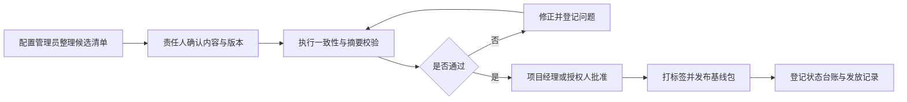
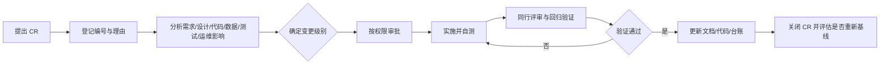

# 学生作业提交与查重系统 配置基线说明（CBM）

| 项目 | 内容 |
| --- | --- |
| 项目名称 | 学生作业提交与查重系统 |
| 文档名称 | 配置基线说明（Configuration Baseline Memorandum, CBM） |
| 文档编号 | DOC-CM-001 |
| 文档版本 | V1.0 |
| 基线编号 | BL-PRJ-2026-001 |
| 基线类型 | 项目集成文档基线（含需求、设计、测试与计划资产） |
| 基线状态 | 冻结候选，待批准 |
| 编制日期 | 2026-10-24 |
| 编制人 | 林伟豪 |
| 上游基线 | 需求基线 BL-REQ-1.2；设计基线 BL-DES-1.0 |
| 受控方式 | Git 标签 + 基线清单 + SHA-256 + 变更单 + 审批记录 |
| 发放范围 | 项目经理、需求/设计/开发/测试/运维负责人、甲方项目联系人 |
| 参照规范 | GB/T 8567-2006、IEEE Std 828-2012、ISO 10007:2017、ISO/IEC/IEEE 12207:2017 |

> 本文档规定学生作业提交与查重系统的配置项识别、基线组成、版本规则、变更控制、状态记录与发布归档方式。本文档不替代需求、设计、测试文档；发生内容冲突时，需求范围以《学生作业提交与查重系统-需求规格说明书 V1.2》为准，技术实现取舍以《学生作业提交与查重系统-架构设计文档 V1.0》记录的架构决策为准。

## 目录

1. 文档说明
2. 项目与基线概况
3. 配置管理组织与职责
4. 配置项识别与命名
5. 当前配置基线
6. 基线规划与建立
7. 版本控制与库管理
8. 变更控制
9. 配置状态记录与审核
10. 发布、交付与归档
11. 当前差距与整改计划
12. 审批与生效
13. 修订记录
附录 A. 基线文件校验和
附录 B. 变更申请单模板
附录 C. 配置状态台账模板
附录 D. 发布基线检查单
附录 E. 轻量核验方法

## 1. 文档说明

### 1.1 目的

本文档用于建立学生作业提交与查重系统可核对、可追踪、可复现的配置基线，回答以下问题：

- 哪些文档、代码、数据库脚本、测试资产和发布制品属于受控配置项；
- 某一时点被批准、冻结的准确版本及其摘要是什么；
- 由谁提出变更、由谁评估、由谁批准、变更后如何重新建立基线；
- 开发、测试、发布和生产环境分别应使用哪一份版本；
- 发生争议、故障或申诉复核时，如何证明当时使用的版本和参数。

本文档是项目配置管理的总入口，也是配置审核、发布评审和交付验收的依据之一。

### 1.2 范围

本版基线覆盖项目当前已有的需求、设计、测试和计划类文档，并规定后续源代码、数据库迁移、构建配置、部署配置、发布制品与运维记录的纳入方式。

本版基线**不包含**以下内容：

- 尚未产生的应用源代码、容器镜像和可执行制品；
- 生产环境中的学生作业、查重报告、成绩、申诉等业务数据；
- 第三方文献库、互联网比对源的原始内容；
- 密钥、口令、证书私钥和外部服务凭证；
- 个人临时文件、编辑器缓存、自动生成文件和未评审草稿。

查重算法、参数、比对库水位等影响报告可复现性的信息，应随每次发布或每份报告单独固化，不直接复制进本文档。

### 1.3 编制依据

| 序号 | 依据文件 | 版本/状态 | 用途 |
| --- | --- | --- | --- |
| 1 | 学生作业提交与查重系统-需求规格说明书v1.2.md | V1.2，评审基线 | 确定项目范围、需求优先级、验收要求和变更边界 |
| 2 | 学生作业提交与查重系统-架构设计文档.md | V1.0，设计基线 | 确定架构、技术栈、部署单元和设计决策 |
| 3 | 学生作业提交与查重系统-数据库设计文档.md | V1.0，设计基线 | 确定数据库 schema、约束、迁移和保留策略 |
| 4 | 学生作业提交与查重系统-接口设计文档.md | V1.0，设计基线 | 确定 REST API、事件契约、兼容和弃用规则 |
| 5 | 学生作业提交与查重系统-功能测试用例.md | V1.0（本次基线登记） | 确定功能、业务规则和端到端验证范围 |
| 6 | 学生作业提交与查重系统-功能逻辑设计.md | V1.0 | 提供设计背景和功能闭环说明 |
| 7 | WBS任务分解表v1.1.xlsx | v1.1 | 提供任务分解和计划参照 |
| 8 | 用例图.png | 本次基线登记 | 提供角色与用例关系附件 |

### 1.4 术语与缩略语

| 术语 | 说明 |
| --- | --- |
| 配置项（CI） | 需要单独识别、版本化并受变更控制的工作产品，如文档、源代码、数据库脚本、部署配置或发布包 |
| 基线（Baseline） | 经评审或批准后冻结的一组配置项及其版本，作为后续变更和验收的参照 |
| 配置管理（CM） | 对配置项识别、版本控制、变更控制、状态记录和配置审核进行管理的过程 |
| 变更控制委员会（CCB） | 对重大变更进行影响评估和批准的责任组；本项目采用轻量小组形式 |
| 变更申请（CR） | 记录变更原因、内容、影响、验证和批准情况的受控记录 |
| 基线清单（Manifest） | 记录基线内每个配置项编号、版本、位置、摘要和状态的清单 |
| 校验和（Checksum） | 由文件内容计算的摘要，用于发现文件被误改或替换；本项目采用 SHA-256 |
| 冻结（Freeze） | 在基线段内停止直接修改，后续修改必须经过变更流程 |
| 配置漂移（Drift） | 实际环境、部署制品或文件内容与已批准基线不一致的状态 |
| 金样本集（Golden Sample） | 用于回归验证查重分类、算法和阈值稳定性的固定样本集合 |
| SBOM | Software Bill of Materials，软件物料清单，记录构建所用组件及版本 |
| 语义化版本 | 采用 `MAJOR.MINOR.PATCH` 表示兼容性变化：不兼容升级 MAJOR，兼容新增升级 MINOR，修正升级 PATCH |
| 制品摘要 | 容器镜像摘要或构建产物摘要，如 Docker `image@sha256:...` |

### 1.5 中小团队裁剪原则

本项目按“控制充分、流程轻量、证据可查”的原则裁剪配置管理活动，不照搬大型组织的高频审批和专用配置管理系统。

| 管理领域 | 本项目做法 | 不采用的做法 |
| --- | --- | --- |
| 组织 | 配置管理工程师可由项目经理、技术负责人或测试负责人兼任；重大变更组成 3～5 人微型 CCB | 设立独立配置管理部、专职 CCB 秘书 |
| 工具 | 一个 Git 仓库、一个共享制品目录、一份基线台账、一套 Markdown 模板 | 同时维护多个配置库、部署重型 CMDB |
| 分支 | `main` 加短生命周期 `feature/*`、`fix/*`、`release/*`、`hotfix/*` 分支 | 长期并行多个开发分支和复杂多级分支 |
| 评审 | 普通变更 1 名同行评审；高风险变更 2 名评审；紧急变更事后补审 | 所有变更固定 3 人以上会签 |
| 基线频率 | 仅在需求、设计、测试、开发、发布等关键关口建立正式基线 | 每次提交或每天创建正式基线 |
| 状态记录 | 一份汇总台账 + Git 标签 + 每月一次 15 分钟核对 | 每次变更生成多份周报、月报和专项报告 |
| 审核 | 基线建立时自检；每月抽查；每次发布前专项审核 | 每周全量人工盘点全部文件 |
| 规模升级 | 团队超过 20 人、出现多项目并行或独立发布节奏时，再评估分库、分权和自动化审批 | 在项目初期过度设计 |

## 2. 项目与基线概况

### 2.1 项目范围

系统面向高校教学场景，覆盖“作业发布—提交—查重—评审—反馈—申诉—归档”的教学闭环，支持文本作业与代码作业查重，服务学生、教师、助教和系统管理员四类角色。

需求共识别 10 个功能域：

| 功能域 | 编号范围 | 主要配置关注点 |
| --- | --- | --- |
| 用户与权限管理 | FR-U-01～06 | 登录、RBAC、数据范围、账号停用和审计 |
| 课程管理 | FR-C-01～05 | 课程、花名册、助教授权、课程归档 |
| 作业管理 | FR-A-01～06 | 作业配置、查重参数、量规、状态流转 |
| 提交管理 | FR-S-01～06 | 多版本提交、生效版本、迟交、文件校验 |
| 查重引擎 | FR-K-01～15 | 文本/代码/混合/压缩包查重、算法版本与报告 |
| 评审与反馈 | FR-R-01～09 | 批注、量规评分、成绩发布、批量和匿名评审 |
| 申诉与延期 | FR-E-01～05 | 申诉时限、处理过程、延期审批 |
| 通知 | FR-N-01～04 | 事件触发、渠道、模板和用户偏好 |
| 统计分析 | FR-ST-01～06 | 看板、统计口径、异常预警 |
| 系统管理 | FR-AD-01～06 | 全局参数、监控、审计、备份和比对库 |

### 2.2 当前基线概况

截至 2026-10-24，项目处于“需求与设计完成、测试资产已编制、开发制品尚未形成”的阶段。

| 项目 | 当前状态 |
| --- | --- |
| 需求基线 | 已形成。SRS V1.2 共 68 条功能需求，其中 P0 43 条、P1 22 条、P2 1 条；另有 11 条 UI、11 条性能、11 条安全、11 条质量属性、18 条业务规则和 6 个用例 |
| 设计基线 | 已形成。架构、数据库和接口设计均为 V1.0，状态为设计基线 |
| 测试基线 | 已形成候选。测试用例覆盖 SRS 第 3.2 节和主要业务规则，共 159 条编号用例；尚未见原文档的正式批准状态 |
| 计划资产 | WBS v1.1 可用，作为范围与任务参照，不作为产品验收依据 |
| 源代码与构建 | 尚未形成，未纳入本基线 |
| 版本控制现状 | 当前目录尚未初始化为 Git 仓库，文件以本地工作目录保存 |
| 正式发布 | 尚未发生，不建立产品发布基线 |

因此，本版建立的是**项目集成文档基线**，不是可交付的生产发布基线。开发与发布基线应在满足第 6 章入口条件后分别建立。

### 2.3 基线目标

1. **唯一性**：同一时间每个受控配置项只有一个有效版本，旧版本只能作为历史记录。
2. **可追溯性**：每项变更能追溯到需求、设计、代码、测试、发布和审批记录。
3. **可复现性**：依据基线和制品摘要可重建同一版本的构建与部署，查重报告可复算。
4. **受控性**：基线形成后不得直接覆盖，变更须经申请、评估、批准和验证。
5. **适度性**：流程和记录量与 5～15 人团队相匹配，优先保证关键风险受控。

## 3. 配置管理组织与职责

### 3.1 角色与职责

中小团队允许一人兼任多个角色，但重大变更的申请人与最终批准人不得为同一人。

| 角色 | 主要职责 | 建议兼任方式 |
| --- | --- | --- |
| 项目负责人/项目经理 | 批准基线和重大变更；主持微型 CCB；协调资源和发布窗口 | 项目负责人可由技术负责人之外的人员担任 |
| 配置管理工程师 | 维护配置项清单和状态台账；建立标签与基线包；组织配置审核；保管变更记录 | 可由测试负责人或项目助理兼任 |
| 需求负责人 | 维护 SRS、需求优先级和需求追溯；评估需求变更影响；确认验收口径 | 由需求分析人员担任 |
| 设计/技术负责人 | 维护架构、数据库、接口和关键设计决策；评估技术变更；确保方案一致性 | 可由后端技术负责人担任 |
| 开发负责人 | 执行分支与提交规范；保证代码、单元测试、数据库迁移和构建可复现 | 各开发单元可设一名代码所有者 |
| 测试负责人 | 维护测试用例、测试数据和金样本；确认回归范围与测试结论 | 可由质量负责人兼任 |
| 运维/发布负责人 | 维护环境配置、部署清单、回滚方案、监控和备份；记录生产变更 | 试点阶段可由开发负责人兼任 |
| 全体成员 | 不直接覆盖已基线文件；通过分支和 CR 提交修改；配合配置审核 | 所有成员均有遵守义务 |

### 3.2 职责分配（RACI）

说明：A=最终负责，R=执行，C=被咨询，I=被通知。

| 活动 | 项目经理 | 配置管理员 | 需求负责人 | 技术负责人 | 开发负责人 | 测试负责人 | 运维负责人 |
| --- | --- | --- | --- | --- | --- | --- | --- |
| 建立文档基线 | A | R | C | C | I | C | I |
| 变更需求范围或 P0 优先级 | A | R | R | C | C | C | I |
| 变更架构、数据库或接口 | C | R | C | A | R | C | C |
| 变更查重算法、权重或阈值 | A | R | C | R | R | C | C |
| 代码合并与构建 | I | C | I | A | R | C | I |
| 建立测试基线 | I | R | C | C | C | A | I |
| 发布前配置审核 | A | R | I | C | C | C | R |
| 生产紧急回滚 | A | C | I | C | C | I | R |
| 基线归档与备份 | I | R | I | I | I | I | C |

### 3.3 微型变更控制委员会

本项目不设常设大型 CCB。发生重大变更时，由以下人员组成微型 CCB：

- 项目经理（主持和最终决策）；
- 配置管理工程师（记录、核对影响和更新基线）；
- 技术负责人（技术可行性、风险与工作量）；
- 测试负责人（验证范围与回归风险）；
- 需求负责人（涉及范围、验收或优先级时参加）；
- 运维负责人（涉及部署、数据、安全或回滚时参加）。

决策规则：

1. 会议由项目经理召集，可采用 30 分钟线上会议或异步书面评审。
2. 至少项目经理、配置管理员和技术负责人参与；涉及测试或运维影响时必须通知对应负责人。
3. 以协商一致为主；无法一致时由项目经理决定，但关键反对意见必须记入 CR。
4. 重大变更决策目标时限为 5 个工作日，普通变更目标时限为 3 个工作日。
5. 涉及生产安全的紧急变更可先处置、后补批，但必须在 1 个工作日内补齐记录，2 个工作日内完成基线更新。

## 4. 配置项识别与命名

### 4.1 配置项分类与受控等级

| 类别代码 | 配置项类别 | 典型内容 | 受控等级 |
| --- | --- | --- | --- |
| PLN | 计划与项目管理 | WBS、里程碑、资源计划、风险清单 | C2 |
| REQ | 需求 | SRS、用例、需求附件、需求追溯矩阵 | C1 |
| DES | 设计 | 架构、数据库、接口、功能逻辑、设计决策记录 | C1 |
| TST | 测试 | 测试计划、测试用例、测试数据、金样本、测试报告 | C1 |
| CM | 配置管理 | 基线说明、配置台账、变更单、审核记录 | C1 |
| SRC | 源代码 | 前端、教学业务服务、查重 Worker、通知与调度、沙箱任务 | C1 |
| DB | 数据库 | Flyway 迁移脚本、初始化脚本、参考数据、DDL 基线 | C1 |
| CFG | 配置 | 环境配置模板、功能开关、部署参数、算法参数模板 | C1 |
| BLD | 构建与流水线 | CI/CD 定义、依赖锁文件、构建脚本、代码质量规则 | C1 |
| REL | 发布制品 | 镜像、安装包、发布说明、SBOM、签名和摘要 | C1 |
| OPS | 运维记录 | 部署记录、回滚记录、监控规则、巡检与演练报告 | C2 |
| REF | 外部参考 | 标准、第三方文档、开源许可证说明 | C2 |

受控等级定义：

- **C1 严格受控**：必须版本化、纳入基线、经过评审和变更控制；未经批准不得直接修改。
- **C2 登记受控**：纳入清单并记录版本和责任人；修改需通知配置管理员，不要求每次变更召开评审。
- **C3 不纳入基线**：临时文件、缓存、本地日志、个人草稿、自动生成且可由源文件重建的中间产物。

### 4.2 配置项编号

统一格式：

```text
<类别>-<业务域或制品>-<三位序号>
```

示例：

| 编号 | 含义 |
| --- | --- |
| DOC-REQ-001 | 第 1 项需求类文档 |
| DOC-DES-002 | 第 2 项设计类文档 |
| SRC-TEACHING-001 | 教学业务服务源代码单元 |
| SRC-CHECK-WORKER-001 | 查重 Worker 源代码单元 |
| DB-MIG-001 | 第 1 项数据库迁移资产 |
| CFG-PROD-001 | 生产环境配置模板 |
| BLD-CI-001 | 持续集成流水线定义 |
| REL-APP-001 | 应用发布制品 |

文档类配置项在正文中使用 `DOC-<域>-<序号>`，文件名继续保留可读中文名称。已有已评审文档不因编号规则而立即改名；编号与文件路径的映射以本文件和后续台账为准。

### 4.3 文件命名与版本标识

新文件建议采用：

```text
学生作业提交与查重系统-<文档主题>v<主版本>.<次版本>.<扩展名>
```

规则：

1. 文件名中不出现“最终版”“最新版”“修改版”等无法比较的词。
2. 已基线文档的修改不得覆盖原文件；应生成新版本并登记旧版本为“已替代”。
3. 现有文件名如 `v1.2`、`v1.0` 保持稳定，避免破坏引用；语义统一由台账管理。
4. 二进制附件（图片、演示文稿、测试样本包）不得超过 5 MB 直接提交 Git；超过时存入制品库，并在台账记录摘要和访问路径。
5. 任何密钥、令牌、证书私钥、真实个人数据不得进入文件名、正文、Git 历史或基线包。

### 4.4 配置库结构

当前项目文件位于同一工作目录，尚未初始化 Git。初始化仓库后建议采用以下目标结构：

```text
student-homework-check/
├─ docs/
│  ├─ 01-plan/
│  ├─ 02-requirements/
│  ├─ 03-design/
│  ├─ 04-test/
│  ├─ 05-configuration/
│  └─ 06-release/
├─ src/
│  ├─ web-app/
│  ├─ teaching-service/
│  ├─ check-worker/
│  ├─ notification-worker/
│  ├─ scheduler/
│  └─ sandbox-job/
├─ db/
│  └─ migration/
├─ deploy/
│  ├─ helm/
│  ├─ config/
│  └─ scripts/
├─ tests/
│  ├─ unit/
│  ├─ integration/
│  ├─ contract/
│  ├─ e2e/
│  └─ fixtures/
├─ baseline/
│  └─ BL-PRJ-2026-001/
├─ .github/workflows/      或 .gitlab-ci.yml
├─ CHANGELOG.md
└─ README.md
```

迁移原则：

- 当前已评审文档不立即移动或重命名，先完成首次 Git 提交并记录当前路径。
- 下一次文档实质性修订时，再迁移至目标目录，并同步更新所有引用链接。
- 代码、数据库脚本、部署配置和测试代码自首次提交起即按目标结构组织。
- `baseline/` 目录存放基线清单、发布说明和校验和，不存放重复的大体积制品。

### 4.5 纳入与排除规则

**纳入基线：**

- 已批准或冻结的需求、设计、接口、数据库和测试文档；
- 可构建产品的源代码、依赖锁文件、数据库迁移和部署配置；
- 影响查重结论的算法插件版本、权重、阈值模板和金样本集版本；
- 发布镜像、SBOM、测试报告、发布说明和回滚方案；
- 与生产环境对应且不含密钥的环境配置清单。

**排除基线：**

- 旧版本文件中已被明确替代的版本（只保留归档，不再作为有效配置项）；
- `~$` 临时锁文件、编辑器备份、本地缓存、构建中间产物；
- 个人草稿、未评审会议记录、AI 生成过程记录；
- 密钥值、令牌、证书私钥、数据库口令；
- 可随时由源文件重建且无需审计的中间文件。

### 4.6 有效版本优先级

当同一内容存在多个来源时，按以下顺序判定：

1. 已批准的基线清单和 Git 标签；
2. 需求范围与验收口径以 SRS V1.2 为准；
3. 技术实现与架构取舍以架构设计文档和 ADR 为准；
4. 接口字段以接口设计文档和 OpenAPI 契约为准；
5. 数据库结构以数据库设计文档和已合并的 Flyway 迁移为准；
6. 实际部署以发布清单、镜像摘要和部署记录为准。

口头说明、即时聊天、个人本地文件不得作为正式基线依据。

## 5. 当前配置基线

### 5.1 基线组成

基线编号：`BL-PRJ-2026-001`  
基线快照日期：`2026-10-24`  
基线状态：冻结候选，待项目负责人批准后生效

| 配置项编号 | 名称 | 当前版本 | 状态 | 责任角色 | SHA-256 前 16 位 |
| --- | --- | --- | --- | --- | --- |
| DOC-REQ-001 | 需求规格说明书 | V1.2 | 已评审需求基线 | 需求负责人（黄小容） | `3CEE732E3813E488` |
| DOC-REQ-002 | 用例图 | V1.0（基线登记） | 需求附件 | 需求负责人 | `151B62D5EAF7ACC3` |
| DOC-DES-001 | 功能逻辑设计 | V1.0 | 设计输入 | 设计负责人 | `E516C2C2FDBE8763` |
| DOC-DES-002 | 架构设计文档 | V1.0 | 设计基线 | 设计负责人（林伟豪） | `2607CF7DC25CED1D` |
| DOC-DES-003 | 数据库设计文档 | V1.0 | 设计基线 | 设计负责人（林伟豪） | `7AAFEF69ACDF7B0C` |
| DOC-DES-004 | 接口设计文档 | V1.0 | 设计基线 | 设计负责人（林伟豪） | `70FC5294BC22EEC7` |
| DOC-TST-001 | 功能测试用例 | V1.0（基线登记） | 冻结候选 | 测试负责人 | `3F8A687F08B8187B` |
| DOC-PLN-001 | WBS 任务分解表 | v1.1 | 计划参考 | 计划负责人（林伟豪） | `5981FA3AD86E2661` |
| DOC-CM-001 | 本配置基线说明 | V1.0 | 冻结候选 | 配置管理工程师 | 批准后登记 |

注：

- DOC-REQ-002 和 DOC-TST-001 原文件未标注版本号，本次按内容快照登记为 V1.0；下一次实质性修改升为 V1.1。
- DOC-CM-001 作为自身基线记录，不嵌入自身摘要，以免形成自引用。其批准后的摘要记录在配置状态台账和 Git 标签中。
- WBS 文件在计算摘要时可能处于编辑器的打开状态；校验和对应磁盘上已保存的内容，任何未保存修改不进入本基线。

### 5.2 需求基线内容

需求基线 `BL-REQ-1.2` 以 SRS V1.2 为准，冻结范围包括：

| 内容类别 | 数量/范围 | 基线约束 |
| --- | --- | --- |
| 功能需求 | 68 条，FR-U/C/A/S/K/R/E/N/ST/AD | P0 共 43 条，是首个可发布版本的必备范围 |
| P1 需求 | 22 条 | 进入第二阶段或经批准后纳入当前发布；延期必须登记 |
| P2 需求 | 1 条（FR-R-09 互评） | 不阻断 P0/P1 交付，变更优先级须经 CCB |
| 用户界面需求 | UI-01～11 | P0 功能对应界面须在发布前完成验证 |
| 性能需求 | NFR-P-01～11 | 以 P95、并发量、容量和压缩包处理指标为验收口径 |
| 安全需求 | NFR-S-01～11 | 不做“上线后补做”；权限、文件安全和审计为发布必要条件 |
| 质量属性 | NFR-Q-01～11 | 可靠性、可维护性、可观测性、合规性等纳入验收 |
| 业务规则 | BR-01～18 | 必须落实为约束、状态机校验或自动化测试 |
| 用例 | UC-01～06 | 用于端到端场景验证 |
| 设计与实现约束 | C-01～08 | 涉及 SSO、成绩导出、算法可插拔、文件安全、隐私和沙箱 |
| 假设与依赖 | A-01～07 | 外部依赖失效时应记录风险并启动降级或替代方案 |

需求基线特别规则：

1. 本班库默认开启且不可关闭；文献库默认关闭，须教师显式选择且具备授权。
2. 预查重不进入正式比对库，正式查重完成后按业务规则入库。
3. 查重报告生成后不可修改；重查生成新报告版本。
4. 压缩包查重只默认比对核心源码桶 A 与配置构建桶 B；桶 C 默认排除但教师可开启；桶 D/E/F 始终排除。
5. 任何 P0 需求删除、验收口径降低、优先级降级均属于重大变更。

### 5.3 设计基线内容

设计基线 `BL-DES-1.0` 冻结以下内容和关键决策：

- **总体架构**：教学业务采用模块化单体，查重计算、通知投递和沙箱任务按独立部署单元隔离；初期不全面微服务化。
- **技术栈**：Vue 3 + TypeScript 前端；Java 21 + Spring Boot 3.x 教学业务服务；Python 3.12 查重 Worker；PostgreSQL 16+；Redis 7+；RabbitMQ 3.13+；MinIO/OSS；OpenSearch 按阶段引入。
- **数据设计**：按业务域划分 schema；提交、报告、成绩和申诉采用版本化或只追加策略；数据库迁移使用 Flyway，已应用脚本不得修改。
- **接口设计**：REST + JSON，当前 API 版本 `/api/v1`；接口契约以 OpenAPI 3.1 为唯一事实来源；不兼容变更升级大版本。
- **查重证据**：报告必须固化算法版本、参数摘要、比对库水位、输入摘要和生成时间；报告采用 JSON 与静态 HTML 双格式并防篡改。
- **安全设计**：RBAC 加数据范围校验；上传隔离、病毒扫描、沙箱解压、路径穿越检查、ZIP Bomb 防护和审计留痕。
- **运行设计**：开发、集成、预生产、生产环境分离；配置通过 ConfigMap/Secret 或受控配置注入；密钥不得进入代码仓库。

设计基线中的具体库小版本不在本文档手工锁定，应在开发基线和发布基线中通过依赖锁文件、SBOM 和镜像摘要固定。

### 5.4 测试与计划资产

- DOC-TST-001 覆盖 SRS 第 3.2 节功能需求、主要业务规则、非功能专项和端到端场景，共 159 条编号用例。
- 测试资产当前为冻结候选。正式建立 `BL-TST-1.0` 前，应确认用例评审记录、责任人、测试环境和测试数据来源。
- P0 需求必须有至少一条正向用例和适用时的异常用例；业务规则 BR-01～18 必须有验证证据或明确的人工检查项。
- 查重算法、文件分类和阈值相关测试应使用固定金样本集；金样本集本身属于 C1 配置项。
- WBS v1.1 用于任务分解和范围核对；计划日期变化不自动触发产品基线变更，但影响 P0 范围、外部依赖或发布窗口时必须登记 CR。

### 5.5 基线边界

本基线冻结的是文档内容、结构关系和版本事实，不冻结以下动态状态：

- 项目成员在本地编辑器中的未保存修改；
- 尚未评审的测试结果和缺陷；
- 生产环境实时配置值；
- 查重比对库的实时入库水位；
- 外部教务系统、统一认证、文献库和通知渠道的实时可用性。

这些动态状态应在发布记录、测试报告、运行台账或查重报告中单独固化。

### 5.6 完整性与一致性要求

本次基线应满足：

1. 清单中所有文件存在，大小和 SHA-256 与附录 A 一致。
2. SRS V1.2 与设计文档中的范围、角色、术语、接口和状态机无未解释冲突。
3. 数据库实体与 SRS 3.7 节一致；接口路径和状态枚举与数据库、业务规则一致。
4. 10 个功能域均有设计承载和测试用例覆盖。
5. 不含旧版 SRS、旧版 WBS、临时锁文件和密钥。
6. 本文件审批后，其状态从“冻结候选”转为“已批准基线”，并在台账登记生效日期。

## 6. 基线规划与建立

### 6.1 基线类型与当前状态

| 基线编号 | 类型 | 主要内容 | 当前状态 | 建立或触发条件 |
| --- | --- | --- | --- | --- |
| BL-REQ-1.2 | 需求基线 | SRS V1.2、用例及需求附件 | 已建立 | SRS 已标记评审基线且需求范围可执行 |
| BL-DES-1.0 | 设计基线 | 架构、数据库、接口、功能逻辑 | 已建立 | 设计文档标记设计基线，关键决策可追溯 |
| BL-TST-1.0 | 测试基线 | 测试用例、测试数据、金样本、测试计划 | 候选 | 测试负责人确认覆盖、评审记录和数据来源 |
| BL-DEV-1.0 | 开发基线 | 源代码、迁移脚本、依赖锁、构建配置 | 未建立 | P0 代码完成合并，主分支构建成功，单元和契约测试通过 |
| BL-REL-1.0.0 | 发布基线 | 镜像、SBOM、测试报告、部署清单、发布说明 | 未建立 | 发布候选版本通过发布门禁并获批准 |
| BL-OPS-1.0.0 | 运行基线 | 生产镜像摘要、配置版本、迁移版本、算法版本、库水位 | 未建立 | 首次生产部署完成并核对无漂移 |
| BL-PRJ-2026-001 | 项目集成文档基线 | 本次冻结的需求、设计、测试和计划资产 | 冻结候选 | 本文件获批并完成标签登记 |

`BL-PRJ-2026-001` 是当前阶段的集成快照，不替代后续开发、发布和运行基线。

### 6.2 基线建立流程



具体步骤：

1. 配置管理员按配置项类别整理候选文件、版本、路径和责任人。
2. 需求、设计、测试负责人确认内容和版本状态，处理跨文档冲突。
3. 计算 SHA-256，检查文件完整性、命名、旧版本和敏感信息。
4. 核对需求—设计—测试追溯，确认无缺失的 P0 承载。
5. 项目经理或授权人批准；重大基线可由微型 CCB 会签。
6. 在 Git 上创建只读标签，在 `baseline/` 下形成基线包和清单。
7. 登记生效日期、发放对象、未关闭问题和下一次复核时间。

### 6.3 建立频率

- 需求、设计、测试、开发、发布、运行基线在对应关口建立，不按日历机械创建。
- 同一基线段内，普通修改通过提交、评审和台账登记控制，不每次都生成新基线。
- 重大变更导致范围、外部接口、数据库不兼容、算法语义或安全边界变化时，建立新的主版本基线。
- 每月可生成一次“状态快照”用于核对，但状态快照不等于正式基线。

### 6.4 重新基线条件

出现以下任一情况时，应评估新建基线：

- P0 范围发生变化；
- 需求优先级发生跨级调整；
- API 发生不兼容变更或数据库迁移不可逆；
- 查重算法、权重、阈值语义或比对源规则变化；
- 安全控制、权限模型或数据保留策略变化；
- 发布制品、镜像摘要或部署拓扑变化；
- 生产环境与已批准运行基线出现漂移。

## 7. 版本控制与库管理

### 7.1 仓库策略

项目当前尚未初始化 Git。建议在进入编码前完成以下操作：

1. 初始化单一 Git 仓库，首次提交完整纳入当前受控文档。
2. 设置 `main` 为受保护分支，禁止直接推送。
3. 配置提交者姓名、邮箱和统一换行策略。
4. 添加 `.gitignore`，排除构建产物、IDE 文件、缓存、日志、临时文件和本地密钥。
5. 配置远程仓库和至少一份异地备份。
6. 对首个提交打标签 `bl-prj-2026-001`，并记录提交摘要。

### 7.2 分支模型

| 分支 | 用途 | 生命周期 | 合并要求 |
| --- | --- | --- | --- |
| `main` | 唯一可发布主线 | 长期 | 受保护；通过 PR 合并；CI 必须通过 |
| `feature/<CR-ID>-<简述>` | 新功能或需求变更 | 建议不超过 5 个工作日 | 至少 1 名同行评审；关联 CR |
| `fix/<CR-ID>-<简述>` | 普通缺陷修复 | 尽量不超过 2 个工作日 | 关联缺陷和 CR；附回归说明 |
| `release/<版本>` | 发布候选稳定化 | 从冻结到发布 | 只允许缺陷修复；发布后合回 `main` |
| `hotfix/<版本>` | 生产紧急修复 | 尽量不超过 24 小时 | 快速审批；发布后补 CR 并合回 `main` |

小团队不要求每次修改都创建独立分支；文档错字、注释等低风险修改可在单个短分支中合并，但仍需留下评审和变更记录。

### 7.3 标签与基线

标签格式：

```text
bl-<基线类型>-<版本>
```

示例：

- `bl-req-1.2`
- `bl-des-1.0`
- `bl-tst-1.0`
- `bl-dev-1.0`
- `bl-rel-1.0.0`
- `bl-ops-1.0.0`
- `bl-prj-2026-001`

规则：

1. 标签只能由配置管理员或授权发布人员从 `main` 创建。
2. 已发布标签不得移动、覆盖或删除；确需更正时发布新版本。
3. 标签说明必须包含基线编号、日期、批准人、关键配置项和已知问题。
4. 正式发布标签应关联制品摘要、SBOM 和发布说明。

### 7.4 各类配置项版本规则

| 类型 | 版本规则 | 示例 |
| --- | --- | --- |
| 管理文档 | `V<主>.<次>`；兼容性修订升次版本，范围或结构重大调整升主版本 | SRS V1.2 → V1.3；若范围重构则 V2.0 |
| 源代码 | 语义化版本 + Git 短 SHA | `2.1.0+8f31a9b` |
| 构建号 | 版本 + 日期 + 流水线序号 | `2.1.0.20261024.37` |
| 容器镜像 | 版本标签 + 不可变摘要 | `teaching-service:2.1.0@sha256:...` |
| 数据库迁移 | 时间戳 + 描述，按顺序执行且已应用脚本不可修改 | `V202610241030__add_report_digest.sql` |
| API | URL 主版本；不兼容变更升级大版本 | `/api/v1` → `/api/v2` |
| 查重算法 | 插件 ID + 语义化版本 + 参数摘要 | `code-similarity@1.2.0` + `sha256:...` |
| 运行配置 | 配置集版本 + 变更记录；密钥只记录引用名 | `cfg-prod-2026.10.24-01` |
| 发布包 | `R<YYYY.MM.DD>-<序号>` + 制品摘要 | `R2026.11.15-01` |

### 7.5 不可变与可重建要求

- 已合并并应用的数据库迁移脚本只追加、不修改；修复通过新迁移完成。
- 已发布的查重报告不覆盖；重查产生新报告版本。
- 已发布容器镜像不打新标签覆盖旧内容；必须使用新摘要。
- 构建应锁定依赖版本，保留锁文件、SBOM 和构建参数。
- 可执行文件、镜像和大型测试样本不重复存放在 Git；以摘要和制品库路径关联。
- 生产配置与代码分离；所有密钥通过外部密钥管理注入。

### 7.6 提交信息

提交信息建议格式：

```text
<type>(<scope>): <summary> [<CR-ID>]
```

示例：

```text
feat(check): add zip bomb protection [CR-20261024-01]
fix(api): return 409 on duplicate effective version [CR-20261025-03]
docs(req): clarify literature library authorization [CR-20261026-02]
```

允许的 type：`feat`、`fix`、`refactor`、`test`、`docs`、`build`、`ci`、`perf`、`chore`、`revert`。

## 8. 变更控制

### 8.1 变更流程



变更编号：

```text
CR-YYYYMMDD-NN
```

例如 `CR-20261024-01`。编号由配置管理员分配，不使用个人姓名或“临时修改”作为标识。

### 8.2 变更级别与审批

| 级别 | 典型情形 | 审批人 | 验证要求 | 目标时限 |
| --- | --- | --- | --- | --- |
| 重大变更 | P0 范围或优先级变化；验收口径降低；API 不兼容；数据库不兼容；安全模型变化；算法语义或查重比对源变化；发布拓扑重大调整 | 微型 CCB + 项目负责人 | 需求确认、技术评审、完整回归、必要时安全和性能专项 | 5 个工作日 |
| 一般变更 | P1/P2 功能调整；兼容性接口新增；内部架构调整；页面交互调整；非破坏性数据库迁移 | 责任负责人 + 技术负责人；配置管理员登记 | 相关单元、集成和回归测试 | 3 个工作日 |
| 轻微变更 | 错字、排版、注释、无行为变化的文档澄清、测试描述修正 | 文件责任人 + 配置管理员 | 自查和差异复核 | 1 个工作日 |
| 紧急变更 | 生产 P0 故障、安全漏洞、数据损坏、关键依赖中断 | 项目经理 + 技术/运维负责人先行批准 | 最小修复、冒烟测试、监控验证、回滚预案 | 立即处置，1 个工作日内补记录 |

审批原则：

- 申请人不能作为重大变更的唯一批准人。
- 任何涉及 P0 需求、安全边界、数据保留或查重结论的变更，不得以“口头同意”关闭。
- 轻微变更不得借机修改业务逻辑或验收范围。

### 8.3 影响分析矩阵

| 变更对象 | 至少检查的影响 | 必要证据 |
| --- | --- | --- |
| 需求范围、优先级或验收口径 | SRS、用例、架构、接口、测试、WBS、发布说明 | 需求差异、影响清单、测试调整、CCB 记录 |
| 架构或技术栈 | ADR、部署单元、接口、性能、安全、运维成本 | 设计评审、风险清单、基准测试或原型结论 |
| REST API 或事件契约 | 调用方、OpenAPI、兼容窗口、错误码、前端、Worker | 契约测试、兼容性说明、弃用计划 |
| 数据库结构或保留策略 | DDL、迁移顺序、索引、事务、备份、接口、报表 | 迁移脚本、回滚或前向修复方案、数据校验 |
| 查重算法、权重或阈值 | 报告语义、金样本、性能、申诉解释、历史报告 | 算法版本、参数摘要、回归结果、变更说明 |
| 权限、认证或安全控制 | 角色矩阵、API、前端路由、审计、测试 | 安全评审、越权测试、审计验证 |
| 部署配置或环境参数 | 镜像、配置版本、密钥引用、监控、回滚 | 配置差异、发布清单、冒烟结果 |
| 数据集或测试样本 | 测试有效性、金样本基线、隐私 | 样本来源、脱敏说明、摘要、版本 |

### 8.4 专项变更规则

1. **需求变更**：只修改设计或代码而不更新 SRS 和用例，视为未完成变更。
2. **接口变更**：必须同步 OpenAPI、接口文档、前端调用、Worker 契约和契约测试；破坏性变更使用新主版本。
3. **数据库变更**：使用 expand-migrate-contract；禁止直接修改已应用脚本；破坏性操作前必须验证备份和恢复。
4. **查重算法变更**：不得直接替换线上算法；先在测试环境用固定金样本回归，记录版本、参数和结果差异；历史报告保持原版本可查看。
5. **查重阈值调整**：区分“模板默认值”和“某次作业配置快照”；不得回写已生成报告。
6. **安全变更**：涉及文件上传、沙箱、权限、会话、报告签名或审计时，必须增加专项验证并评估合规影响。
7. **环境变更**：生产参数、功能开关和依赖地址变化必须记录变更前后值、操作人、时间、原因和回滚方式。

### 8.5 紧急变更

紧急变更按以下最小流程执行：

1. 由发现人或值班人员提出，明确影响范围、严重级别和临时处置方案。
2. 项目经理以及技术或运维负责人通过可留存的方式批准。
3. 使用最短分支完成修复，禁止顺带加入无关功能。
4. 执行最小必要测试、冒烟验证和监控观察，确认回滚条件。
5. 1 个工作日内补充 CR，2 个工作日内补齐评审、测试记录和基线更新。
6. 在最近一次团队复盘中分析根因，决定是否调整测试、监控或流程。

### 8.6 变更关闭条件

只有同时满足以下条件，CR 才能关闭：

- 变更内容已实施并合并到正确分支；
- 文档、接口、数据库、测试和部署清单已同步；
- 评审意见已关闭；
- 验证证据已归档；
- 配置管理员已更新台账和版本；
- 是否需要重新基线已有明确结论；
- 受影响人员和环境已完成通知。

## 9. 配置状态记录与审核

### 9.1 配置状态台账

配置管理员维护一份主台账，至少记录：

- 配置项编号、名称和类别；
- 当前版本、状态和责任角色；
- 文件路径、Git 提交或制品摘要；
- 所属基线编号；
- 最近变更 CR 和变更日期；
- 评审、测试或批准状态；
- 替代关系、归档位置和备注。

台账模板见附录 C。台账可保存在受控 Markdown 或表格文件中，但只能保留一个权威副本。

### 9.2 状态定义

| 状态 | 含义 |
| --- | --- |
| 草稿 | 正在编写，不对外承诺 |
| 待评审 | 内容完成，等待评审或验证 |
| 已批准 | 已通过评审，但可能尚未进入集成基线 |
| 冻结候选 | 已纳入候选基线包，等待批准 |
| 已基线 | 已批准并纳入正式基线，后续修改须走 CR |
| 已发布 | 已随某个发布版本交付或部署 |
| 已替代 | 已被新版本替代，仅保留历史追溯 |
| 已归档 | 不再活跃，按保留策略存档 |

### 9.3 基线状态报告

每次建立基线或发布时，生成 1～2 页状态报告，内容包括：

1. 基线编号、日期、审批状态和适用范围；
2. 配置项数量、版本和摘要；
3. 自上一基线以来的 CR 清单及关闭情况；
4. 未关闭缺陷、已知问题和例外；
5. 测试、性能和安全的当前结论；
6. 与计划的范围和进度偏差；
7. 下一基线的入口条件和责任人。

中小团队不要求周报。建议每月 1 次状态核对，每个正式基线或发布节点生成一次报告。

### 9.4 配置审核

| 审核类型 | 时机 | 检查重点 | 负责人 |
| --- | --- | --- | --- |
| 基线自检 | 每次建立基线前 | 文件存在、摘要一致、版本正确、无旧版混入、无敏感信息 | 配置管理员 |
| 同行审核 | 变更合并前 | 变更范围、代码质量、测试影响、文档同步 | 同行/技术负责人 |
| 发布前审核 | 每个发布候选 | 基线、制品、配置、SBOM、测试、回滚、已知问题 | 配置管理员 + 测试 + 运维 |
| 月度抽查 | 每月一次 | 台账与仓库、路径、标签、状态是否一致 | 配置管理员 |
| 项目验收审核 | 验收或交付前 | 需求—设计—测试—发布追溯完整性、归档与备份 | 项目经理组织 |

审核发现的问题分三级：

- **阻断**：基线不完整、P0 追溯缺失、制品摘要不一致、密钥泄露、生产无法回滚；必须修复后才能发布。
- **重要**：非关键文档未同步、标签说明不完整、测试证据缺失；限期关闭。
- **一般**：命名、格式、索引或说明问题；纳入下一次修订。

### 9.5 轻量指标

建议跟踪以下 5 项指标，不做过度统计：

| 指标 | 目标 |
| --- | --- |
| 基线文件摘要一致率 | 100% |
| P0 需求—设计—测试追溯覆盖率 | 100% |
| 未授权基线修改数 | 0 |
| 发布回滚率 | 持续下降，每次回滚必须有复盘 |
| CR 按期关闭率 | ≥ 90% |

## 10. 发布、交付与归档

### 10.1 环境配置基线

开发、集成、预生产、生产环境必须分别登记，禁止共用生产数据库、对象桶或密钥。

| 配置内容 | 登记要求 |
| --- | --- |
| 应用镜像 | 版本标签 + `sha256` 摘要 |
| 前端静态资源 | 构建号、提交 SHA 和发布目录摘要 |
| 数据库 | 当前迁移版本、备份状态和恢复验证结果 |
| 运行配置 | 配置集版本、变更 CR、生效时间和回滚值 |
| 密钥 | 只记录密钥管理系统中的引用名，不记录值 |
| 功能开关 | 开关名、当前状态、影响范围和责任人 |
| 查重算法 | 插件版本、参数摘要、金样本回归结论 |
| 比对库 | 库类型、版本或水位，不复制受版权保护的内容 |
| 外部依赖 | 教务、SSO、对象存储、消息、邮件等端点版本或配置引用 |

### 10.2 发布基线包

每个正式发布至少包含：

1. 发布版本号和基线编号；
2. 对应 Git 标签、提交 SHA 和构建号；
3. 镜像摘要和前端制品摘要；
4. SBOM 与依赖漏洞扫描结果；
5. 数据库迁移清单和已执行状态；
6. 环境配置清单（不含密钥值）；
7. 测试报告、性能与安全结论、已知问题；
8. 发布说明和用户可见变化；
9. 部署步骤、验证步骤和回滚方案；
10. 审批记录和发放范围。

发布制品命名建议：

```text
<system>-<component>-<version>-<yyyymmdd>-<shortsha>
```

例如：

```text
homework-check-teaching-service-2.1.0-20261115-8f31a9b
```

### 10.3 发布门禁

发布前必须全部满足：

- [ ] 发布基线和制品摘要已批准；
- [ ] P0 缺陷为 0；P1 已知问题已记录并获接受；
- [ ] P0 需求全部通过验收；P1/P2 延期已登记；
- [ ] 单元、集成、契约、端到端和回归测试通过；
- [ ] 权限、文件上传、沙箱、报告签名和审计专项通过；
- [ ] 数据库迁移在前向执行、备份和回滚/前向修复上均验证；
- [ ] SBOM 完整，关键和高危漏洞已处置或有批准例外；
- [ ] 生产配置与预生产配置差异已评审；
- [ ] 密钥未进入仓库、镜像、日志或基线包；
- [ ] 监控、告警、备份和回滚方案可执行；
- [ ] 发布说明、操作手册和用户通知已准备；
- [ ] 微基线或试点范围、退出条件和责任人已明确。

### 10.4 生产变更与回滚

- 生产发布采用滚动或小范围灰度；首批用户、课程或学院应可控。
- 发布后执行冒烟测试和关键指标观察，确认提交、查重、评审、通知主链路正常。
- 数据库使用 expand-migrate-contract；不依赖破坏性回滚脚本作为唯一恢复手段。
- 回滚时保留故障版本、日志、监控快照和 CR，不得覆盖证据。
- 回滚后进行根因分析，评估测试缺口、监控盲区和流程问题。

### 10.5 存储、备份与保留

| 对象 | 存储位置 | 保留要求 |
| --- | --- | --- |
| 文档与源代码 | Git 远程仓库 | 全历史保留；正式标签永久保留 |
| 发布镜像与包 | 制品库 | 正式版本至少保留 2 年；被替代版本按学校要求保留 |
| SBOM、测试报告、审批记录 | Git 或受控制品目录 | 与对应发布版本同生命周期 |
| 基线清单和状态台账 | Git 的 `baseline/` 或受控文档目录 | 永久保留 |
| 本地工作目录 | 不作为唯一副本 | 至少每日同步远端；关键节点做离线备份 |
| 生产备份 | 独立备份域 | 按 SRS 与架构设计执行，定期恢复演练 |

最低备份要求：

1. Git 远端仓库每日可访问并至少保留一份异地备份。
2. 发布制品和 SBOM 在发布后 24 小时内完成归档。
3. 基线批准后的清单、摘要和审批记录不得只保存在个人电脑。
4. 每季度至少执行一次恢复抽查，确认能够从标签和制品重建版本。

## 11. 当前差距与整改计划

| 序号 | 当前差距 | 风险 | 整改动作 | 责任人 | 完成关口 |
| --- | --- | --- | --- | --- | --- |
| G-01 | 当前目录尚未初始化 Git，缺少提交历史和不可变标签 | 无法可靠证明版本和变更来源 | 初始化仓库、添加 `.gitignore`、提交当前基线并保护 `main` | 配置管理员 | 开始编码前 |
| G-02 | 测试用例文件未标注正式版本和批准状态 | 测试基线无法正式成立 | 补充文档元数据、评审记录和责任角色，建立 BL-TST-1.0 | 测试负责人 | 集成测试前 |
| G-03 | 功能逻辑设计和测试用例缺少统一文档编号/日期字段 | 版本追溯不完整 | 在下一次修订时补齐编号、版本、日期、作者和上游依据 | 设计/测试负责人 | BL-TST-1.0 前 |
| G-04 | 目录中同时保留 SRS V1.0、V1.1、V1.2 和 WBS v1.0、v1.1 | 可能误用旧版本 | 建立归档子目录，台账明确有效版本；首次 Git 提交后归档旧版 | 配置管理员 | 首次 Git 提交时 |
| G-05 | 尚无源代码、依赖锁、SBOM 和镜像摘要 | 无法建立开发和发布基线 | 首个可构建版本形成时补齐锁文件、SBOM、构建号和镜像摘要 | 开发/运维负责人 | BL-DEV-1.0 前 |
| G-06 | 尚无独立制品库和统一发布目录 | 制品可能散落个人电脑 | 指定制品库或受控共享目录，按版本和摘要归档 | 运维负责人 | 首次 CI 构建前 |
| G-07 | 尚无自动化摘要校验和敏感信息扫描 | 人工核对易遗漏 | 在 CI 中加入摘要核验、密钥扫描和依赖漏洞扫描 | 开发负责人 | BL-DEV-1.0 前 |
| G-08 | 需求—设计—测试追溯分散在多份文档 | 变更影响分析耗时 | 以 SRS 编号为键建立一页式追溯表，随测试基线维护 | 测试负责人 | BL-TST-1.0 前 |

上述整改不改变当前文档的内容结论；完成后再分别建立开发、测试和发布基线。

## 12. 审批与生效

本文件经以下角色审批后，`BL-PRJ-2026-001` 由“冻结候选”转为“已批准基线”。

| 环节 | 角色 | 姓名/签字 | 日期 | 意见 |
| --- | --- | --- | --- | --- |
| 编制 | 配置管理工程师 |  | 2026-10-24 | 提交评审 |
| 审核 | 项目经理 |  |  |  |
| 会签 | 需求负责人 |  |  |  |
| 会签 | 设计/技术负责人 |  |  |  |
| 会签 | 测试负责人 |  |  |  |
| 批准 | 项目负责人 |  |  |  |

生效规则：

1. 未完成批准前，本文件仅作为基线冻结候选和配置管理建议，不作为正式交付承诺。
2. 批准后，基线内文件进入冻结状态；任何修改必须按第 8 章提出 CR。
3. 批准记录、Git 标签和基线包摘要应同时登记，缺一不可。

## 13. 修订记录

| 版本 | 日期 | 修订人 | 修订内容 |
| --- | --- | --- | --- |
| V1.0 | 2026-10-24 | 配置管理工程师 | 首次建立项目集成文档基线，登记需求、设计、测试和计划资产；明确轻量配置管理职责、版本规则、变更流程、发布门禁与整改计划 |

## 附录 A. 基线文件校验和

校验算法：SHA-256。以下摘要对应 2026-10-24 本基线快照的磁盘内容。

| 配置项编号 | 文件名 | 文件大小（字节） | SHA-256 |
| --- | --- | ---: | --- |
| DOC-REQ-001 | 学生作业提交与查重系统-需求规格说明书v1.2.md | 60,681 | `3CEE732E3813E4881F2FABA396DDC8769FCF4129FA1569050674A794A0B5BC71` |
| DOC-REQ-002 | 用例图.png | 110,182 | `151B62D5EAF7ACC34D554BB3765901096A858AF7BB436EB94BD8745796EC4517` |
| DOC-DES-001 | 学生作业提交与查重系统-功能逻辑设计.md | 27,111 | `E516C2C2FDBE8763D4763F9C3F500ABE1A15428C2DE2A87A5F1BA660BA1BD099` |
| DOC-DES-002 | 学生作业提交与查重系统-架构设计文档.md | 100,037 | `2607CF7DC25CED1DE09EEE9B83D4D28088FB15FDBB89B926948B1919448CBCEE` |
| DOC-DES-003 | 学生作业提交与查重系统-数据库设计文档.md | 130,822 | `7AAFEF69ACDF7B0CC2DFA13435B34CF599431ABE9609D32DC87A15A1BBDEE274` |
| DOC-DES-004 | 学生作业提交与查重系统-接口设计文档.md | 139,166 | `70FC5294BC22EEC7523A9B7FC9577482D391F3E126382CDAB40044BB48E30DD9` |
| DOC-TST-001 | 学生作业提交与查重系统-功能测试用例.md | 30,122 | `3F8A687F08B8187BAD49AC8FF4568F2ABA2E7E8B09D93CC5B6192D68774133E5` |
| DOC-PLN-001 | WBS任务分解表v1.1.xlsx | 22,279 | `5981FA3AD86E26615484FE94A7A11709885A3253A300D42BD891DFA18A051883` |

未纳入本基线的文件：

| 文件 | 原因 |
| --- | --- |
| 学生作业提交与查重系统-需求规格说明书v1.0.md | 已被 V1.1、V1.2 替代，仅作历史归档 |
| 学生作业提交与查重系统-需求规格说明书v1.1.md | 已被 V1.2 替代，仅作历史归档 |
| WBS任务分解表v1.0.xlsx | 已被 v1.1 替代，仅作历史归档 |
| 需求设计ai工程留档.txt | AI 辅助过程记录，不作为正式需求或设计依据 |
| `~$WBS任务分解表v1.1.xlsx` | Excel 临时锁文件，不是配置项 |

## 附录 B. 变更申请单模板

```markdown
# 变更申请单（CR）

| 字段 | 内容 |
| --- | --- |
| CR 编号 | CR-YYYYMMDD-NN |
| 提出人/日期 |  |
| 变更标题 |  |
| 变更级别 | 重大 / 一般 / 轻微 / 紧急 |
| 受影响基线 | BL-REQ / BL-DES / BL-TST / BL-DEV / BL-REL / BL-OPS |
| 受影响配置项 |  |
| 变更原因 |  |
| 变更前内容 |  |
| 变更后内容 |  |
| 需求影响 |  |
| 设计/接口影响 |  |
| 数据库影响 |  |
| 代码/构建影响 |  |
| 测试与回归范围 |  |
| 安全/隐私影响 |  |
| 部署与回滚影响 |  |
| 工作量与目标完成时间 |  |
| 不实施的风险 |  |
| 拟批准人 |  |

## 评审记录

| 角色 | 意见 | 结论 | 日期 |
| --- | --- | --- | --- |
| 需求负责人 |  |  |  |
| 技术负责人 |  |  |  |
| 测试负责人 |  |  |  |
| 运维负责人 |  |  |  |
| 项目经理 |  |  |  |

## 实施与验证

| 项目 | 内容 |
| --- | --- |
| 实施分支/提交 |  |
| 涉及文档版本 |  |
| 测试证据 |  |
| 发布或部署记录 |  |
| 回滚验证 |  |
| 是否需重新基线 | 是 / 否 |

## 关闭

| 字段 | 内容 |
| --- | --- |
| 关闭人/日期 |  |
| 遗留问题 |  |
| 通知范围 |  |
```

## 附录 C. 配置状态台账模板

| 配置项编号 | 名称 | 类别 | 当前版本 | 状态 | 所属基线 | 路径/摘要 | 责任人 | 最近 CR | 生效日期 | 备注 |
| --- | --- | --- | --- | --- | --- | --- | --- | --- | --- | --- |
| DOC-REQ-001 | 需求规格说明书 | REQ | V1.2 | 已基线 | BL-REQ-1.2 | `3CEE...` | 需求负责人（黄小容） | - | 2026-10-12 | 评审基线 |
| DOC-DES-002 | 架构设计文档 | DES | V1.0 | 已基线 | BL-DES-1.0 | `2607...` | 设计负责人（林伟豪） | - | 2026-10-23 | 设计基线 |
| DOC-TST-001 | 功能测试用例 | TST | V1.0 | 冻结候选 | BL-TST-1.0 | `3F8A...` | 测试负责人 | 待登记 |  | 待正式批准 |
| DOC-CM-001 | 配置基线说明 | CM | V1.0 | 冻结候选 | BL-PRJ-2026-001 | 批准后登记 | 配置管理工程师 | - |  | 本文件 |

## 附录 D. 发布基线检查单

### D.1 范围与需求

- [ ] 发布范围对应需求基线版本已登记；
- [ ] P0 需求 100% 有验收证据；
- [ ] P1/P2 延期或未完成项已记录并批准；
- [ ] 需求变更均有 CR 和影响分析。

### D.2 设计与接口

- [ ] 架构、数据库、接口和功能逻辑版本一致；
- [ ] API 契约测试通过；
- [ ] 不兼容变更已升级主版本或提供兼容窗口；
- [ ] 关键设计决策和例外已记录。

### D.3 代码、构建与制品

- [ ] `main` 与发布标签一致；
- [ ] 依赖锁文件、SBOM 和许可证清单完整；
- [ ] 镜像摘要与发布清单一致；
- [ ] 代码质量、单元、集成和回归检查通过；
- [ ] 高危漏洞和密钥扫描无未批准例外。

### D.4 数据与安全

- [ ] 数据库迁移已验证，备份和恢复路径可用；
- [ ] 权限、越权、文件上传、沙箱和审计专项通过；
- [ ] 查重报告签名和版本策略生效；
- [ ] 生产配置与预生产差异已评审；
- [ ] 密钥未写入仓库、镜像、日志或文档。

### D.5 发布与运维

- [ ] 发布说明、部署步骤和回滚方案已批准；
- [ ] 监控、告警和应急预案已配置；
- [ ] 试点或灰度范围、退出条件明确；
- [ ] 完成发布后冒烟测试和指标确认；
- [ ] 运行基线已登记镜像、配置、迁移、算法版本和库水位。

## 附录 E. 轻量核验方法

### E.1 文件完整性

在项目目录执行：

```powershell
Get-FileHash -Algorithm SHA256 -LiteralPath "学生作业提交与查重系统-需求规格说明书v1.2.md"
Get-FileHash -Algorithm SHA256 -LiteralPath "学生作业提交与查重系统-架构设计文档.md"
Get-FileHash -Algorithm SHA256 -LiteralPath "学生作业提交与查重系统-数据库设计文档.md"
Get-FileHash -Algorithm SHA256 -LiteralPath "学生作业提交与查重系统-接口设计文档.md"
Get-FileHash -Algorithm SHA256 -LiteralPath "学生作业提交与查重系统-功能逻辑设计.md"
Get-FileHash -Algorithm SHA256 -LiteralPath "学生作业提交与查重系统-功能测试用例.md"
```

将输出与附录 A 比较。任一摘要不一致时，不得直接覆盖基线，应确认修改来源并按变更流程处理。

### E.2 Git 版本核验

```powershell
git status --short
git rev-parse HEAD
git describe --tags --always
git tag --list "bl-*"
```

发布环境的提交必须与发布记录中的提交一致；工作区不得存在未提交的工作文件。

### E.3 制品摘要核验

```powershell
docker image inspect <image:tag> --format "{{.RepoDigests}}"
```

发布记录应以镜像摘要为准，不以浮动标签 `latest` 作为版本依据。

### E.4 基线核验结论

| 检查项 | 结论 | 证据/备注 |
| --- | --- | --- |
| 文件齐全 |  |  |
| SHA-256 一致 |  |  |
| 版本与台账一致 |  |  |
| 无旧版混入 |  |  |
| 无密钥和个人敏感数据 |  |  |
| P0 追溯完整 |  |  |
| Git 标签与基线一致 |  |  |
| 审批记录完整 |  |  |
